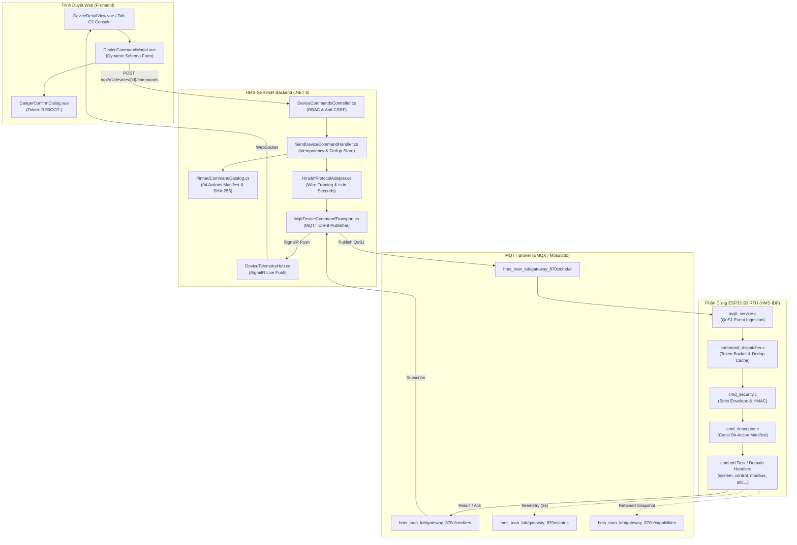

# Kiến Trúc Tích Hợp Toàn Bộ MQTT APIs & Command Plane (HMS-IDF → Web UI)

> **Mã tài liệu**: `ARCH-MQTT-API-CATALOG-001`  
> **Phiên bản**: 3.0.0 (Production Blueprint)  
> **Trạng thái**: Đã phê duyệt qua Hội đồng Tranh biện 35 Chuyên gia (Arena Debate Consensus)  
> **Phạm vi**: Toàn bộ 94 MQTT Actions của phần cứng RTU (`D:\WORKSPACE\PROJECT\HMS-IDF`) tích hợp lên Web UI (`HMS-SERVER`)  
> **Nguyên tắc cốt lõi**: **READ-ONLY** trên firmware RTU, zero-drift, chuẩn hóa giao thức wire và dynamic schema form  

---

## 1. Tổng Quan Kiến Trúc & Luồng Dữ Liệu (System Topology)

Hệ thống kết nối thiết bị RTU phần cứng (ESP32-S3) với giao diện người dùng qua mô hình hàng đợi phân tán bất đối xứng:



---

## 2. Đặc Tả Giao Thức Wire MQTT (Wire Protocol Contract)

### 2.1 Topic Taxonomy
| Mục Đích | Pattern Topic | Chiều Dữ Liệu | QoS | Retained |
|---|---|---|---|---|
| Inbound Commands | `{prefix}/{deviceId}/cmd/#` | Backend → RTU | 1 | False |
| Default Response | `{prefix}/{deviceId}/cmd/res` | RTU → Backend | 1 | False |
| Response Override | `{response_topic}` | RTU → Backend | 1 | False (Nếu pass validation) |
| Heartbeat Telemetry | `{prefix}/{deviceId}/status` | RTU → Backend | 0/1 | False (Chu kỳ 3s) |
| LWT Connectivity | `{prefix}/{deviceId}/status/connectivity` | RTU → Broker | 1 | True (offline/online) |
| Capabilities Discovery | `{prefix}/{deviceId}/capabilities` | RTU → Backend | 1 | True (Snapshot 94 actions) |
| Audit Trail Stream | `{prefix}/{deviceId}/audit` | RTU → Backend | 1 | False (Khi có mutation) |

### 2.2 Command Request Envelope (Gửi Xuống RTU)
```json
{
  "type": "control",
  "id": "c2-1714900000-a1b2c",
  "ts": 1714900000,
  "data": {
    "action": "set_output",
    "channel": 1,
    "value": true
  },
  "ttl_ms": 30000,
  "dry_run": false,
  "confirm": "REBOOT-gateway_870c",
  "response_topic": "custom/res/topic",
  "trace_id": "tr-xyz-789",
  "sig": "9f83c1..." 
}
```

#### Quy Tắc Bắt Buộc Tại Firmware:
1. **`ts` (Timestamp)**: Bắt buộc là Unix Epoch tính bằng **GIÂY** (Seconds), không dùng milliseconds. Nếu `ts > now + 60s` → lỗi `future_timestamp`.
2. **`ttl_ms`**: Đơn vị milliseconds. Mặc định 120,000ms (2 phút) nếu không truyền; tối đa 24 giờ.
3. **`data.action`**: Tuyệt đối không đặt `"action"` ở cấp độ root JSON. Nếu có `root.action` → reject `schema:top_level_action_invalid`.
4. **`confirm`**: Bắt buộc với lệnh Class F/D có `confirm_required = true`. Chuỗi confirm phải thay thế đúng `<DEVID>` (VD: `REBOOT-gateway_870c`).

### 2.3 Command Response Envelope (Nhận Về Từ RTU)
```json
{
  "id": "c2-1714900000-a1b2c",
  "type": "control",
  "action": "set_output",
  "success": true,
  "ts": 1714900001,
  "data": {
    "channel": 1,
    "state": true,
    "mode": "toggle",
    "source": "mqtt"
  },
  "error": null,
  "key_ver": 1,
  "sig": "b4e82..."
}
```

---

## 3. Bảng Danh Mục Toàn Diện 94 MQTT Actions (Full 94-Action Catalog)

> **Đã thay thế (2026-10-05):** bảng dưới được chép từ code firmware và có chỗ khác đặc tả. Nguồn có hiệu lực cho class, permission, TTL, dry run và confirm là §11 của đặc tả MQTT `HMS-IDF/engineering-docs/api/mqtt-api.md`; server không đọc code firmware (plan `261005-0556-device-permissions-what-where`, design contract Q14). Bảng giữ lại làm lịch sử.

Dưới đây là đặc tả chi tiết 100% của 94 actions trích xuất trực tiếp từ bảng manifest `cmd_descriptor.c` và các file handler trong `HMS-IDF`:

### 3.1 Subsystem `system` (14 Actions)
| Action | Class | Required Permission | Confirm Template | Default TTL | Tham Số Đầu Vào (`data`) | Phản Hồi (`data`) & Ý Nghĩa |
|---|---|---|---|---|---|---|
| `get_info` | R | `sys.info_view` | — | 0 | None | `{ version, model, uptime, build_date }` |
| `get_heap` | R | `sys.info_view` | — | 0 | None | `{ free_heap, min_free, psram_free, internal_free }` |
| `ping` | R | `sys.info_view` | — | 0 | None | `{ pong: true, time: ... }` |
| `get_device_id` | R | `sys.info_view` | — | 0 | None | `{ device_id: "gateway_870c" }` |
| `get_operations`| R | `sys.info_view` | — | 0 | `{"operation_id": "123"}` | Tra cứu tác vụ bất đồng bộ `{ state, terminal, resultSuccess, resultCode }` |
| `get_hostname` | R | `sys.hostname_view` | — | 0 | None | `{ hostname: "maitech-rtu" }` |
| `set_hostname` | W | `sys.hostname_edit` | — | 0 | `{"hostname": "new-name"}` | Cập nhật tên mDNS của RTU |
| `get_time` | R | `sys.time_view` | — | 0 | None | `{ epoch: 1714900000, formatted: "..." }` |
| `set_time` | C | `sys.time_edit` | — | 0 | `{"epoch": 1714900000}` | Cài đặt giờ RTC phần cứng |
| `sync_ntp` | C | `sys.time_edit` | — | 0 | None | Kích hoạt đồng bộ NTP tức thì |
| `set_timezone` | W | `sys.time_edit` | — | 0 | `{"timezone": "Asia/Ho_Chi_Minh"}` | Cài đặt chuỗi múi giờ POSIX |
| `set_ntp_servers`| C | `sys.time_edit` | — | 0 | `{"servers": ["pool.ntp.org"]}` | Đặt danh sách tối đa 3 máy chủ NTP |
| `reboot` | F | `sys.reboot` | `REBOOT-<DEVID>` | 60000ms | `{"delay_ms": 2000}` | Khởi động lại thiết bị an toàn |
| `factory_reset`| F | `sys.factory_reset` | `FACTORY-RESET-<DEVID>` | 60000ms | `{"confirmed": true, "level": 1}` | Khôi phục cấu hình xuất xưởng (level 1..3) |

### 3.2 Subsystem `control` (4 Actions - Digital Output Relay)
| Action | Class | Required Permission | Confirm Template | Default TTL | Tham Số Đầu Vào (`data`) | Phản Hồi (`data`) |
|---|---|---|---|---|---|---|
| `set_output` | B | `gpio.do_write` | — | 0 | `{"channel": 1, "value": true}` | Đóng/ngắt relay kênh 1..4 (hỗ trợ bool hoặc 0/1) |
| `pulse` | B | `gpio.do_write` | — | 0 | `{"channel": 1, "duration_ms": 500}` | Kích xung relay trong thời gian chỉ định |
| `get_status` | R | `gpio.do_view` | — | 0 | None | Mảng 4 kênh relay `{ channel, state, mode, pulseCount }` |
| `set_all` | B | `gpio.do_write` | — | 0 | `{"values": [true, false, true, false]}` | Điều khiển đồng loạt cả 4 ngõ ra |

### 3.3 Subsystem `config` (3 Actions - Đa Miền 6 Phân Vùng)
| Action | Class | Quyền Phân Giải Theo Domain | Tham Số Đầu Vào (`data`) | Ghi Chú Miền Cấu Hình |
|---|---|---|---|---|
| `list_domains` | R | `sys.info_view` | None | Trả về 6 miền: `system`, `network`, `wifi_sta`, `wifi_ap`, `mqtt`, `adc` |
| `get` | R | View permission của domain | `{"domain": "wifi_sta"}` | Đọc cấu hình chi tiết của 1 phân vùng |
| `set` | W | Edit permission của domain | `{"domain": "...", "config": {...}}` | Ghi đè cấu hình phân vùng (hỗ trợ reboot flag) |

### 3.4 Subsystem `adc` (6 Actions - Analog Input)
| Action | Class | Required Permission | Tham Số Đầu Vào (`data`) | Ý Nghĩa |
|---|---|---|---|---|
| `get_config` | R | `adc.view` | None | Đọc toàn bộ cấu hình ADC |
| `get_channels` | R | `adc.view` | None | Danh sách 16 kênh đo lường tương tự |
| `get_status` | R | `adc.view` | None | Trạng thái chip ADC, tần số lấy mẫu |
| `get_values` | R | `adc.view` | None | Giá trị đọc thời gian thực (mV, mA, raw) |
| `set_channel` | W | `adc.config_edit` | `{"ai": 1, "gain": 1, ...}` | Cấu hình tham số cho 1 kênh AI |
| `toggle_channel`| C | `adc.enable` | `{"ai": 1, "enabled": true}` | Bật / tắt quét dữ liệu trên kênh AI |

### 3.5 Subsystem `battery` (4 Actions)
| Action | Class | Required Permission | Tham Số Đầu Vào (`data`) | Ý Nghĩa |
|---|---|---|---|---|
| `get_status` | R | `sys.battery_view` | None | Điện áp pin (mV), phần trăm dung lượng, trạng thái sạc |
| `get_alerts` | R | `sys.battery_view` | None | Danh sách cờ cảnh báo bất thường nguồn điện |
| `clear_alert` | C | `sys.diagnostic` | `{"flag": 1}` | Xóa cờ cảnh báo pin |
| `quick_start` | C | `sys.diagnostic` | None | Kích hoạt chế độ kiểm tra sức khỏe pin |

### 3.6 Subsystem `broker` (16 Actions - Data Transformation Engine)
| Action | Class | Required Permission | Tham Số Đầu Vào | Ý Nghĩa |
|---|---|---|---|---|
| `list_signals` | R | `broker.signal_view` | None | Danh sách toàn bộ biến tín hiệu (Signals) |
| `get_signal` | R | `broker.signal_view` | `{"tag_name": "..."}` | Xem thuộc tính và nguồn cấp của 1 signal |
| `create_signal` | W | `broker.signal_edit` | `{...}` | Khai báo 1 signal mới vào hệ thống |
| `update_signal` | W | `broker.signal_edit` | `{"tag_name": "...", ...}` | Sửa đổi thuộc tính của signal |
| `delete_signal` | D | `broker.signal_edit` | `{"tag_name": "..."}` | Xóa bỏ 1 signal khỏi pipeline |
| `list_pipelines`| R | `broker.pipeline_view`| None | Danh sách các pipeline chuyển đổi dữ liệu |
| `create_pipeline`| W| `broker.pipeline_edit`| `{...}` | Tạo mới 1 pipeline định tuyến |
| `update_pipeline`| W| `broker.pipeline_edit`| `{"id": 1, ...}` | Cập nhật pipeline |
| `delete_pipeline`| D| `broker.pipeline_edit`| `{"id": 1}` | Xóa pipeline |
| `list_chains` | R | `broker.chain_view` | None | Danh sách chuỗi logic liên kết |
| `list_scales` | R | `broker.scale_view` | None | Bảng tham số tỷ lệ chuyển đổi đo lường |
| `list_filters` | R | `broker.filter_view` | None | Bảng thuật toán lọc nhiễu (Moving Average...) |
| `list_formulas`| R | `broker.formula_view`| None | Bảng công thức toán học |
| `rebuild` | C | `broker.rebuild` | None | Biên dịch và tái thiết lập bộ nhớ pipeline |
| `hook_stats` | R | `broker.stats_view` | None | Thống kê số lượng gói tin đi qua hook |
| `diagnostics` | R | `broker.stats_view` | None | Thống kê bộ nhớ và thời gian trễ của broker |

### 3.7 Subsystem `modbus` (6 Actions - RS485 RTU)
| Action | Class | Required Permission | Framing Body | Ghi Chú & Cơ Chế Thực Thi |
|---|---|---|---|---|
| `get_rtu_config` | R | `mb_rtu.config_view` | Không | Đọc cấu hình Master/Slave (Baudrate, Parity, Slaves) |
| `set_rtu_config` | W | `mb_rtu.config_edit` | Không | Lưu cấu hình Modbus mới vào flash |
| `get_rtu_status` | R | `mb_rtu.config_view` | Không | Trạng thái cổng RS485, lỗi CRC, tỷ lệ thành công |
| `restart_rtu` | C | `mb_rtu.config_edit` | Không | Hot-restart bus Modbus (Bất đồng bộ qua `system.get_operations`) |
| `check_rtu_config`| R | `mb_rtu.config_view` | Có (`ndjson`) | Thẩm định cấu hình RTU dạng stream không commit |
| `replace_rtu_config`| W| `mb_rtu.config_edit` | Có (`ndjson`) | Ghi đè toàn bộ cấu hình RTU dạng stream ndjson |

### 3.8 Subsystem `mqtt` (4 Actions)
| Action | Class | Required Permission | Ý Nghĩa |
|---|---|---|---|
| `get_status` | R | `mqtt.status_view` | Trạng thái kết nối broker, số tin gửi/nhận, backlog |
| `get_config` | R | `mqtt.status_view` | Host, port, clientId, prefix (Password tự động che giấu) |
| `set_config` | W | `mqtt.config_edit` | Cập nhật cấu hình broker mới |
| `reconnect` | C | `mqtt.control` | Ngắt và kết nối lại MQTT Broker |

### 3.9 Subsystem `network` (27 Actions - WiFi, Ethernet, Modem)
- **Ethernet & Định Tuyến (6 actions)**:
  - `get_ethernet` (R) / `configure_ethernet` (W): Cấu hình IP tĩnh hoặc DHCP cho cổng RJ45.
  - `get_priority` (R) / `set_priority` (W): Độ ưu tiên mạng (`ETH_FIRST`, `WIFI_FIRST`, `MODEM_FIRST`).
  - `get_all_status` (R): Tình trạng tổng hợp tất cả card mạng.
  - `get_modem` (R): Thông số sóng 4G LTE, IMEI, IMSI, IP mạng di động.
- **WiFi Station Client (7 actions)**:
  - `wifi_sta_status` (R), `wifi_sta_config_get` (R), `wifi_sta_config_set` (W).
  - `wifi_sta_connect` (C), `wifi_sta_disconnect` (C), `wifi_sta_enable` (C), `wifi_sta_disable` (C).
- **WiFi Access Point (5 actions)**:
  - `wifi_ap_status` (R), `wifi_ap_clients` (R), `wifi_ap_config_get` (R), `wifi_ap_config_set` (W).
  - `wifi_ap_enable` (C), `wifi_ap_disable` (C).
- **WiFi Scan & Known Network Storage (9 actions)**:
  - `wifi_scan_start` (C), `wifi_scan_results` (R).
  - `wifi_known_list` (R), `wifi_known_add` (W), `wifi_known_update` (W).
  - `wifi_known_remove` (D), `wifi_known_connect` (C), `wifi_known_auto_connect` (W).

### 3.10 Subsystem `ota` (4 Actions - Nâng Cấp Từ Xa)
| Action | Class | Required Permission | Confirm Template | Ý Nghĩa |
|---|---|---|---|---|
| `get_status` | R | `sys.info_view` | — | Phân vùng đang chạy, version, SHA-256 firmware |
| `remote_config_get` | R | `sys.ota` | — | Lấy URL máy chủ cập nhật OTA HTTPS |
| `remote_start` | F | `sys.ota` | — | Kích hoạt tải firmware từ URL vào inactive slot |
| `apply` | F | `sys.ota` | `OTA-APPLY-<DEVID>` | Chuyển đổi boot partition và khởi động lại |

### 3.11 Subsystem `sms` (3 Actions - Tin Nhắn Di Động)
| Action | Class | Required Permission | Ý Nghĩa & Cơ Chế An Toàn |
|---|---|---|---|
| `get_status` | R | `sms.view` | Trạng thái module SIM, số tin nhắn chưa đọc |
| `storage_stats` | R | `sms.view` | Dung lượng lưu trữ tin nhắn trên flash/SD |
| `list` | R | `sms.view` | Đọc danh sách tin nhắn có phân trang (`page`, `limit` tối đa 10 tin) |

### 3.12 Subsystem `status` (3 Actions - Giám Sát Sức Khỏe)
| Action | Class | Required Permission | Ý Nghĩa |
|---|---|---|---|
| `dump` | R | `sys.info_view` | Trích xuất toàn diện trạng thái hệ thống, I/O, cảm biến |
| `services` | R | `sys.info_view` | Trạng thái chi tiết từng service nội tại (MQTT, Modbus, NTP...) |
| `tags` | R | `sys.info_view` | Bảng giá trị thời gian thực của toàn bộ data tags |

---

## 4. Kế Hoạch Triển Khai Backend & Web Frontend (Implementation Blueprint)

> **TRẠNG THÁI (2026-10-05)**: Bước 2 của mục 4.1 đã xong ở phase 1 của plan `261005-0556-device-permissions-what-where`. Các bước 1, 3, 4 cần MQTT nên đang tạm dừng (design contract Q14 của plan đó: chỉ làm phần đặc tả MQTT đã định nghĩa, firmware chưa xong); plan `261001-0030-full-hardware-mqtt-apis-c2` chứa các bước này vẫn bị chặn. Khi làm lại, mọi chi tiết giao thức lấy từ đặc tả MQTT, không lấy từ code firmware.

### 4.1 Nâng Cấp Backend `HMS-SERVER` (.NET 10)

1. **Chuẩn hóa Timestamp tại Protocol Adapter (`HmsIdfProtocolAdapter.cs`)** — *tạm dừng (cần MQTT)*:
   - Chuyển đổi `plan.Request.RequestedAt.ToUnixTimeMilliseconds()` sang **`plan.Request.RequestedAt.ToUnixTimeSeconds()`** để hoàn toàn tương thích với firmware ESP32.
2. **Quyền theo action từ đặc tả MQTT (catalog v2)** — *xong ở phase 1 của `261005-0556`*:
   - `scripts/generate-command-catalog.mjs` (Node, chỉ dùng module có sẵn) đọc §11 của `HMS-IDF/engineering-docs/api/mqtt-api.md` @ `83e93d77e` qua `git show` rồi sinh `src/Hms.Server.Infrastructure/Commands/command-catalog.json`: 94 action, mỗi action 9 trường, 6 config domain, kèm hash SHA-256. `--check` không ghi file và thoát mã 1 khi file này lệch với §11. Server chỉ dùng đặc tả, không đọc code firmware.
   - `PinnedCommandCatalog` kiểm tra metadata, từng dòng và hash ngay khi khởi tạo; sai thì dừng với `COMMAND_CATALOG_METADATA_INVALID`, `COMMAND_CATALOG_ROW_INVALID` hoặc `COMMAND_CATALOG_HASH_MISMATCH`. Mọi action vẫn là `DeniedUntilActionContract`.
   - Từ vựng quyền `DevicePermissionVocabulary.All` có 50 mã: 46 mã từ §11 của đặc tả và 4 mã server (`device.view`, `device.edit_basics`, `device.edit_product`, `device.record_measurements`).
3. **Kích hoạt Toàn Bộ 94 Command Definitions** — *tạm dừng (cần MQTT; phase 01 của `261001-0030`)*:
   - Thay đổi `CommandAvailability.DeniedUntilActionContract` thành `CommandAvailability.Enabled` cho các actions đã hoàn thiện schema.
4. **Hiện Thực `IDeviceCommandTransport` qua MQTT Bridge** — *tạm dừng (phase 02 của `261001-0030`)*:
   - Định tuyến gói tin đã chuẩn bị tới topic `hms_toan_lab/{deviceId}/cmd`.
   - Lắng nghe topic `hms_toan_lab/{deviceId}/cmd/res` để hoàn thành `CommandExecutionPlan` và trả về qua SignalR.

### 4.2 Nâng Cấp Frontend Web (`DeviceCommandModal.vue`)

1. **Dynamic Schema Input Renderer**:
   - Xây dựng từ điển Schema tương ứng cho các hành động:
     - `control.set_output`: Kênh (1..4 dropdown), Giá trị (Toggle switch ON/OFF).
     - `control.pulse`: Kênh (1..4 dropdown), Độ rộng xung (Number input `duration_ms`, 100..5000ms).
     - `system.set_hostname`: Hostname text input.
     - `system.set_time`: Epoch number hoặc DateTimePicker.
     - `config.get` / `config.set`: Domain selector (`system`, `network`, `wifi_sta`...).
     - `sms.list`: Page (1..n), Limit (1..10).
2. **Hộp Thoại Xác Nhận An Toàn (Danger Confirmation Dialog)**:
   - Khi chọn lệnh Class F/D (`system.reboot`, `system.factory_reset`, `ota.apply`), hiển thị modal đỏ cảnh báo.
   - Bắt buộc người dùng gõ chính xác `REBOOT-<DEVID>` hoặc `OTA-APPLY-<DEVID>` mới kích hoạt nút thực thi.
3. **Bảo Tồn Bản Sắc Giao Diện**:
   - Giữ nguyên màu cam `#f97316` ở nút Dispatch chính theo quy chuẩn nhận diện thương hiệu.

---

## 5. Kết Luận

Kiến trúc trên cung cấp sự liên kết liền mạch giữa hạ tầng Web hiện đại và vi điều khiển công nghiệp RTU. Bằng cách tôn trọng 100% giao thức bất biến của firmware `HMS-IDF` (READ-ONLY) và khai thác triệt để 94 actions sẵn có, hệ thống đạt được tính sẵn sàng cao, bảo mật cấp độ doanh nghiệp, và trải nghiệm vận hành hoàn hảo.
