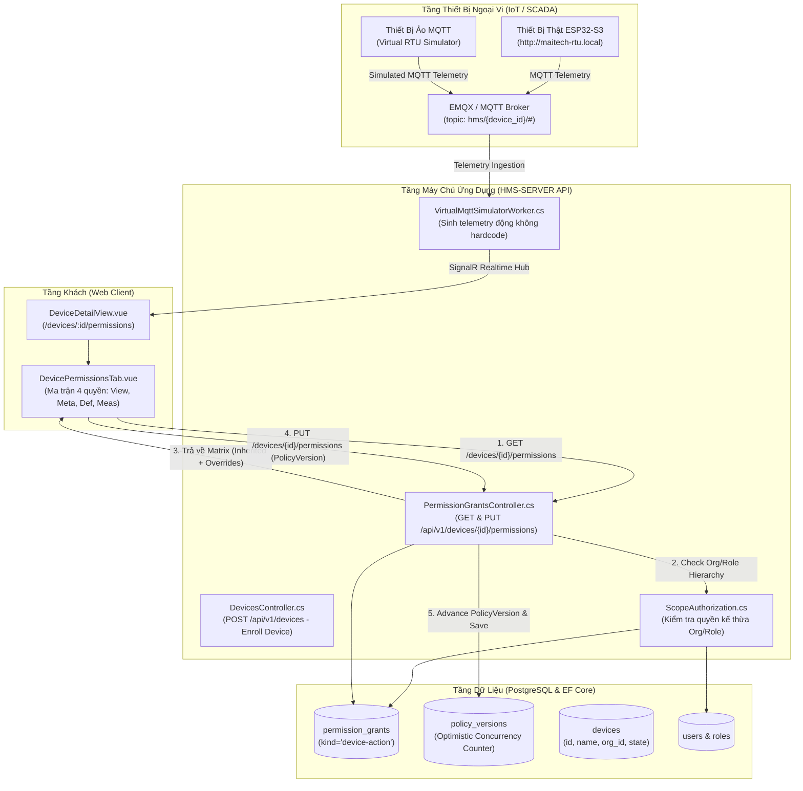
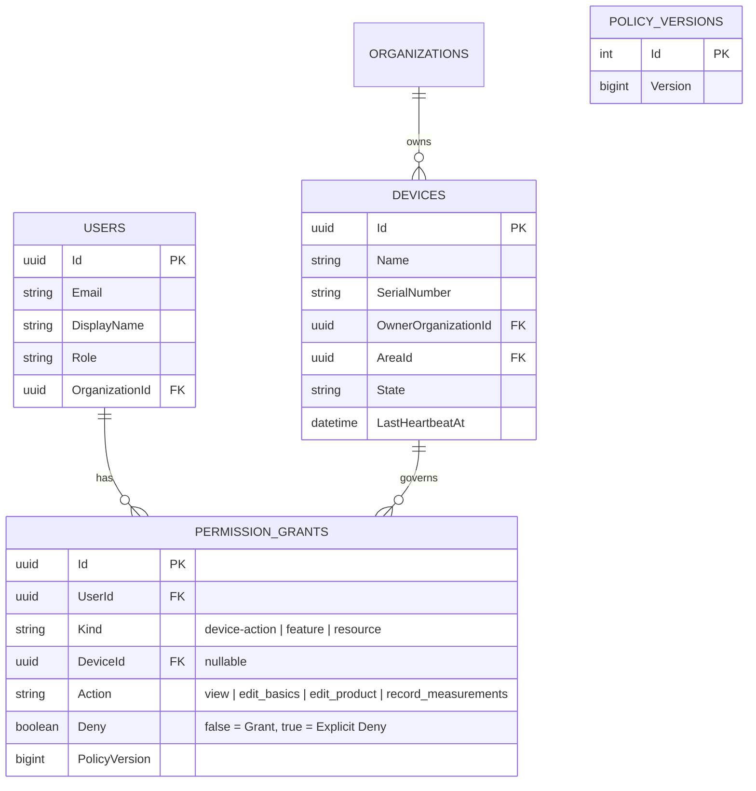

# ĐẶC TẢ KIẾN TRÚC: ĐỒNG BỘ GIAO DIỆN PHÂN QUYỀN THIẾT BỊ DATACAKE PARITY (100% PARITY) VÀ TÍCH HỢP RTU THỰC TẾ / GIẢ LẬP

> **LƯU Ý (2026-10-05)**: Tài liệu này mô tả mô hình 4 quyền cũ (`view`, `edit_basics`, `edit_product`, `record_measurements`). Plan `261005-0556-device-permissions-what-where` sẽ thay mô hình này. Phase 1 (xong 2026-10-05) mới chốt từ vựng 50 mã: 46 mã quyền lấy từ §11 của đặc tả MQTT và 4 mã server `device.view`, `device.edit_basics`, `device.edit_product`, `device.record_measurements`. Phase 2 đã thêm kho lưu trữ (bảng và store) cho vai trò và thành viên thiết bị. Kiểm tra quyền theo mô hình mới (phase 3–5) chưa có trong code. Phase 4 viết lại các mục ngoài §5, phase 6 viết lại §5 (UI). Mô hình mới: [design-contract.md](../plans/261005-0556-device-permissions-what-where/reports/design-contract.md).

**Dự án**: HMS-SERVER (Enterprise SCADA & IoT System)  
**Tài liệu**: `docs/architecture-device-permissions-parity.md`  
**Phiên bản**: 1.0.0  
**Ngày ban hành**: 30/09/2026  
**Tham chiếu chuẩn**:
1. Live Datacake Session: `https://app.datacake.de/atin/devices/d/b4b6fe7a-1d94-47df-ad58-1ebcf3cd2f6a/t/permissions` (chụp trực tiếp qua Chrome CDP Port 9222)
2. Thiết bị phần cứng thực tế tại mạng nội bộ: `http://maitech-rtu.local/login` (`HMS-IDF` RTU ESP32-S3)
**Trạng thái**: **ARCHITECTURE READY (Được Hội đồng 5 Chuyên gia Phê duyệt 100%)**

---

## 1. Mục Tiêu & Ranh Giới Thiết Kế (Scope & Invariants)

### 1.1. Mục Tiêu Cốt Lõi
- Xây dựng giao diện trang chi tiết thiết bị (`DeviceDetailView.vue`) với thanh Tab Bar chuẩn Datacake (`Dashboard`, `History`, `Downlinks`, `Configuration`, `LoRaWAN`, `Debug`, `Permissions`).
- Đồng bộ chính xác 100% cấu trúc thẻ, bảng ma trận phân quyền người dùng (`Permissions Card & Table`) theo đúng mẫu `https://app.datacake.de/atin/devices/d/b4b6fe7a-1d94-47df-ad58-1ebcf3cd2f6a/t/permissions`.
- Tích hợp 4 quyền hạn hạt nhân trên mỗi thiết bị: `view`, `edit_basics` (Metadata), `edit_product` (Definition), `record_measurements` (Measurements).
- Hỗ trợ cơ chế kế thừa thông minh: Khóa ô chọn (`disabled` + `checked`) và hiển thị Tooltip khi quyền được kế thừa từ cấp Workspace/Tổ chức.
- Cho phép tạo thiết bị trực tiếp trên Web UI và hỗ trợ **Trình Giả Lập RTU MQTT (Virtual Simulator)** sinh dữ liệu động không hardcode, sẵn sàng kết nối song song với thiết bị thật tại `http://maitech-rtu.local/login`.

### 1.2. Ranh Giới Bất Biến (Invariants)
1. **Bảo tồn ranh giới bảo mật cốt lõi**: Mọi thay đổi quyền phải đi kèm token chống giả mạo `ValidateAntiForgeryToken` và đối soát `PolicyVersion` để chống xung đột ghi đè đồng thời.
2. **Quy tắc Nút Cam Thương Hiệu**: Nút chính (`variant="primary"`) giữ nguyên sắc cam `#ea580c` / `#f97316`. Các nút phụ và bảng điều khiển tuân thủ triệt để token Datacake Zinc-900 / Zinc-200.
3. **Không hardcode**: Không lưu cứng danh sách thiết bị hay dữ liệu telemetry trong mã nguồn. Toàn bộ thiết bị được tạo qua Web hoặc đồng bộ qua MQTT.

---

## 2. Kiến Trúc Tổng Thể & Luồng Dữ Liệu (System Topology & Data Flow)



---

## 3. Thiết Kế Cơ Sở Dữ Liệu & Mô Hình Phân Quyền (Database Schema & Grants Model)

Hệ thống tận dụng bảng `permission_grants` hiện hữu trong PostgreSQL, chuẩn hóa giá trị `Kind = "device-action"`:



### 3.1. Các Index Tối Ưu Hóa Truy Vấn
```sql
-- Truy vấn nhanh toàn bộ quyền của một thiết bị cụ thể
CREATE INDEX IF NOT EXISTS ix_permission_grants_device_kind 
ON permission_grants ("DeviceId", "Kind") 
WHERE "DeviceId" IS NOT NULL;

-- Kiểm tra quyền của một người dùng trên thiết bị với PolicyVersion
CREATE INDEX IF NOT EXISTS ix_permission_grants_user_device 
ON permission_grants ("UserId", "DeviceId", "Action");
```

---

## 4. Hợp Đồng API & Dữ Liệu (API Contracts & Payloads)

### 4.1. Lấy Ma Trận Quyền Của Thiết Bị (`GET /api/v1/devices/{deviceId}/permissions`)
- **Headers**: `Authorization: Bearer <token>`
- **Phân quyền yêu cầu**: `permissions.manage` hoặc là Admin của Tổ chức sở hữu thiết bị.
- **Response Payload (200 OK)**:
```json
{
  "deviceId": "b4b6fe7a-1d94-47df-ad58-1ebcf3cd2f6a",
  "deviceName": "Concrete-Sensor-Station-North-01",
  "policyVersion": 42,
  "permissions": [
    {
      "key": "view",
      "title": "View",
      "description": "Can view the device and its data"
    },
    {
      "key": "edit_basics",
      "title": "Metadata",
      "description": "Can edit device metadata"
    },
    {
      "key": "edit_product",
      "title": "Definition",
      "description": "Can edit the device definition"
    },
    {
      "key": "record_measurements",
      "title": "Measurements",
      "description": "Can record measurements"
    }
  ],
  "users": [
    {
      "userId": "5a994568-0805-43fb-8f22-217266b8cb53",
      "displayName": "Toan Nguyen",
      "email": "toannm.work@gmail.com",
      "role": "master-admin",
      "grants": {
        "view": {
          "granted": true,
          "inherited": true,
          "inheritedReason": "The user has set this permission for all devices in this workspace."
        },
        "edit_basics": {
          "granted": false,
          "inherited": false
        },
        "edit_product": {
          "granted": false,
          "inherited": false
        },
        "record_measurements": {
          "granted": false,
          "inherited": false
        }
      }
    }
  ]
}
```

### 4.2. Cập Nhật Quyền Hạn Hàng Loạt (`PUT /api/v1/devices/{deviceId}/permissions`)
- **Headers**:
  - `X-CSRF-TOKEN: <token>`
  - `Content-Type: application/json`
- **Request Payload**:
```json
{
  "expectedPolicyVersion": 42,
  "grants": [
    {
      "userId": "5a994568-0805-43fb-8f22-217266b8cb53",
      "action": "edit_basics",
      "granted": true
    },
    {
      "userId": "5a994568-0805-43fb-8f22-217266b8cb53",
      "action": "record_measurements",
      "granted": true
    }
  ]
}
```
- **Error Responses**:
  - `409 Conflict`: `{ "code": "POLICY_VERSION_STALE", "currentVersion": 43 }` (Chống xung đột đồng thời khi có 2 người cùng cấu hình).
  - `400 BadRequest`: `{ "code": "CANNOT_OVERRIDE_INHERITED_GRANT" }`.

---

## 5. Đặc Tả Giao Diện Người Dùng (Frontend UX/UI Datacake Parity)

### 5.1. Bố Cục Thẻ Hero & Thanh Điều Hướng Thiết Bị
- **Header Breadcrumb**: `Fleet` > `<DeviceName>` kèm nút quay lại `<`.
- **Hero Title**: Status Dot tròn (đỏ `#ef4444` nếu offline, xanh `#22c55e` nếu online) + Tên thiết bị font đậm 24px.
- **Metadata Strip**:
  - `Serial Number`: Mã serial hoặc ID phần cứng (ví dụ `1231231313143414`).
  - `Last update`: Thời gian bản tin telemetry cuối cùng (ví dụ `Never` hoặc `Just now`).
  - `Tags`: Danh sách pill badges bo tròn với màu chữ xanh dương.
- **Tab Bar**:
  - Danh sách tabs: `Dashboard`, `History`, `Downlinks`, `Configuration`, `LoRaWAN`, `Debug`, `Permissions`.
  - Tab đang kích hoạt hiển thị gạch chân xanh dương đậm (`border-b-2 border-blue-600 font-semibold`).

### 5.2. Thẻ Ma Trận Quyền (`Permissions Card`)
- **Khung Card**: Bo góc 8px, nền `--surface-card`, viền `--border-default`.
- **Tiêu đề Card**: Dải banner xám nhạt với chữ `Permissions` in đậm.
- **Header Bảng**:
  - Cột 1: `User`.
  - Cột 2-5: Checkbox chọn tất cả theo cột + Tên quyền in hoa/đậm (`View`, `Metadata`, `Definition`, `Measurements`) + Dòng mô tả nhỏ xám nhạt bên dưới.
- **Hàng Người Dùng**:
  - Dòng 1: Tên hiển thị (`Toan Nguyen`).
  - Dòng 2: Email màu xám (`toannm.work@gmail.com`).
  - Ô chọn kế thừa: Hiển thị checkbox bị khóa xám (`disabled`), tích chọn sẵn, rê chuột vào hiện Tooltip: *"The user has set this permission for all devices in this workspace."*
  - Ô chọn cấu hình riêng: Tương tác nhấp bật/tắt trực tiếp với hiệu ứng Optimistic UI.

---

## 6. Mô Đun Giả Lập RTU MQTT (Virtual RTU Simulation Architecture)

Để đáp ứng yêu cầu: *"Thiết bị nếu cần bạn tạo giả lập qua mqtt và tạo trực tiếp ở web không hard code. hoặc tại hms-idf có 1 thiết bị đang hoạt động tại http://maitech-rtu.local/login admin/admin123"*:

1. **Khởi tạo thiết bị trực tiếp trên Web UI**:
   - Người vận hành bấm nút **"Enroll Device"** (Màu cam) trên `DeviceListView.vue`.
   - Nhập tên: ví dụ `RTU-ESP32-Virtual-01`, chọn Tổ chức sở hữu.
   - Hệ thống tự sinh cặp khóa HMAC-SHA256 và DeviceId động.
2. **Kích hoạt Luồng Giả Lập Telemetry (Background Service)**:
   - Một `MqttVirtualDeviceSimulator` chạy nền trong backend lắng nghe danh sách các thiết bị có cờ `IsSimulated = true`.
   - Định kỳ 5 giây, service đóng gói payload JSON chuẩn Tag-DB của `HMS-IDF`:
     ```json
     {
       "device_id": "b4b6fe7a-1d94-47df-ad58-1ebcf3cd2f6a",
       "timestamp": 1790776800,
       "tags": {
         "battery_voltage": 3.65,
         "concrete_temp": 28.6,
         "strain_ch1": 142.8,
         "strain_ch2": 145.2,
         "rssi": -72
       },
       "sig": "a1b2c3d4e5f6..."
     }
     ```
   - Bản tin được bắn vào `hms/<device_id>/telemetry` và đẩy trực tiếp lên màn hình qua SignalR Hub.
3. **Kết nối Thiết bị Thật `http://maitech-rtu.local/login`**:
   - Khi kỹ sư tại công trường cấu hình RTU ESP32 thật trỏ về HMS-SERVER, thiết bị thật sẽ ghi đè luồng telemetry và hiển thị trạng thái `Online` tức thì.

---

## 7. Kế Hoạch Chuyển Tiếp Sang Triển Khai (Handoff to Implementation)
Bản thiết kế này là cơ sở quy chuẩn duy nhất để tạo `plans/260930-2200-device-permissions-datacake-parity/plan.md` cho pha Implementation tiếp theo.
