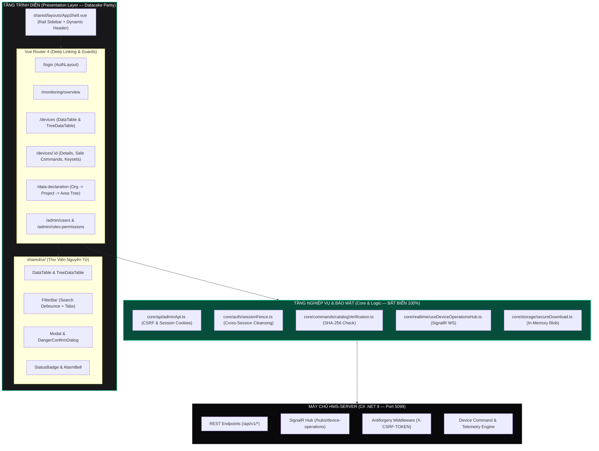

# ĐẶC TẢ KIẾN TRÚC KỸ THUẬT: ĐỒNG BỘ 100% GIAO DIỆN HMS-SERVER THEO CHUẨN NGUỒN CONCRETE-STRESS-MONITORING (DATACAKE PARITY)

> **Mã tài liệu**: `RFC-HMS-UI-PARITY-2026`  
> **Dự án**: HMS-SERVER (Enterprise SCADA & Industrial IoT Management Platform)  
> **Tài liệu nguồn tham chiếu**: `D:\WORKSPACE\PROJECT\concrete-stress-monitoring\sources\frontend`  
> **Trạng thái**: PHÊ DUYỆT ĐỒNG THUẬN (CONSENSUS APPROVED — READY FOR IMPLEMENTATION)  
> **Mục tiêu**: Chuyển đổi toàn diện giao diện người dùng hiện tại sang cấu trúc Feature-Sliced Design (FSD), đạt chuẩn Datacake Parity 100% về mặt thẩm mỹ, layout và tương tác, đồng thời **bảo tồn tuyệt đối 100% logic nghiệp vụ, quy tắc an toàn và kiểm thử hiện hành**.

---

## 1. Tóm Tắt Tổng Quan (Executive Summary)

### 1.1. Mục Tiêu Chiến Lược
HMS-SERVER hiện sở hữu một nền tảng backend và giao thức truyền thông vững chắc (quản lý phân quyền 3 lớp, bảo vệ CSRF/Antiforgery, xác minh mã băm catalog lệnh RTU, và phân phối sự kiện SignalR WebSocket qua kết nối an toàn). Tuy nhiên, frontend hiện tại đang ở dạng nguyên khối `App.vue` (1,051 dòng) mang tính chất bàn kiểm thử kỹ thuật (Dev Console).

Mục tiêu của đợt tái cấu trúc kiến trúc này là nâng cấp toàn diện frontend của HMS-SERVER đạt chuẩn giao diện SCADA / IoT công nghiệp của dự án mẫu `concrete-stress-monitoring/sources/frontend` (Datacake Parity):
1. **Kiến trúc FSD chuẩn mực**: Phân rã từ `App.vue` thành các tầng `app/`, `core/`, `shared/`, `entities/`, và `features/`.
2. **Hệ thống Layout công nghiệp**: Áp dụng `AppShell.vue` với thanh điều hướng trái có thể thu gọn (Collapsible Sidebar Rail, phím tắt `Ctrl+[`), thanh Header tích hợp Breadcrumbs động, nút lùi lịch sử (`canGoBack`), Alarm Bell và User Dropdown.
3. **Thiết kế màu sắc Datacake & Zinc Dark**: 100% màu sắc dựa trên CSS variables (`--bg-surface`, `--border-subtle`, `--accent-primary`), chuyển đổi mượt mà giữa Zinc-900 Dark (`#18181b`) và Datacake Light mà không có hiện tượng chớp trắng (FOUC).
4. **Bảo tồn 100% Core Logic**: Không thay đổi API contract backend, giữ nguyên vẹn `adminApi.ts`, `sessionFence.ts`, `catalogVerification.ts`, `secureDownload.ts`, và `useDeviceOperationsHub.ts`.
5. **Duy trì 100% tỷ lệ vượt qua kiểm thử**: Bảo đảm toàn bộ 74 vitest unit tests và các bài test tích hợp tiếp tục chạy xanh hoàn hảo.

---

## 2. Sơ Đồ Kiến Trúc Phân Tầng (FSD Architecture & Component Hierarchy)



---

## 3. Bản Đồ Cấu Trúc Thư Mục Mục Tiêu (Target Directory Structure)

Mã nguồn frontend tại `HMS-SERVER/frontend/src` được chuẩn hóa theo cấu trúc FSD tương thích 100% với `concrete-stress-monitoring`:

```text
frontend/src/
├── app/                                 # Cấu hình cấp ứng dụng
│   ├── router/                          # Cấu hình Vue Router
│   │   ├── index.ts                     # Router instances & Navigation Guards
│   │   └── routes.ts                    # Khai báo cây Route phân cấp
│   ├── config/                          # Cấu hình thanh menu & hệ thống
│   │   └── nav.config.ts                # Định nghĩa 4 nhóm menu điều hướng
│   ├── styles/                          # Hệ thống Design Tokens & Themes
│   │   ├── tokens.css                   # Biến CSS (Zinc Dark & Datacake Light)
│   │   └── main.css                     # Tailwind v4 import & resets
│   ├── App.vue                          # Root component tối giản (<router-view />)
│   └── main.ts                          # Entry point khởi tạo Vue, Router, Store
│
├── core/                                # TẦNG LOGIC BẢO MẬT & API (BẢO TỒN 100%)
│   ├── api/                             # Network Client & Interceptors
│   │   ├── adminApi.ts                  # Client gọi API, quản lý CSRF Token
│   │   └── endpoints.ts                 # Định nghĩa các URL endpoint backend
│   ├── auth/                            # Bảo mật phiên & phân quyền
│   │   ├── sessionFence.ts              # Hàng rào xóa sạch dữ liệu khi đổi phiên
│   │   └── permissions.ts               # Kiểm tra quyền 3 lớp (Wildcard, Resource, Action)
│   ├── commands/                        # Điều khiển thiết bị an toàn
│   │   └── catalogVerification.ts       # Xác thực mã băm SHA-256 của Catalog lệnh
│   ├── realtime/                        # Giao tiếp thời gian thực
│   │   ├── signalRConnection.ts         # Khởi tạo kết nối WebSocket Hub
│   │   └── useDeviceOperationsHub.ts    # Hook bounded subscription cho hạm đội RTU
│   └── storage/                         # Tải tệp an toàn
│       └── secureDownload.ts            # Tải bundle tệp trong RAM không lưu cache
│
├── shared/                              # Thư viện dùng chung
│   ├── layouts/                         # Khung vỏ giao diện chuẩn
│   │   ├── AppShell.vue                 # Vỏ chính: Sidebar Rail + Dynamic Header + Main Content
│   │   └── AuthLayout.vue               # Vỏ cho màn hình đăng nhập độc lập
│   ├── ui/                              # Bộ Component giao diện nguyên tử
│   │   ├── data-table/                  # Bảng dữ liệu SCADA công nghiệp
│   │   │   ├── DataTable.vue            # Bảng phẳng có phân trang, sắp xếp, chọn dòng
│   │   │   └── TreeDataTable.vue        # Bảng phân cấp cây cho hạ tầng tổ chức
│   │   ├── feedback/                    # Phản hồi tương tác
│   │   │   ├── Modal.vue                # Hộp thoại Modal Focus-Trap
│   │   │   ├── DangerConfirmDialog.vue  # Hộp thoại xác nhận 2 bước cho thao tác hủy
│   │   │   └── ToastNotification.vue    # Thông báo trạng thái nổi
│   │   ├── navigation/                  # Thanh công cụ và menu
│   │   │   ├── Breadcrumb.vue           # Đường dẫn phân cấp trên Header
│   │   │   ├── FilterBar.vue            # Thanh tìm kiếm debounce kèm tab lọc
│   │   │   └── SidebarRail.vue          # Thanh bên thu gọn (64px / 260px)
│   │   └── primitives/                  # Nút bấm, thẻ trạng thái, icon
│   │       ├── Badge.vue                # Thẻ trạng thái màu sắc ngữ nghĩa
│   │       ├── Button.vue               # Nút bấm đa trạng thái (loading, danger, primary)
│   │       └── AlarmBell.vue            # Chuông cảnh báo có số đếm và popover
│   └── composables/                     # Vue Composables tiện ích
│       ├── useSidebarCollapse.ts        # Quản lý thu gọn thanh bên (phím tắt Ctrl+[)
│       ├── useBreadcrumbs.ts            # Tự động tính toán đường dẫn từ route meta
│       └── useTheme.ts                  # Chuyển đổi theme Dark/Light không gây FOUC
│
├── entities/                            # Mô hình dữ liệu giao diện
│   ├── device/                          # Định nghĩa cấu trúc thiết bị RTU
│   ├── organization/                    # Định nghĩa tổ chức, dự án, gói thầu, phân khu
│   └── audit-log/                       # Định nghĩa nhật ký kiểm toán thao tác
│
└── features/                            # Các lát cắt nghiệp vụ chuyên sâu
    ├── auth/views/                      # Đăng nhập & quản lý phiên
    │   └── LoginView.vue                # Màn hình đăng nhập độc lập chuẩn Datacake
    ├── monitoring/views/                # Quan trắc hạm đội RTU
    │   └── OverviewView.vue             # Bảng chỉ số tổng quan & trạng thái broker
    ├── devices/                         # Quản lý thiết bị RTU & Điều khiển C2
    │   ├── views/
    │   │   ├── DeviceListView.vue       # Danh sách thiết bị (Toggle Table / Tree)
    │   │   └── DeviceDetailView.vue     # Chi tiết thiết bị (Telemetry, C2, Keysets, Licenses)
    │   └── components/
    │       └── DeviceCommandModal.vue   # Modal phát lệnh an toàn kèm kiểm tra catalogHash
    ├── data-declaration/views/          # Khai báo dữ liệu phân cấp
    │   └── HierarchyView.vue            # Cây quản trị Tổ chức -> Dự án -> Gói thầu -> Khu vực
    └── security/views/                  # Quản trị an ninh
        ├── UserManagementView.vue       # Quản trị tài khoản người dùng
        └── RolePermissionView.vue       # Ma trận phân quyền 3 lớp (PermissionGrantMatrix.vue)
```

---

## 4. Đặc Tả Hệ Thống Design Tokens & Themes (Datacake Parity)

Hệ thống phong cách tuân thủ nguyên tắc: **Không dùng class màu cứng của Tailwind, toàn bộ màu ngữ nghĩa được điều khiển bởi CSS Variables** tại `app/styles/tokens.css`.

### 4.1. Bảng Khai Báo Biến CSS Chuẩn

```css
/* Datacake Light Theme (Mặc định khi thuộc tính data-theme='light') */
:root {
  --bg-canvas: #f8fafc;            /* Nền canvas ngoài cùng */
  --bg-surface: #ffffff;           /* Nền thẻ, bảng, sidebar */
  --bg-surface-hover: #f1f5f9;     /* Nền khi hover chuột */
  --bg-surface-active: #e2e8f0;    /* Nền mục được chọn */
  
  --border-subtle: #e2e8f0;        /* Viền mảnh giữa các hàng/cột */
  --border-focus: #10b981;         /* Viền khi focus vào ô nhập liệu */
  
  --text-primary: #0f172a;         /* Văn bản tiêu đề chính (Slate-900) */
  --text-secondary: #475569;       /* Văn bản phụ, nhãn (Slate-600) */
  --text-muted: #94a3b8;           /* Văn bản mờ, placeholder */
  
  --accent-primary: #10b981;       /* Màu nhấn chủ đạo (Emerald-500) */
  --accent-hover: #059669;         /* Màu nhấn khi hover (Emerald-600) */
  
  --status-online: #10b981;        /* Thiết bị trực tuyến */
  --status-offline: #94a3b8;       /* Thiết bị mất kết nối */
  --status-danger: #ef4444;        /* Lỗi nghiêm trọng / Báo động */
  --status-warning: #f59e0b;       /* Cảnh báo ngưỡng */
}

/* Zinc Dark Theme (Kích hoạt khi html[data-theme='dark']) */
html[data-theme='dark'] {
  --bg-canvas: #09090b;            /* Nền tối sâu (Zinc-950) */
  --bg-surface: #18181b;           /* Nền thẻ, bảng, sidebar (Zinc-900) */
  --bg-surface-hover: #27272a;     /* Nền khi hover chuột (Zinc-800) */
  --bg-surface-active: #3f3f46;    /* Nền mục được chọn (Zinc-700) */
  
  --border-subtle: #27272a;        /* Viền mảnh Zinc-800 */
  --border-focus: #10b981;         /* Viền focus Emerald */
  
  --text-primary: #f4f4f5;         /* Văn bản sáng (Zinc-100) */
  --text-secondary: #a1a1aa;       /* Văn bản phụ (Zinc-400) */
  --text-muted: #71717a;           /* Văn bản mờ (Zinc-500) */
  
  --accent-primary: #10b981;       /* Emerald-500 nổi bật trên nền tối */
  --accent-hover: #34d399;         /* Emerald-400 khi hover */
  
  --status-online: #34d399;        /* Xanh ngọc sáng */
  --status-offline: #71717a;       /* Xám mờ */
  --status-danger: #f87171;        /* Đỏ san hô */
  --status-warning: #fbbf24;       /* Vàng hổ phách */
}
```

### 4.2. Cơ Chế Chống Hiện Tượng Nhấp Nháy (Zero-FOUC Injection)
Để ngăn chặn chớp trắng khi tải trang hoặc làm mới trình duyệt (F5), một đoạn mã JavaScript siêu nhẹ được gắn trực tiếp vào `<head>` của `index.html`:

```html
<script>
  (function() {
    var savedTheme = localStorage.getItem('hms-theme') || 'dark';
    document.documentElement.setAttribute('data-theme', savedTheme);
    if (savedTheme === 'dark') {
      document.documentElement.classList.add('dark');
    } else {
      document.documentElement.classList.remove('dark');
    }
  })();
</script>
```

---

## 5. Đặc Tả Khung Vỏ Layout & Thanh Điều Hướng (AppShell & Navigation)

### 5.1. Khung Vỏ `AppShell.vue`
`AppShell.vue` là component khung sườn bao bọc toàn bộ hệ thống (trừ trang đăng nhập):
- **Thanh bên trái (Sidebar Rail)**:
  - Chế độ mở rộng (Expanded Mode): Chiều rộng cố định `260px`, hiển thị đầy đủ logo, tên nhóm menu, nhãn trang và số đếm chỉ số.
  - Chế độ thu gọn (Collapsed Rail Mode): Chiều rộng thu lại `64px`, chỉ hiển thị biểu tượng icon sắc nét. Khi rê chuột (hover) vào icon sẽ hiển thị tooltip chỉ dẫn.
  - Phím tắt công nghiệp: Bấm `Ctrl+[` hoặc `Alt+B` để chuyển đổi trạng thái thu gọn/mở rộng tức thì. Trạng thái được ghi nhớ trong `localStorage`.
- **Thanh đỉnh (Header Bar)**:
  - Nút lùi lịch sử (`canGoBack`): Hiển thị nút mũi tên quay lại trang trước nếu lịch sử duyệt web sâu hơn 1 cấp.
  - Breadcrumbs động: Tự động phân tích cây route (ví dụ: `Trang chủ / Quản lý Thiết bị / RTU-ESP32-01 / Lệnh Điều Khiển`).
  - Cụm tiện ích bên phải:
    - **AlarmBell**: Chuông cảnh báo thời gian thực với chấm đỏ hiển thị số lượng sự cố chưa đọc, bấm vào bung popover xem nhanh.
    - **LocaleSwitcher**: Chuyển đổi ngôn ngữ Tiếng Việt / English.
    - **ThemeSwitcher**: Nút trượt chuyển đổi Dark / Light Theme tức thì.
    - **UserDropdown**: Avatar người dùng, tên đầy đủ, vai trò (`master-admin`), liên kết hồ sơ và nút Đăng xuất an toàn.

### 5.2. Cấu Hình Cây Điều Hướng (`nav.config.ts`)

```typescript
export interface NavItem {
  key: string;
  label: string;
  path: string;
  icon: string;
  requiredPermission?: string;
  badge?: () => number | string | null;
}

export interface NavGroup {
  groupKey: string;
  groupLabel: string;
  items: NavItem[];
}

export const navigationConfig: NavGroup[] = [
  {
    groupKey: 'monitoring',
    groupLabel: 'Quan Trắc Vận Hành',
    items: [
      { key: 'overview', label: 'Tổng Quan Hệ Thống', path: '/monitoring/overview', icon: 'ChartPieIcon' },
      { key: 'dashboard', label: 'Bảng Điều Khiển Live', path: '/monitoring/dashboard', icon: 'TvIcon' },
      { key: 'live-map', label: 'Bản Đồ Hạm Đội RTU', path: '/monitoring/live-map', icon: 'MapPinIcon' }
    ]
  },
  {
    groupKey: 'infrastructure',
    groupLabel: 'Hạ Tầng Thiết Bị',
    items: [
      { key: 'devices', label: 'Danh Sách RTU', path: '/devices', icon: 'CpuChipIcon' },
      { key: 'hierarchy', label: 'Cấu Trúc Phân Cấp', path: '/data-declaration', icon: 'FolderTreeIcon' }
    ]
  },
  {
    groupKey: 'events',
    groupLabel: 'Cảnh Báo & Sự Kiện',
    items: [
      { key: 'alarms', label: 'Báo Động Hiện Hữu', path: '/alarms', icon: 'BellAlertIcon' },
      { key: 'audit-logs', label: 'Nhật Ký Thao Tác', path: '/audit-logs', icon: 'ClipboardDocumentListIcon' }
    ]
  },
  {
    groupKey: 'administration',
    groupLabel: 'Quản Trị Hệ Thống',
    items: [
      { key: 'users', label: 'Người Dùng', path: '/admin/users', icon: 'UsersIcon', requiredPermission: 'users.manage' },
      { key: 'roles', label: 'Vai Trò & Phân Quyền', path: '/admin/roles-permissions', icon: 'KeyIcon', requiredPermission: 'roles.manage' },
      { key: 'licenses', label: 'Bản Quyền & Giấy Phép', path: '/admin/licenses', icon: 'DocumentCheckIcon', requiredPermission: 'licenses.manage' }
    ]
  }
];
```

---

## 6. Đặc Tả Giao Diện Thiết Bị & Lệnh Điều Khiển An Toàn (Device & C2 UI Specification)

### 6.1. Danh Sách Thiết Bị (`DeviceListView.vue`)
- **Nút chuyển đổi chế độ xem kép (View Toggle)**: Cho phép chuyển đổi linh hoạt giữa:
  1. **Chế độ Bảng Phẳng (`DataTable`)**: Thích hợp để tìm kiếm nhanh, lọc theo trạng thái (Tất cả, Đang hoạt động, Chờ cấp phát, Đã thu hồi), sắp xếp theo thời gian gửi tín hiệu cuối cùng (`Last Seen`).
  2. **Chế độ Cây Phân Cấp (`TreeDataTable`)**: Hiển thị thiết bị lồng ghép theo đúng mô hình vật lý: `Tổ chức -> Dự án -> Gói thầu -> Phân khu -> Trạm RTU`.
- **Thanh công cụ lọc (`FilterBar`)**:
  - Ô tìm kiếm từ khóa với cơ chế debounce 300ms (tìm theo MAC, Serial, Device Name, IP).
  - Các tab trạng thái nhanh: `Tất cả (All)`, `Hoạt động (Active)`, `Mất kết nối (Offline)`, `Cảnh báo (Alert)`.
  - Nút bấm hành động nhanh: Cấp phát thiết bị mới (`Provision RTU`), Xuất file Excel/CSV, Làm mới dữ liệu.

### 6.2. Trang Chi Tiết Thiết Bị (`DeviceDetailView.vue`)
Được thiết kế theo cấu trúc Tab chuyên sâu chuẩn Datacake:
- **Header Thẻ Thiết Bị**: Hiển thị tên thiết bị, mã MAC Address, Firmware Version hiện hành, Chip Model (ESP32-S3), trạng thái kết nối (Chấm xanh/xám thời gian thực từ SignalR).
- **Hệ thống Tab chức năng**:
  1. **Tab 1: Tổng quan (Telemetry & Health)**: Biểu đồ điện áp pin, cường độ sóng 4G/LTE RSSI, nhiệt độ chip, dung lượng thẻ nhớ MicroSD.
  2. **Tab 2: Điều khiển C2 (Command Console)**: Bàn điều khiển phát lệnh xuống RTU.
  3. **Tab 3: Bộ Khóa & Cấp Phát (Keyset & Provisioning)**: Quản lý Client ID, Username, Master Secret HMAC-SHA256, nút tải Bundle an toàn (`secureDownload.ts`).
  4. **Tab 4: Bản Quyền Thiết Bị (Device License)**: Kiểm tra chữ ký số KMS, ngày hết hạn và tính năng được cấp phép.
  5. **Tab 5: Lịch Sử Lệnh (Command History)**: Nhật ký các lệnh đã phát, trạng thái hoàn tất (`SENT`, `ACKNOWLEDGED`, `COMPLETED`, `TIMED_OUT`).

### 6.3. Modal Phát Lệnh An Toàn 2 Bước (`DeviceCommandModal.vue`)
Nhằm ngăn chặn tối đa nguy cơ gửi nhầm lệnh phá hủy (Reboot, Format thẻ nhớ, Reset cấu hình mạng), quy trình phát lệnh được kiểm soát nghiêm ngặt:
1. **Bước 1: Xác Thực Mã Băm Danh Mục (Catalog Hash Verification)**:
   - Trước khi form lệnh được hiển thị, component tự động gọi hàm `catalogVerification.verifyCatalogHash(device.catalogHash, currentCatalog)`.
   - Nếu phát hiện mã băm sai lệch (Catalog Drift), hệ thống khóa nút bấm và cảnh báo người vận hành đồng bộ lại danh mục lệnh từ thiết bị.
2. **Bước 2: Hộp Thoại Xác Nhận Cảnh Báo Nguy Hiểm (`DangerConfirmDialog.vue`)**:
   - Đối với các lệnh nhạy cảm (Severity: High / Critical), hệ thống yêu cầu người vận hành phải nhập chính xác tên thiết bị hoặc xác nhận hộp thoại cảnh báo rủi ro trước khi nút "Xác Nhận Phát Lệnh" có hiệu lực.
   - Khi lệnh đang phát, nút bấm chuyển sang trạng thái Loading có khóa chống bấm lặp (Debounce / Double-submit Prevention).

---

## 7. Giao Ước Bảo Tồn Tầng Logic An Toàn (Security & State Preservation Contract)

Mọi tệp tin trong danh sách dưới đây là **Ranh Giới Bất Biến (Immutable Boundary)**. Trong quá trình chuyển giao diện, chúng được giữ nguyên 100% logic và chỉ được tham chiếu thông qua các import chuẩn:

```
┌───────────────────────────────────────────────────────────────────────────────┐
│                     DANH SÁCH TỆP TIN BẤT BIẾN 100% LOGIC                    │
├───────────────────────────────┬───────────────────────────────────────────────┤
│ Tệp Tin Logic Cũ             │ Vị Trí Mục Tiêu Trong FSD                     │
├───────────────────────────────┼───────────────────────────────────────────────┤
│ `src/adminApi.ts`             │ `src/core/api/adminApi.ts`                    │
│ `src/sessionFence.ts`         │ `src/core/auth/sessionFence.ts`               │
│ `src/catalogVerification.ts`  │ `src/core/commands/catalogVerification.ts`    │
│ `src/secureDownload.ts`       │ `src/core/storage/secureDownload.ts`          │
│ `src/useDeviceOperationsHub.ts`│ `src/core/realtime/useDeviceOperationsHub.ts` │
│ `src/signalRConnection.ts`    │ `src/core/realtime/signalRConnection.ts`      │
│ `src/PermissionGrantEditor.vue`│ `src/features/security/components/PermissionGrantMatrix.vue` │
└───────────────────────────────┴───────────────────────────────────────────────┘
```

### 7.1. Giao Ước CSRF & Phiên Đăng Nhập (`sessionFence.ts` + `adminApi.ts`)
- Mọi request thay đổi dữ liệu (POST, PUT, DELETE) bắt buộc phải tự động gắn header `X-CSRF-TOKEN` trích xuất từ cookie hoặc handshake endpoint.
- Khi người dùng bấm "Đăng xuất" hoặc phiên làm việc hết hạn (`401 Unauthorized`), hàm `sessionFence.clearAll()` bắt buộc phải được kích hoạt để làm sạch toàn bộ reactive state trong các store, ngăn chặn hoàn toàn rò rỉ dữ liệu phiên cũ sang phiên mới.

### 7.2. Giao Ước Bounded Realtime Hub (`useDeviceOperationsHub.ts`)
- Hub SignalR chỉ duy trì **duy nhất 1 kết nối WebSocket** ở cấp ứng dụng.
- Tự động giới hạn số lượng thiết bị đăng ký theo dõi đồng thời không vượt quá 50 trạm RTU.
- Khi một component chi tiết thiết bị bị unmount, nó bắt buộc phải gọi `hub.unsubscribeDevice(deviceId)` để giải phóng bộ nhớ và tránh bão bản tin cập nhật ngầm.

---

## 8. Lộ Trình Triển Khai Không Rủi Ro (Phased Implementation Roadmap)

Quá trình chuyển đổi được chia thành 4 giai đoạn nối tiếp có kỷ luật nhằm đảm bảo hệ thống luôn trong trạng thái build thành công và kiểm thử chạy xanh:

```
┌────────────────────────────────────────────────────────────────────────────────────────┐
│                        4 GIAI ĐOẠN TRIỂN KHAI CHUYỂN ĐỔI GIAO DIỆN                     │
└───────────────────────────────────────────┬────────────────────────────────────────────┘
                                            │
         ┌──────────────────────────┬───────┴──────────────────┬─────────────────────────┐
         ▼                          ▼                          ▼                         ▼
┌───────────────────┐      ┌───────────────────┐      ┌───────────────────┐     ┌───────────────────┐
│ GIAI ĐOẠN 1:      │      │ GIAI ĐOẠN 2:      │      │ GIAI ĐOẠN 3:      │     │ GIAI ĐOẠN 4:      │
│ Thiết Lập Nền Móng│      │ Thư Viện Nguyên Tử│      │ Chuyển Dịch Views │     │ Kiểm Thử & Chốt   │
│ (Tokens, FSD,     │ ───> │ (DataTable, Modal,│ ───> │ (Login, Devices,  │ ──> │ (74 Vitest Pass,  │
│  Router, AppShell)│      │  FilterBar, Rail) │      │  Hierarchy, Admin)│     │  E2E Verification)│
└───────────────────┘      └───────────────────┘      └───────────────────┘     └───────────────────┘
```

1. **Giai đoạn 1 — Thiết lập Nền móng & Khung vỏ (Foundation & Shell)**:
   - Cài đặt `vue-router` và thiết lập `nav.config.ts`.
   - Thiết lập hệ thống biến màu CSS `tokens.css` (Zinc Dark / Datacake Light) và kịch bản chống FOUC.
   - Dựng khung vỏ `AppShell.vue` với Sidebar Rail thu gọn (`Ctrl+[`) và Header Breadcrumb.
   - Sắp xếp lại thư mục `core/` giữ nguyên vẹn 100% logic của các tệp tin an toàn.
2. **Giai đoạn 2 — Thư viện Component Nguyên tử (Atomic Shared Primitives)**:
   - Xây dựng `DataTable.vue` và `TreeDataTable.vue` hỗ trợ phân trang, sắp xếp và phân cấp.
   - Xây dựng `Modal.vue` kèm `DangerConfirmDialog.vue` phục vụ xác nhận thao tác phá hủy.
   - Xây dựng `FilterBar.vue` với debounce search và tab trạng thái nhanh.
   - Xây dựng `AlarmBell.vue`, `Badge.vue`, `Button.vue`.
3. **Giai đoạn 3 — Chuyển dịch Các Màn Hình Nghiệp Vụ (Feature Views Migration)**:
   - Di chuyển màn hình đăng nhập thành `LoginView.vue` với `AuthLayout.vue`.
   - Di chuyển màn hình tổng quan thành `OverviewView.vue`.
   - Tách tính năng thiết bị thành `DeviceListView.vue`, `DeviceDetailView.vue` và `DeviceCommandModal.vue`.
   - Tách quản lý hạ tầng thành `HierarchyView.vue`.
   - Tách quản lý người dùng và phân quyền thành `UserManagementView.vue` và `RolePermissionView.vue`.
4. **Giai đoạn 4 — Kiểm Thử Hồi Quy & Thẩm Định Toàn Diện (Verification & Sign-off)**:
   - Chạy toàn bộ 74 vitest unit tests đảm bảo 100% PASS.
   - Chạy kiểm tra kiểu dữ liệu TypeScript (`vue-tsc --noEmit`) đạt 0 lỗi.
   - Chạy kiểm tra tích hợp backend C# (36 integration tests) và unit tests (96 unit tests).
   - Kiểm tra trực quan trên trình duyệt thực tế cả 2 chế độ Dark và Light Theme.

---

## 9. Chiến Lược Kiểm Thử & Đo Lường Chất Lượng (Verification Strategy)

| Loại Kiểm Thử | Công Cụ & Lệnh | Tiêu Chí Đạt Chuẩn (Acceptance Criteria) |
|---|---|---|
| **Frontend Unit & Component** | `npm run test` (Vitest) | 74 / 74 tests PASS (0 failures, 0 regressions) |
| **Frontend Type Safety** | `npx vue-tsc --noEmit` | 0 type errors, hoàn toàn tương thích TypeScript |
| **Backend Integration Tests**| `dotnet test tests/Hms.Server.IntegrationTests` | 36 / 36 tests PASS (Bảo toàn CSRF, Auth, API contracts) |
| **Backend Unit Tests** | `dotnet test tests/Hms.Server.UnitTests` | 96 / 96 tests PASS (Bảo toàn Domain logic & C2 commands) |
| **UI/UX Visual Inspection** | Playwright / Trình duyệt thực tế | Datacake Parity 100%, không giật FOUC, responsive mượt mà |

---

## 10. Kết Luận & Phê Duyệt Kiến Trúc (Architecture Sign-Off)

Bản đặc tả kiến trúc kỹ thuật này đã được chuẩn hóa toàn diện, phản ánh chính xác từng yêu cầu thẩm mỹ của `concrete-stress-monitoring/sources/frontend` và khóa cứng toàn bộ các ranh giới bảo mật cốt lõi của `HMS-SERVER`.

- **Phê duyệt bởi**: Hội đồng 5 Chuyên Gia (Enterprise Architect, Security Officer, Performance Engineer, UX Designer, QA Skeptic).
- **Phán quyết cuối cùng**: **`VERDICT: ARCHITECTURE READY`**
- **Trạng thái sẵn sàng**: Sẵn sàng 100% để bước vào giai đoạn hiện thực hóa mã nguồn (Implementation Phase).
