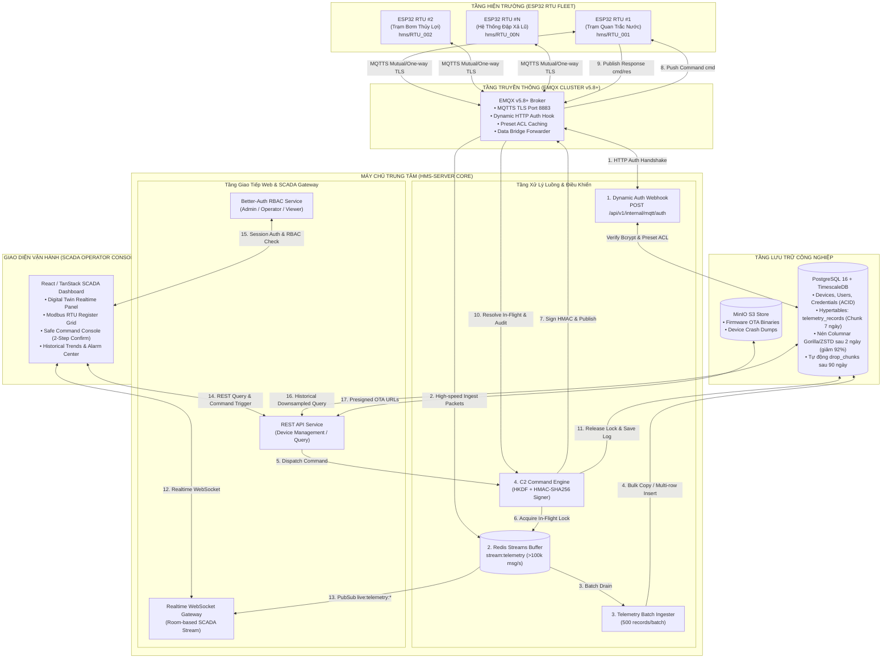

# TÀI LIỆU ĐẶC TẢ KIẾN TRÚC HỆ THỐNG (ARCHITECTURE RFC)
## HMS-SERVER — Hệ Thống Máy Chủ SCADA Quản Lý & Điều Khiển Hạm Đội RTU ESP32

> **SUPERSEDED / HISTORICAL — KHÔNG DÙNG LÀM ARCHITECTURE ENTRY POINT**  
> RFC này mô tả một phương án telemetry/SCADA cũ và không còn đại diện cho
> HMS-SERVER Release 1. Nó chứa các claim đã bị loại khỏi phạm vi hiện hành,
> gồm Node/Fastify, React, TimescaleDB, Redis Streams, telemetry history và
> HKDF/master-secret. Nguồn hiện hành là
> `plans/260924-2044-hms-server-management/plan.md`; firmware behavior phải
> được kiểm tra lại từ `D:/WORKSPACE/PROJECT/HMS-IDF`. Các link tới
> `apps/server`, `apps/web`, `packages/shared` và `docker-compose.yml` bên
> dưới chỉ có giá trị lịch sử, không phải file implementation hiện tại.

> **Mã tài liệu**: `RFC-HMS-SERVER-2026-FINAL`  
> **Trạng thái**: **HISTORICAL / SUPERSEDED — NOT A CURRENT ARCHITECTURE**  
> **Firmware reference**: `D:\WORKSPACE\PROJECT\HMS-IDF` (historical proposal; not protocol proof)  
> **Historical stack proposal**: Node.js/Fastify + PostgreSQL/TimescaleDB + Redis Streams + React/TanStack SCADA. The current approved stack is recorded in the management/control-plane plan.

---

## 1. Tổng Quan Kiến Trúc & Mục Tiêu Thiết Kế

Hệ thống **HMS-SERVER** được thiết kế để giải quyết bài toán quản trị, giám sát và điều khiển tập trung hàng nghìn trạm RTU (Remote Terminal Unit) dựa trên vi điều khiển ESP32-S3 (8MB PSRAM) chạy firmware `HMS-IDF`.

### 1.1. Mục Tiêu Cốt Lõi
1. **Quản trị hạm đội RTU quy mô lớn (Fleet Management)**: Quản lý hàng nghìn trạm phân tán trên toàn quốc kết nối qua mạng 4G LTE Modem, WiFi hoặc Ethernet.
2. **Cấp phát định danh & Phân quyền động (Dynamic Per-Device MQTT ACL)**: Mỗi RTU sở hữu một cặp tài khoản MQTT (`username`, `password_hash`) riêng biệt và một khóa ký số (`master_secret`). Broker EMQX xác thực qua Webhook và cấp **Preset ACL**, cô lập cứng RTU trong topic `hms/<device_id>/#`.
3. **Phân luồng Telemetry thông minh (Dual-Stream Ingestion)**: Phân biệt rõ giữa dữ liệu đo tức thời (**Realtime Telemetry**) đẩy lên Web SCADA và dữ liệu xả lại từ thẻ nhớ SD (**Offline Replay**) ghi đúng mốc thời gian lịch sử vào TimescaleDB.
4. **Kênh điều khiển hai chiều tin cậy tuyệt đối (C2 Command Plane)**: Gửi lệnh điều khiển Modbus, ADC, DI/DO, Network, Reboot có ký số **HMAC-SHA256** phái sinh từ MAC phần cứng qua **HKDF-SHA256**, tuân thủ giới hạn **1024 bytes** của task queue ESP32.
5. **Nền tảng SCADA Web hiện đại**: Giao diện Digital Twin, giám sát lưới Tag thời gian thực, bảng điều khiển hiện trường có khóa an toàn hai bước, phân quyền vận hành nghiêm ngặt qua **Better-Auth RBAC**.

---

## 2. Sơ Đồ Tôpô Hệ Thống & Luồng Dữ Liệu (System Topology)



---

## 3. Thiết Kế Cơ Sở Dữ Liệu Chi Tiết (Database Schema & ERD)

```mermaid
erDiagram
    USERS ||--o{ SESSIONS : has
    USERS ||--o{ COMMAND_AUDIT_LOGS : executes
    
    DEVICES ||--|| DEVICE_CREDENTIALS : secures
    DEVICES ||--|| DEVICE_SECRETS : holds_keys
    DEVICES ||--o{ DEVICE_TAGS : defines
    DEVICES ||--o{ TELEMETRY_RECORDS : generates
    DEVICES ||--o{ COMMAND_AUDIT_LOGS : receives
    DEVICES ||--o{ ALARMS : triggers

    USERS {
        uuid id PK
        string name
        string email UK
        string role "SUPER_ADMIN | OPERATOR | VIEWER"
        timestamp createdAt
    }

    DEVICES {
        uuid id PK
        string device_id UK "Mã định danh (Khớp topic prefix)"
        string mac_address UK "AA:BB:CC:DD:EE:FF"
        string name "Tên trạm quan trắc"
        string hardware_version
        string firmware_version
        string status "ONLINE | OFFLINE | ERROR"
        jsonb capabilities_cache "JSON snapshot từ /capabilities"
        jsonb last_health_view "health.level, warmup, conditions"
        timestamp last_seen_at
        timestamp created_at
    }

    DEVICE_CREDENTIALS {
        uuid id PK
        uuid device_id FK UK
        string mqtt_username UK "device_id"
        string mqtt_password_hash "Bcrypt hash"
        boolean is_active
        timestamp last_authenticated_at
    }

    DEVICE_SECRETS {
        uuid id PK
        uuid device_id FK UK
        bytea encrypted_master_secret "Mã hóa AES-256-GCM"
        bytea iv_nonce "12 bytes"
        bytea auth_tag "16 bytes"
        integer key_version
        timestamp last_rotated_at
    }

    TELEMETRY_RECORDS {
        timestamp recorded_at PK "TimescaleDB Time Dimension"
        uuid device_id FK PK
        string tag_name PK "temperature | flow_rate | v_bat"
        double precision numeric_value
        string string_value
        integer quality "0=Good, 1=Bad, 2=Uncertain"
        string unit
        boolean is_offline_replay "Đánh dấu bản tin từ thẻ nhớ SD"
    }

    COMMAND_AUDIT_LOGS {
        uuid id PK
        string cmd_id UK "UUIDv4 gửi qua MQTT envelope"
        uuid device_id FK
        uuid operator_id FK
        string cmd_type "system | modbus | network | config"
        string action "reboot | set_rtu_config | write_coil"
        jsonb request_payload
        string signature_hex "64 hex chars HMAC-SHA256"
        string status "PENDING | DELIVERED | ACKNOWLEDGED | TIMEOUT"
        jsonb response_payload
        integer execution_time_ms
        timestamp sent_at
        timestamp completed_at
    }
```

### 3.1. DDL Bảng Quan Hệ (PostgreSQL 16)
```sql
-- 1. Bảng danh bạ RTU
CREATE TABLE devices (
    id UUID PRIMARY KEY DEFAULT gen_random_uuid(),
    device_id VARCHAR(32) NOT NULL UNIQUE,
    mac_address VARCHAR(17) NOT NULL UNIQUE,
    name VARCHAR(128) NOT NULL,
    description TEXT,
    hardware_version VARCHAR(32),
    firmware_version VARCHAR(32),
    status VARCHAR(20) NOT NULL DEFAULT 'OFFLINE',
    capabilities_cache JSONB DEFAULT '{}'::jsonb,
    last_health_view JSONB DEFAULT '{}'::jsonb,
    last_seen_at TIMESTAMPTZ,
    created_at TIMESTAMPTZ NOT NULL DEFAULT NOW(),
    updated_at TIMESTAMPTZ NOT NULL DEFAULT NOW()
);
CREATE INDEX idx_devices_status ON devices(status);
CREATE INDEX idx_devices_device_id ON devices(device_id);

-- 2. Bảng cấp phát tài khoản MQTT
CREATE TABLE device_credentials (
    id UUID PRIMARY KEY DEFAULT gen_random_uuid(),
    device_id UUID NOT NULL UNIQUE REFERENCES devices(id) ON DELETE CASCADE,
    mqtt_username VARCHAR(64) NOT NULL UNIQUE,
    mqtt_password_hash VARCHAR(255) NOT NULL,
    is_active BOOLEAN NOT NULL DEFAULT TRUE,
    last_authenticated_at TIMESTAMPTZ,
    created_at TIMESTAMPTZ NOT NULL DEFAULT NOW(),
    updated_at TIMESTAMPTZ NOT NULL DEFAULT NOW()
);
CREATE INDEX idx_device_credentials_username ON device_credentials(mqtt_username);

-- 3. Bảng lưu trữ khóa bí mật ký số HMAC (Mã hóa AES-256-GCM)
CREATE TABLE device_secrets (
    id UUID PRIMARY KEY DEFAULT gen_random_uuid(),
    device_id UUID NOT NULL UNIQUE REFERENCES devices(id) ON DELETE CASCADE,
    encrypted_master_secret BYTEA NOT NULL,
    iv_nonce BYTEA NOT NULL,
    auth_tag BYTEA NOT NULL,
    key_version INTEGER NOT NULL DEFAULT 1,
    last_rotated_at TIMESTAMPTZ NOT NULL DEFAULT NOW(),
    created_at TIMESTAMPTZ NOT NULL DEFAULT NOW()
);
```

### 3.2. DDL Bảng Chuỗi Thời Gian (TimescaleDB Hypertable)
```sql
-- 4. Bảng chuỗi thời gian telemetry cảm biến
CREATE TABLE telemetry_records (
    recorded_at TIMESTAMPTZ NOT NULL,
    device_id UUID NOT NULL REFERENCES devices(id) ON DELETE CASCADE,
    tag_name VARCHAR(64) NOT NULL,
    numeric_value DOUBLE PRECISION,
    string_value TEXT,
    quality SMALLINT NOT NULL DEFAULT 0,
    unit VARCHAR(16),
    is_offline_replay BOOLEAN NOT NULL DEFAULT FALSE,
    metadata JSONB DEFAULT '{}'::jsonb
);

-- Khởi tạo Hypertable phân vùng theo thời gian (Chunk 7 ngày)
SELECT create_hypertable('telemetry_records', 'recorded_at', chunk_time_interval => INTERVAL '7 days');

-- Tạo Composite Index tối ưu truy vấn dải thời gian theo thiết bị và tag
CREATE INDEX idx_telemetry_device_tag_time ON telemetry_records (device_id, tag_name, recorded_at DESC);

-- Kích hoạt Columnar Compression tự động sau 2 ngày (Nén Gorilla/ZSTD giảm 92% đĩa)
ALTER TABLE telemetry_records SET (
    timescaledb.compress,
    timescaledb.compress_segmentby = 'device_id, tag_name',
    timescaledb.compress_orderby = 'recorded_at DESC'
);
SELECT add_compression_policy('telemetry_records', INTERVAL '2 days');

-- Tự động dọn dẹp dữ liệu cũ sau 90 ngày (Xóa chunk tức thì không lock bảng)
SELECT add_retention_policy('telemetry_records', INTERVAL '90 days');

-- 5. Bảng lưu vết lịch sử điều khiển C2 Audit Trail
CREATE TABLE command_audit_logs (
    id UUID PRIMARY KEY DEFAULT gen_random_uuid(),
    cmd_id VARCHAR(64) NOT NULL UNIQUE,
    device_id UUID NOT NULL REFERENCES devices(id) ON DELETE CASCADE,
    operator_id UUID REFERENCES users(id) ON DELETE SET NULL,
    cmd_type VARCHAR(32) NOT NULL,
    action VARCHAR(64) NOT NULL,
    request_payload JSONB NOT NULL,
    signature_hex VARCHAR(64) NOT NULL,
    status VARCHAR(20) NOT NULL DEFAULT 'PENDING',
    response_payload JSONB,
    execution_time_ms INTEGER,
    sent_at TIMESTAMPTZ NOT NULL DEFAULT NOW(),
    completed_at TIMESTAMPTZ
);
CREATE INDEX idx_command_logs_device_id ON command_audit_logs(device_id, sent_at DESC);
```

---

## 4. Quy Trình Cấp Phát MQTT Độc Lập & Webhook Xác Thực (EMQX Preset ACL)

### 4.1. Vòng Đời Cấp Phát Định Danh (Device Provisioning)
1. **Đăng ký trên Server**: Kỹ thuật viên nhập tên trạm và địa chỉ MAC của ESP32 qua API `POST /api/v1/devices`.
2. **Sinh khóa tự động**:
   - Server sinh ngẫu nhiên `mqtt_username = device_id` và `mqtt_password` (32 ký tự CSPRNG).
   - Server sinh ngẫu nhiên `master_secret` 32 bytes, mã hóa AES-256-GCM lưu vào `device_secrets`.
3. **Nạp vào RTU**: Kỹ thuật viên nạp thông tin này vào NVS của ESP32 qua giao diện cấu hình Web nội bộ hoặc cổng USB Serial.

### 4.2. Hợp Đồng Webhook Xác Thực Động EMQX (`POST /api/v1/internal/mqtt/auth`)
- **Headers**: `X-EMQX-Secret: <PRESHARED_SERVER_TOKEN>` (Chống brute-force từ bên ngoài).
- **Request từ EMQX**:
  ```json
  {
    "clientid": "RTU-TRAM-BOM-01",
    "username": "RTU-TRAM-BOM-01",
    "password": "pA9$kL2#xM9!vQ8@zT4*wR1^yU7&eI0("
  }
  ```
- **Response Success (200 OK — Cấp Preset ACL)**:
  ```json
  {
    "result": "allow",
    "is_superuser": false,
    "acl": [
      {
        "permission": "allow",
        "action": "publish",
        "topic": "hms/${username}/#"
      },
      {
        "permission": "allow",
        "action": "subscribe",
        "topic": "hms/${username}/cmd/#"
      },
      {
        "permission": "deny",
        "action": "all",
        "topic": "#"
      }
    ]
  }
  ```

---

## 5. Hợp Đồng Ký Số Lệnh Điều Khiển HMAC-SHA256 (C2 Plane Contract)

### 5.1. Thuật toán Phái sinh Khóa (HKDF-SHA256) Khớp Firmware
- **Input**: `master_secret_hex` (32 bytes) và `mac_address` (12 ký tự hex sạch, ví dụ: `"A4CF1289FE34"`).
- **Công thức**:
  $$\text{PRK} = \text{HMAC-SHA256}(\text{key}=\text{MAC\_clean\_bytes}, \text{data}=\text{master\_secret\_bytes})$$
  $$\text{Derived Key (32 bytes)} = \text{HKDF-Expand}(\text{PRK}, \text{info}=b"\text{mqtt-cmd}", \text{length}=32)$$

### 5.2. Cấu Trúc Envelope Wire Format & Gắn Chữ Ký (Tối đa 1024 Bytes)
Chuỗi JSON thô trước khi ký:
```json
{
  "type": "modbus",
  "id": "7b069d30-b97c-47b2-bc05-b0b3d11b3ea4",
  "ts": 1740000000,
  "ttl_ms": 10000,
  "dry_run": false,
  "confirm": "",
  "response_topic": "hms/RTU-01/cmd/res",
  "data": {
    "action": "set_rtu_config",
    "data": {
      "baud_rate": 9600,
      "data_bits": 8,
      "parity": 0,
      "stop_bits": 1
    }
  },
  "kid": "key-1",
  "generation": 1
}
```
1. Serialize JSON dạng Canonical không khoảng trắng (`separators=(',', ':')`).
2. Tính toán: $\text{sig\_hex} = \text{HMAC-SHA256}(\text{key}=\text{Derived Key}, \text{data}=\text{Canonical JSON}).\text{hexdigest}()$
3. Gắn chữ ký vào trường cuối cùng:
   $$\text{Wire Bytes} = \text{JSON\_PREFIX} \mathbin{\Vert} \text{b',\"sig\":\"'} \mathbin{\Vert} \text{sig\_hex} \mathbin{\Vert} \text{b'\"}'}$$

---

## 6. Xử Lý Phân Luồng Telemetry: Realtime vs Offline Replay Thẻ SD

Hệ thống phân tách hai luồng dữ liệu cảm biến:
1. **Luồng Realtime (Mạng thông suốt)**:
   - Dữ liệu đến topic `hms/<device_id>/sensors/#` có độ trễ $t_{\text{server}} - t_{\text{packet}} < 10\text{s}$.
   - Server vừa ghi vào database vừa broadcast qua WebSocket `live:telemetry:<device_id>` lên màn hình SCADA cho người vận hành xem tức thời.
2. **Luồng Offline Replay (Xả từ thẻ MicroSD sau khi có mạng lại)**:
   - Gói tin mang mốc thời gian $t_{\text{packet}}$ trong quá khứ (cách hiện tại vài giờ hoặc vài ngày).
   - Ingest Worker phát hiện cờ Replay hoặc thời gian lệch $\rightarrow$ Ghi vào `telemetry_records` với `is_offline_replay = true` và **giữ nguyên mốc `recorded_at = t_packet`**, không broadcast làm nhiễu loạn giao diện realtime.

---

## 7. Hợp Đồng API REST & WebSocket Realtime SCADA

### 7.1. REST Endpoints Cốt Lõi
- `GET /api/v1/devices`: Lấy danh sách RTU (lọc theo trạng thái Online/Offline, tìm kiếm).
- `POST /api/v1/devices`: Đăng ký RTU mới, sinh mật khẩu MQTT và Master Secret.
- `GET /api/v1/devices/:id`: Xem chi tiết trạm RTU, capabilities cache, nhịp tim và sức khỏe `health.level`.
- `POST /api/v1/devices/:id/commands`: Phát lệnh điều khiển ký số HMAC xuống RTU.
- `GET /api/v1/devices/:id/telemetry`: Truy vấn dữ liệu lịch sử cảm biến theo dải ngày giờ (có hỗ trợ gom mẫu Downsampling AVG theo phút/giờ).
- `POST /api/v1/internal/mqtt/auth`: Webhook xác thực cho EMQX (yêu cầu header `X-EMQX-Secret`).

### 7.2. WebSocket Gateway (`/ws/scada`)
- **Client Subscribe**: `{"action":"subscribe","device_id":"RTU_001"}`
- **Server Broadcast Telemetry**:
  ```json
  {
    "event": "telemetry",
    "device_id": "RTU_001",
    "timestamp": 1740000005,
    "metrics": {
      "water_level": 14.85,
      "flow_rate": 230.5,
      "battery_voltage": 12.6,
      "pump_state": 1
    }
  }
  ```
- **Server Broadcast Command ACK**:
  ```json
  {
    "event": "command_ack",
    "cmd_id": "7b069d30-b97c-47b2-bc05-b0b3d11b3ea4",
    "device_id": "RTU_001",
    "status": "ACKNOWLEDGED",
    "success": true,
    "message": "Modbus RTU config applied successfully",
    "execution_time_ms": 138
  }
  ```

---

## 8. Kiến Trúc Giao Diện SCADA Web (Frontend Console)

1. **Bản đồ & Danh bạ Toàn Trạm (Fleet Topology Map)**:
   - Trực quan hóa toàn bộ trạm trên bản đồ số, phân loại màu theo sức khỏe phần cứng (`OK` = Xanh, `WARN` = Vàng, `CRIT` = Đỏ, `OFFLINE` = Xám).
2. **Digital Twin Trạm Hiện Trường**:
   - Trực quan hóa van, máy bơm, bể chứa, cột đo mưa bằng SVG động cập nhật theo giá trị cảm biến thời gian thực.
3. **Lưới Giám Sát Tag & Thanh Ghi Modbus (Modbus Grid Inspector)**:
   - Hiển thị danh sách 512 tags tín hiệu: giá trị hiện tại, đơn vị, nhãn chất lượng (Good/Bad/Uncertain), thời gian cập nhật gần nhất.
4. **Bàn Điều Khiển Lệnh An Toàn (Safe C2 Console)**:
   - Các nút bấm điều khiển hiển thị trạng thái `In-Flight...` và đếm ngược TTL 10 giây.
   - Các lệnh nguy hiểm (Reboot trạm, Factory reset, cấu hình lại mạng) bắt buộc mở hộp thoại xác nhận 2 bước: yêu cầu gõ đúng chuỗi xác nhận `REBOOT-<device_id>` và kiểm tra quyền `SUPER_ADMIN` của Better-Auth.

---

## 9. Danh Mục 16 File Neo Ngữ Cảnh Hệ Thống (Anchor Context Files)

Để đảm bảo quá trình viết mã nguồn trong repository `HMS-SERVER` diễn ra chuẩn xác, không bị trôi dạt ngữ cảnh nghiệp vụ, các file sau đây là **bộ khung chuẩn mực bắt buộc**:

### 9.1. Nhóm File Neo Ranh Giới & Đặc Tả Cốt Lõi (Repository Root)
1. [`ALIGNMENT.md`](file:///d:/WORKSPACE/PROJECT/HMS-SERVER/ALIGNMENT.md): Khóa chặt ranh giới và các Anti-goals kỹ thuật.
2. [`docs/architecture-hms-server.md`](file:///d:/WORKSPACE/PROJECT/HMS-SERVER/docs/architecture-hms-server.md): Tài liệu đặc tả kiến trúc RFC toàn diện này.
3. [`docs/journal.md`](file:///d:/WORKSPACE/PROJECT/HMS-SERVER/docs/journal.md): Nhật ký kỹ thuật ghi nhận các quyết định và đánh giá trade-off.
4. [`docker-compose.yml`](file:///d:/WORKSPACE/PROJECT/HMS-SERVER/docker-compose.yml): Cấu hình chạy cụm dịch vụ chuẩn: EMQX v5.8+, PostgreSQL 16 + TimescaleDB, Redis 7, MinIO.

### 9.2. Nhóm File Neo Hợp Đồng Chia Sẻ (`packages/shared`)
5. `packages/shared/src/contracts/envelope.ts`: Zod schema định nghĩa Wire Envelope JSON của ESP32.
6. `packages/shared/src/contracts/commands.ts`: Danh mục 9 namespace lệnh và các hành động (Actions).
7. `packages/shared/src/contracts/telemetry.ts`: Zod schema dữ liệu cảm biến (`JSON_FULL` và `JSON_KV`).
8. `packages/shared/src/contracts/events.ts`: Hợp đồng sự kiện WebSocket giữa Server và Web Client.

### 9.3. Nhóm File Neo Backend Core (`apps/server`)
9. `apps/server/src/modules/mqtt/auth-webhook.ts`: Hiện thực hóa endpoint `/api/v1/internal/mqtt/auth` cấp Preset ACL.
10. `apps/server/src/modules/c2/signer.ts`: Historical signer proposal; it is not evidence of the current direct `crypto/cmd_key` firmware contract.
11. `apps/server/src/modules/ingest/stream-worker.ts`: Worker đọc từ Redis Streams và xả batch vào TimescaleDB.
12. `apps/server/src/modules/auth/better-auth.ts`: Cấu hình Better-Auth RBAC và session storage.
13. `apps/server/src/database/schema.ts`: Drizzle ORM / Kysely schema định nghĩa các bảng PostgreSQL và TimescaleDB.

### 9.4. Nhóm File Neo Frontend SCADA (`apps/web`)
14. `apps/web/src/hooks/use-device-telemetry.ts`: React Hook quản lý kết nối WebSocket realtime và cập nhật state thiết bị.
15. `apps/web/src/components/scada/digital-twin.tsx`: Component trực quan hóa bản đồ trạng thái phần cứng của RTU.
16. `apps/web/src/components/commands/command-dialog.tsx`: Hộp thoại phát lệnh điều khiển hai bước an toàn.
