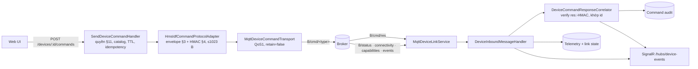

# MQTT device link — server ↔ thiết bị HMS-IDF

Trạng thái: **đã triển khai** (2026-11-06). Hợp đồng duy nhất: `HMS-IDF/engineering-docs/api/mqtt-api.md`, snapshot 2026-10-28, cùng `http-api.md` cho `/api/security/keys`. Không đọc source firmware.

Tài liệu này thay thế luồng "Node bridge → HTTP ingest" trong [architecture-real-device-mqtt-integration.md](architecture-real-device-mqtt-integration.md). Envelope `req_id/client_id/params` trong `plans/261001-0030-full-hardware-mqtt-apis-c2/phase-02-live-mqtt-transport.md` sai spec và **không** được dùng.

## Luồng



`B = <topic_prefix>/<device_id>`, lấy từ binding của từng thiết bị. Server không bao giờ tự đoán prefix.

| Thành phần | File |
|---|---|
| Port + state (binding, link state, pending, reply store) | `src/Hms.Server.Application/DeviceLink/DeviceLinkContracts.cs` |
| Correlator, inbound handler, bind/import-key handler | `src/Hms.Server.Application/DeviceLink/DeviceLinkHandlers.cs` |
| Envelope, ký, verify reply | `src/Hms.Server.Infrastructure/Commands/HmsIdfCommandCodec.cs` |
| Protocol adapter | `src/Hms.Server.Infrastructure/Commands/HmsIdfCommandProtocolAdapter.cs` |
| MQTTnet session, subscribe, publish, sweep timeout | `src/Hms.Server.Infrastructure/Mqtt/MqttDeviceLinkService.cs` |
| Transport | `src/Hms.Server.Infrastructure/Mqtt/MqttDeviceCommandTransport.cs` |
| Bảng `device_mqtt_bindings` | migration `AddDeviceMqttBindings` |

MQTT chỉ nằm trong Infrastructure, theo ADR modular monolith 260927. Service MQTT không chứa logic theo action.

## Quy tắc đã thực thi (spec → code)

- **Envelope** (§3): `type,id,ts(giây),ttl_ms[,key_ver][,confirm][,dry_run],data{action[,data]}`, `sig` nằm cuối.
  - Raw UTF-8, không key trùng (kể cả khác hoa/thường), không NUL, nesting ≤16.
  - Tổng ≤1023 byte **sau** khi gắn sig; quá cỡ thì `COMMAND_TOO_LARGE`, không publish.
- **Ký** (§4): `HMAC-SHA256(key32, bytes)`; reply verify bằng `HMAC(key, "res:"+body)`.
  - Test vector được tính độc lập bằng Node crypto (`tests/.../DeviceLinkTests.cs`).
- **Confirm** (§7): token phải đúng template với **MQTT device id**, ví dụ `REBOOT-gateway_870c`. Dùng GUID server thì bị `CONFIRM_MISMATCH`.
- **Key**: chỉ dùng key đã cấp/import cho đúng `KeyGeneration`. Không có key thì `COMMAND_KEY_NOT_PROVISIONED`, không publish. Key không bao giờ được trả ra API.
- **Capabilities** (§2): khi đã nhận `B/capabilities`, action không `available` bị chặn với `DEVICE_ACTION_UNAVAILABLE`.
- **Reply** (§5, R3): kết quả được ánh xạ như sau.

  | Thiết bị trả về | Status | Code | Detail |
  |---|---|---|---|
  | `success:true` | `Executed` | `DEVICE_EXECUTED` | — |
  | `accepted+pending` | `Acknowledged` | `DEVICE_ACCEPTED` | `operation_id` |
  | `success:false` | `Failed` | `DEVICE_REJECTED` | `error[: data.error]` |

  - Reply của client khác trên cùng topic thì bỏ qua.
  - Chữ ký sai thì command vẫn giữ trạng thái pending.
- **Timeout** (R4): sau 30 giây không có reply thì `Failed/DEVICE_RESPONSE_TIMEOUT`, nghĩa là *không rõ outcome*: phải đọc lại trạng thái trước khi gửi lại với id mới.
- **Audit**: `Published` đến muộn không bao giờ ghi đè outcome của thiết bị.
- **Action mở** (`PinnedCommandCatalog.EnabledActions`, `PhysicalOutputActions`, `ConfigWriteActions`, `FlashActions`): 34 action.
  - 11 action đọc gốc: 9 action read `SLICE_PASS` của snapshot spec, cộng `system.ping` và `system.get_operations`.
  - 15 action đọc giám sát (xem [Lệnh đọc giám sát](#lệnh-đọc-giám-sát)).
  - `control.set_output` và `control.pulse` mở có điều kiện (xem [DO relay control](#do-relay-control)).
  - 5 action ghi cấu hình: `system.set_hostname`, `system.set_timezone`, `system.sync_ntp`, `adc.set_channel`, `adc.toggle_channel` (xem [Cấu hình từ xa](#cấu-hình-từ-xa--hệ-thống--adc)).
  - 1 action class F: `system.reboot`, chỉ master-admin (xem [Khởi động lại an toàn](#khởi-động-lại-an-toàn)).
  - Mọi action khác ngoài các danh sách trên vẫn ở `DENIED_UNTIL_ACTION_CONTRACT`, gồm `system.set_time` và `system.set_ntp_servers` (đồng hồ thiết bị), `system.factory_reset`, `config.set`, `control.set_all` (không atomic), mọi `network.*`, `mqtt.*`, `broker.*`, `ota.*` chưa mở, Modbus, tags, `sms.*`, `config.get`, `ota.remote_config_get`.
- **Inbound**: không bao giờ đổi lifecycle thiết bị. Broker lab cho phép anonymous, nên identity trên broker không phải bằng chứng.

## API

| Method | Route | Quyền |
|---|---|---|
| GET | `/api/v1/command-transport/status` | đăng nhập |
| GET | `/api/v1/devices/{id}/link` | scope thiết bị |
| PUT | `/api/v1/devices/{id}/link` `{topicPrefix, mqttDeviceId, keyVersion?}` | `devices.manage` + CSRF |
| PUT | `/api/v1/devices/{id}/link/command-key` `{valueHex}` | master-admin + CSRF; tăng `KeyGeneration` |
| GET | `/api/v1/devices/{id}/link/capabilities` | scope thiết bị |
| PUT | `/api/v1/devices/{id}/link/output-channels` `{channels}` | master-admin + CSRF |
| GET | `/api/v1/devices/{id}/outputs` | `gpio.do_view` trên thiết bị |
| GET | `/api/v1/devices/{id}/allowed-commands` | scope như POST (`DeviceAccessChecks.CanSendCommands`); trả `{actions: string[]}`; không đủ scope hoặc thiết bị revoke → 404 `DEVICE_NOT_FOUND` |
| GET | `/api/v1/devices/{id}/commands/{correlationId}` | scope như POST; data reply chỉ cho người gửi hoặc master-admin, và chỉ khi người gửi còn quyền của action trên thiết bị |

SignalR có thêm các event `connectivity`, `capabilities`, `device_event`, `command_result` và `outputs`. Event `command_result` chỉ chứa outcome, không chứa data, và **không được phát cho lệnh class R (đọc)**, kể cả khi reply tới hoặc khi timeout. Người đọc poll `GET .../commands/{correlationId}`. Event `outputs` chỉ chứa `readAt`, `stale`, `staleReason`.

## Cấu hình (`Mqtt`)

```json
{ "Mqtt": { "Enabled": true, "Host": "192.168.1.101", "Port": 443, "UseTls": true,
  "CaCertificatePath": "<pem>", "ClientId": "hms-server-dev", "ResponseTimeoutSeconds": 30,
  "MaxPendingReadsPerDevice": 4,
  "Devices": [ { "DeviceId": "870c870c-…", "TopicPrefix": "hms_toan_lab", "MqttDeviceId": "gateway_870c", "KeyVersion": 11 } ] } }
```

- `Enabled=false` (mặc định): dùng transport deferred. Lệnh hợp lệ trả `MQTT_DEFERRED`; adapter vẫn kiểm đầy đủ.
- `ResponseTimeoutSeconds` phải lớn hơn 20 s (TTL lớn nhất của mọi lệnh), nếu không `MQTT_TIMING_INVALID`.
- `MaxPendingReadsPerDevice` (mặc định 4, hợp lệ 1..16, ngoài khoảng → `MQTT_READ_LIMIT_INVALID`): số lệnh đọc đang chờ tối đa trên mỗi thiết bị. Chi tiết xem [Lệnh đọc giám sát](#lệnh-đọc-giám-sát).
- `Devices[]` chỉ seed trong Development. `CommandKeyHex` chỉ đặt qua user-secrets hoặc env, không commit.
- Máy dev đã có user-secrets `hms-server-api-dev` cho broker lab. Chạy server bằng cấu hình `hms-api` trong `.claude/launch.json`.
- Broker dev: `tools/mqtt-broker/broker.js` (Aedes) bị server từ chối (`MQTT connect refused: 1`) vì MQTTnet 5 của server nói MQTT 5.0. Khi chạy simulator với server, dùng Mosquitto loopback (`listener 8088 127.0.0.1`, anonymous); chưa sửa Aedes trong `src/`.
- Test tích hợp cần `Mqtt__Enabled=false` trong môi trường này, vì user-secrets Development trỏ tới CA path cũ và nhiều test nền thất bại nếu thiếu. Đặt bằng biến môi trường; không sửa user-secrets.

## Lab (quan sát 2026-11-06)

- Gateway `gateway_870c` kết nối Mosquitto TLS `192.168.1.101:443` do tooling HIL của team firmware dựng. CA nằm trong `%TEMP%\hms-idf-mosquitto-*`.
- Thiết bị ở chế độ `signed`. Ngày 2026-11-06 command key đã được **xoay** sang key do server sinh: trước đó là `key_version` 11, fingerprint `7b266b1a`.
  - Key được nạp qua `POST /api/security/keys`. Server không ghim `key_ver`.
  - Tooling HIL của team firmware phải dùng key mới này.
- Nạp key qua web console của thiết bị: trang "Bảo mật lệnh" dùng `confirm()` của trình duyệt, nên trong trình duyệt tích hợp của app nút Nạp không có tác dụng. Dùng Chrome/Edge, hoặc gọi thẳng HTTP API.
- Đã kiểm chứng live:
  - Chiều vào (heartbeat, connectivity, capabilities 105 action) đi tới telemetry và UI.
  - Chiều ra qua đúng broker lab với simulator độc lập theo spec (`hms_server_selftest/sim_001`): ký hợp lệ → `Executed` có data; im lặng → `DEVICE_RESPONSE_TIMEOUT`.
  - **Gateway thật, lệnh ký:** cả 11 action đã mở đều trả `Executed` với reply có `res:`-HMAC hợp lệ, mỗi lệnh khoảng 1 giây.

    | Action | Data trả về |
    |---|---|
    | `system.ping` | `alive` |
    | `system.get_info` | fw 1.0.108, IDF v5.5.5, `device_id` `gateway_870c` |
    | `system.get_heap` | — |
    | `mqtt.get_status`, `mqtt.get_config` | password được che |
    | `status.services` | — |
    | `status.dump` | 2.6 KB |
    | `status.tags` | 6.7 KB |
    | `network.get_all_status` | — |
    | `control.get_status` | 6 kênh DO |
    | `system.get_operations` | — |

## DO relay control

Trạng thái: **đã triển khai và kiểm chứng live** (2026-11-06). Plan: `plans/261106-0735-do-relay-control/`. Trên gateway thật chỉ DO1 nằm trong allowlist; DO2–DO6 chỉ kiểm chứng trên simulator.

### Action mở

| Action | Payload (đúng các key này, không thừa) | Ghi chú |
|---|---|---|
| `control.set_output` | `{channel: int ≥ 1, value: bool}` | `0`/`1` bị từ chối (`COMMAND_PAYLOAD_INVALID`) |
| `control.pulse` | `{channel: int ≥ 1, duration_ms: int 1..MaxPulseMs}` | Kênh phải ở `pulse` mode trên thiết bị |
| `control.set_all` | — | Vẫn đóng: không atomic |

- Kiểm trước khi ký: `OutputCommandPolicy.Check`. Action class B khác → `PHYSICAL_ACTION_UNSUPPORTED`.
- `Mqtt:MaxPulseMs` (`MqttLinkOptions.MaxPulseMs`): mặc định 60000, hợp lệ 1..3600000. Đây là chính sách của server; spec §6.4 để giới hạn thật cho cấu hình HTTP của thiết bị.
- TTL vật lý: `SendDeviceCommandHandler.MaxPhysicalCommandTtlMs = 10000` kẹp TTL lệnh class B xuống 10 s. `ttl_ms` trên envelope cũng ≤ 10000. Các lệnh khác bị kẹp ở `MaxCommandTtlMs = 20000` (xem [Lệnh đọc giám sát](#lệnh-đọc-giám-sát)).
- `Mqtt:ResponseTimeoutSeconds` (mặc định 30) phải lớn hơn 20 s, nếu không `MqttLinkOptions.Validate` ném `MQTT_TIMING_INVALID`. Lý do: thiết bị kiểm TTL khi lệnh rời hàng đợi của nó. Nếu server đã báo timeout mà lệnh còn hạn, lệnh vẫn có thể chạy sau đó, và operator không biết trạng thái thật.

### Allowlist kênh

- Mặc định đóng: `null` hoặc rỗng nghĩa là không kênh nào được điều khiển (`DO_CHANNEL_NOT_ALLOWED`, không ký).
- Giá trị hợp lệ: tối đa 32 phần tử, mỗi số 1..255, không trùng (`DeviceMqttBinding.ValidateOutputChannels`, lỗi `OUTPUT_CHANNELS_INVALID`). Lưu ở cột `AllowedOutputChannels` (`varchar(200)`) của `device_mqtt_bindings`.
- Chỉ master-admin đổi: `PUT /api/v1/devices/{id}/link/output-channels` `{"channels": [1]}`, có CSRF. Không phải master-admin → 403; dữ liệu sai → 400; chưa có binding → 409 `DEVICE_MQTT_BINDING_MISSING`. Mỗi lần đổi được ghi log cảnh báo kèm danh sách trước/sau.
- Re-bind:
  - `PUT /link` cùng topic base: giữ nguyên allowlist.
  - Đổi sang topic base khác: allowlist về đóng và xoá trạng thái DO đã cache (`IDeviceOutputStateStore.Clear`).
- Dev seed: `Mqtt:Devices:N:AllowedOutputChannels` (`MqttDeviceSeedOptions`), chỉ đọc khi Development. Không khai báo thì đóng.

### Trạng thái DO đã xác minh

- Chỉ được ghi từ reply `control.get_status` đã xác minh chữ ký (`DeviceReplyProjection`). Heartbeat, device event và `POST /telemetry` không ghi được.
- Store là in-memory (`IDeviceOutputStateStore`). Sau restart chưa có state, API trả 404 `OUTPUTS_NOT_READ`, UI phải đọc lại.
- `GET /api/v1/devices/{id}/outputs` (`DeviceLinkController.Outputs`) cần `gpio.do_view` trên thiết bị, thiếu quyền → 403 `DEVICE_PERMISSION_REQUIRED`. Trả `channels[{channel, state, mode, pulseActive, enabled, gpioOk, forced, owner, ownerId}]`, `readAt`, `stale`, `staleReason`.
- Năm field kênh `enabled`, `gpioOk`, `forced`, `owner`, `ownerId` (thô `owner_id`) lấy từ reply `control.get_status` (spec `c80797d` L797, L839) và luôn có mặt trong JSON: `enabled`, `gpioOk`, `forced`, `ownerId` là `null` khi thiết bị không gửi hoặc gửi sai kiểu, server không suy diễn (`forced:true` không sinh `owner:"force"`). `owner` là `null` khi thiết bị không gửi (hoặc gửi `null`); một giá trị khác 6 giá trị `none|force|level_rule|event_rule|trigger|unknown` (chuỗi lạ, đổi hoa thường, số, object) thành `"unknown"`; `owner_id` số hay chuỗi đều thành chuỗi `ownerId`. Chỉ thêm field: shape ngoài và catalog không đổi (catalog vẫn ghim `83e93d77e`).
- Event `outputs` không có dữ liệu relay. Người xem phải gọi lại endpoint trên.
- Telemetry: `digital_outputs`/`digitalOutputs` bị gỡ khỏi heartbeat `status` và khỏi telemetry lưu (`TelemetryRelayStates`). **Contract change:** `GET /api/v1/devices/{id}/telemetry` không còn trả `digital_outputs`.

Đánh dấu stale (`staleReason`):

| Reason | Đặt khi |
|---|---|
| `output_command_executed` | Lệnh DO trả `Executed`, chưa đọc lại |
| `output_command_outcome_unknown` | Lệnh DO không `Executed` và không bị từ chối trước handler; hoặc hết thời gian chờ (`DEVICE_RESPONSE_TIMEOUT`) |
| `device_rebooted` | Heartbeat có uptime nhỏ hơn lần trước |
| `device_reboot_scheduled` | `system.reboot` thật được thiết bị nhận (reply thành công); relay sẽ về TẮT lúc khởi động |
| `device_offline` | Connectivity `offline` |

- Spec R3: chỉ các lỗi từ chối trước handler giữ nguyên state: `expired`, `future_timestamp`, `LANE_FULL`, `unknown_action`, `confirm_required`, `permission_unmapped`, `schema:*`. `UNAUTHORIZED` (dedup) vẫn là unknown, vì lần gửi đầu có thể đã chạy.
- Projection chạy trước khi ghi audit. Sweep timeout đánh stale trước, và mỗi lệnh có try/catch riêng.

### Audit

- Cột `command_audits.IssuedBy` (người gửi), `Detail` (varchar 1024, lý do từ thiết bị), `PayloadSummary` (JSON payload, tối đa 512 ký tự). `PayloadSummary` chỉ được lưu cho class B (physical), D, F và 5 action ghi cấu hình; các action W/C khác để `null`.
- Khi khởi động, `FailUnfinished("OUTCOME_UNKNOWN_AFTER_RESTART")` (`Program.cs`) đổi mọi row `Published` và `IN_FLIGHT` thành `Failed` với code `OUTCOME_UNKNOWN_AFTER_RESTART`.
- Kết quả transport muộn (`Published`, `MQTT_PUBLISH_UNCONFIRMED`) không ghi đè outcome mà thiết bị đã báo (`CommandTransportOutcome.IsTransportOnly`).

### UI (`DeviceOutputsPanel.vue`)

- Đây là đường ghi DO duy nhất. `DeviceCommandModal` ẩn `control.set_output`, `control.pulse`, `control.set_all` (`PANEL_ONLY_ACTIONS`).
- Panel hiện cho mọi thiết bị có MQTT binding, kể cả khi chưa có telemetry.
- Quy tắc khoá kênh (`useDeviceCommand.ts`, `certainlyNotSent`):

| Kết quả | Hành vi |
|---|---|
| `ContractUnavailable`, `TransportNotConfigured`, `MQTT_NOT_CONNECTED`, `MQTT_RESPONSE_SUBSCRIPTION_MISSING`, `MQTT_COMMAND_TOPIC_INVALID`, hoặc HTTP 4xx | Mở khoá ngay, hiện lỗi |
| `Executed`, `DEVICE_REJECTED`, timeout, HTTP 5xx, mất kết nối, `IDEMPOTENCY_OUTCOME_UNKNOWN`, các trường hợp khác | Giữ khoá, đọc lại (tối đa 2 lần) |
| Pulse | Sau khi hết xung + 1 s, đọc lại thêm một lần |

- Thiết bị offline hoặc broker server mất kết nối: mọi kênh hiện **Không rõ**, vẫn có nút Bật/Tắt kèm cảnh báo. "Đọc lúc" hiện giờ đọc và tuổi của lần đọc.
- Pulse: số nguyên 1..60000 ms, mặc định 1000 ms. Ngoài khoảng thì không gửi.
- Khoá theo kênh (`outputWriteLock` trong `outputLocks.ts`): khoá Bật, Tắt, Xung và ô ms, kèm lý do. Lấy mức đầu tiên khớp:

| Thứ tự | Điều kiện (lần đọc cuối) | Lý do hiện |
|---|---|---|
| 1 | `gpioOk === false` | GPIO không dùng được |
| 2 | `enabled === false` | Kênh tắt trong cấu hình |
| 3 | `forced === true` hoặc `owner === "force"` | Đang force |
| 4 | `owner === "level_rule"` | Luật #`ownerId` giữ kênh (thiếu id: "Luật giữ kênh") |

  - Xung cũng khoá ở mức 4 có chủ đích: spec L818 ghi `control.pulse` không đổi trong đợt `owned_by_rule` và không nói pulse có bị từ chối trên kênh luật theo mức không, mà luật theo mức giữ kênh đặt lại mức ngay sau mỗi lần ghi (L853 nêu giới hạn 1 s cho trường hợp sau `force_clear`). Khi câu hỏi spec 17 có trả lời, chỉ đổi một điều kiện.
  - Khoá theo lần đọc cuối, kể cả khi trạng thái đã cũ: khoá sai chỉ chặn một lệnh, nút "Đọc trạng thái" luôn có để làm mới.
  - `event_rule`, `trigger`: không khoá, chỉ ghi chú "Luật/trigger có thể đổi kênh sau lệnh tay".
  - `owner` thiếu (firmware cũ) hoặc `unknown`: không khoá theo owner, thiết bị tự quyết; khoá theo `gpioOk`/`enabled`/`forced` vẫn áp khi thiết bị gửi các field đó.
- Dịch lỗi: `gpio_unavailable`, `channel_disabled`, `channel_forced`, `owned_by_rule` (đuôi của `detail`, dạng `ESP_ERR_INVALID_STATE: owned_by_rule`; `stateRefusal`) hiện câu "…: thiết bị không đổi relay", id luật lấy từ `reply.data.rule_id`; mã gốc `DEVICE_REJECTED: …` vẫn hiện font mono. Lệnh ghi không bao giờ tự gửi lại.
- Đọc lại: đường có sẵn (`readBackTwice`) cho một `get_status` khi lần đọc đầu thành công, nên khi thiết bị gửi `owner`, khoá hiện ra ngay sau lần từ chối đầu (không có `owner` thì không có khoá theo owner). Xung bị từ chối bởi 4 lỗi này không đọc lại lần hai sau khi hết xung, vì relay không đổi.

### Simulator

`tools/mqtt-broker/spec-device-simulator.js` là bản mô phỏng độc lập theo spec: kiểm chữ ký thật, trả reply `res:`-HMAC, 6 kênh (DO6 ở pulse mode, còn lại toggle). Cấu hình chỉ qua biến môi trường, không có key trong repo.

```powershell
$env:SIM_MQTT_URL   = "mqtts://192.168.1.101:443"
$env:SIM_CA_PATH    = "<PEM của CA broker, ngoài repo>"
$env:SIM_TOPIC_BASE = "hms_server_selftest/sim_001"   # phải được bind trên server trước
$env:SIM_KEY_FILE   = "<file 64 ký tự hex, ngoài repo>"
$env:SIM_SILENT     = "control.set_output"           # tuỳ chọn: không trả reply, để test R4
node tools/mqtt-broker/spec-device-simulator.js
```

- `SIM_KEY_FILE`: đường dẫn tới file key, nội dung không bao giờ được paste vào repo, log hay tài liệu.
- `SIM_SILENT`: danh sách `type.action` bị bỏ qua. Dùng để kiểm timeout `DEVICE_RESPONSE_TIMEOUT` sau 30 s.
- `SIM_HEARTBEAT_SECONDS` (mặc định 5): simulator gửi `<base>/status` định kỳ. Với `0`, không có heartbeat nào và server coi thiết bị là offline (heartbeat cũ hơn 15 s không còn tính là online).
- Các biến khác: `SIM_SECONDS`, `SIM_CHANNELS` (mặc định 6), `SIM_PULSE_CHANNELS` (mặc định 6).
- Field kênh (spec `c80797d`): mặc định `get_status` nay gửi `enabled`, `gpioOk`, `forced`, `owner` (`none`, hoặc `force` cho kênh force) và `owner_id` (`null`). Từ chối `set_output` mang `data { error, channel[, rule_id] }`, thứ tự `gpio_unavailable`, `channel_disabled`, `channel_forced`, `owned_by_rule` (spec không định thứ tự; đây là thứ tự khoá của panel). `control.pulse` từ chối `gpio_unavailable`, `channel_disabled`, `channel_forced` (cùng dạng và thứ tự với `set_output`) và không kiểm owner.
  - `SIM_DO_LAYOUT=gateway`: bố cục theo HIL L1054, bỏ qua `SIM_CHANNELS`, `SIM_PULSE_CHANNELS`, `SIM_FORCED`.

    | Kênh | Mode | Đặc điểm |
    |---|---|---|
    | DO1 | toggle | tự do, ghi được |
    | DO2, DO3 | toggle | `gpioOk:false` |
    | DO4, DO5 | toggle | force TẮT, `owner:"force"` |
    | DO6 | toggle | `owner:"level_rule"`, `owner_id:1`, luật giữ mức BẬT (mức do simulator chọn, spec không nêu); sau boot luật đặt lại mức BẬT |

  - `SIM_DO_NO_OWNER=1`: `get_status` không có `owner`, `owner_id` (firmware không gửi `owner`); các từ chối giữ nguyên.
  - `SIM_DO_DISABLED=3,5`: các kênh đó `enabled:false`; `set_output` và `control.pulse` từ chối `channel_disabled`. Mỗi phần tử phải là số nguyên 1..`SIM_CHANNELS`, sai thì thoát mã 2; không dùng chung với `SIM_DO_LAYOUT=gateway` (bảng đó đã cố định từng kênh), cũng thoát mã 2.
- Các biến cho `system.reboot` (`SIM_FORCED`, `SIM_BOOT_SECONDS`, `SIM_THROTTLE_S`, `SIM_REBOOT_NO_RETURN`, ...): xem [Khởi động lại an toàn](#khởi-động-lại-an-toàn).

### Kết quả kiểm chứng

Gateway thật (`gateway_870c`, allowlist chỉ có DO1):

| Bước | Kết quả |
|---|---|
| 1. Đọc trạng thái | 6 kênh, đều `toggle`, đều OFF |
| 2. DO1 Bật | `Executed` → `output_command_executed` → đọc lại ON (≈2 s) → mở khoá |
| 3. DO1 Tắt | Đọc lại OFF (≈2 s) |
| 4. `set_output` DO2 qua API | `DO_CHANNEL_NOT_ALLOWED`, từ chối trước khi ký. Sniffer trên `.../cmd/#` cả phiên: 9 lệnh (5 `get_status`, 2 `set_output` DO1, 2 `pulse` DO1), không lệnh nào tới DO2–DO6; bộ đếm thiết bị sau đó: DO1 `totalCommands 2`, DO2–DO6 `0` |
| 5. `pulse` DO1 (toggle) | `DEVICE_REJECTED`, `ESP_ERR_INVALID_ARG`; stale `output_command_outcome_unknown`; đọc lại OK |
| 6. Allowlist `[]` rồi `set_output` DO1 | `DO_CHANNEL_NOT_ALLOWED`; allowlist sau đó được đặt lại `[1]` |
| Kết thúc | DO1 OFF, allowlist về `[]` |

Simulator (`hms_server_selftest/sim_001`):

| Kịch bản | Kết quả |
|---|---|
| `set_output` khi chưa có allowlist | `DO_CHANNEL_NOT_ALLOWED` |
| DO3 ON, rồi OFF | Executed → stale → đọc lại đúng state |
| `pulse` DO6 1500 ms | Executed; đọc giữa xung thấy ON · đang xung; đọc sau xung + 1 s thấy OFF |
| `pulse` trên kênh toggle | `DEVICE_REJECTED` |
| Payload xấu (`value:"1"`, `duration_ms:70000`, channel 7) | `COMMAND_PAYLOAD_INVALID` / `DO_CHANNEL_NOT_ALLOWED`; không tới simulator |
| `SIM_SILENT=control.set_output` | Khoá giữ trong 30 s, `DEVICE_RESPONSE_TIMEOUT`, tự đọc lại, mở khoá |
| Restart giữa lệnh | Chưa chạy live (dev dùng DB in-memory). Kiểm bằng `PhysicalOutputSafetyTests.Commands_a_previous_run_left_unfinished_become_outcome_unknown` và `PersistenceModelTests.Ef_command_audit_fails_what_a_previous_run_left_unfinished_and_keeps_device_outcomes` |

**Spec gap (gateway thật):** `pulse` trên kênh toggle bị thiết bị trả `ESP_ERR_INVALID_ARG` với text `Channel is in toggle mode, use set_output`. Spec §6.4 nói kênh phải ở pulse mode nhưng không định nghĩa mã lỗi. Simulator trả cùng mã và text.

**Spec gap (chủ sở hữu kênh DO, chưa gửi):** (17) `control.pulse` trên kênh có luật theo mức có bị `owned_by_rule` không (L831 chỉ nêu `set_output`, `set_all`, `set_config`; L818 ghi pulse không đổi trong đợt này). (18) `owner`/`owner_id` có từ firmware nào, 1.0.108 có gửi không. (19) Kiểu của `owner_id` (số hay chuỗi). Danh sách đầy đủ ở `plans/reports/brainstorm-261108-1700-mqtt-spec-coverage-and-requests.md` §3.D.

### Rủi ro còn lại

- **Broker lab cho anonymous:** lệnh đã ký có thể bị bắt và replay. Sau khi thiết bị reboot, dedup mất; khi đồng hồ thiết bị chưa sync, không có kiểm tra tuổi lệnh. Cách khắc phục thật là ACL và xác thực trên broker (xem mục Gap, dòng về danh tính/ACL). Hệ quả với `system.reboot`: một lệnh reboot đã ký bị bắt có thể phát lại và làm thiết bị khởi động lại lặp; điều kiện lab và ACL bắt buộc trước production nằm ở [Khởi động lại an toàn](#khởi-động-lại-an-toàn).
- **Store DO in-memory:** sau restart phải đọc lại. Hành vi restart chỉ kiểm bằng test.
- **Client gửi `RequestedAt` lệch tới +60 s** (`SendDeviceCommandHandler`): với lệnh đọc, lệnh đã ký có thể còn hiệu lực tới khoảng +80 s (+60 s và TTL tối đa 20 s), vượt timeout 30 s. Lệnh ghi cấu hình đã dùng giờ server (xem [Cấu hình từ xa](#cấu-hình-từ-xa--hệ-thống--adc)), nên không còn rủi ro này. UI không gửi trường này; script API thì có thể.
- **Dev seed áp lại allowlist mỗi lần khởi động** (`Program.cs`, chưa sửa): khởi động lại sẽ mở lại kênh đã bị đóng qua API. Chỉ dev, nhưng dev đang điều khiển relay lab thật.
- **Read-back bị `DEVICE_READ_BUSY`:** UI đã chờ 1.5 s rồi thử lại một lần. Nhưng server vẫn chỉ ghi audit row cho lần từ chối này, không có log riêng; log có cấu trúc chỉ có cho lệnh bị từ chối trước khi có audit.
- **`PayloadSummary` lưu nguyên payload** cho class B/D/F và 5 action ghi cấu hình. Payload của relay và cấu hình không chứa bí mật. Trước khi mở OTA, action có token, hoặc action ghi có bí mật, phải thêm redaction theo action.

## Lệnh đọc giám sát

Trạng thái: **đã triển khai và kiểm chứng live** (2026-11-06). Plan: `plans/261106-1040-monitoring-read-actions/`. Cả 15 lệnh đều `Executed` trên gateway thật.

Mở trước chiến dịch spec theo quyết định owner: đây là lệnh chỉ đọc, và reply của từng lệnh được đối chiếu với §6 trên gateway thật. Server vẫn ghim catalog `83e93d77e`. Modbus và tags vẫn đóng cho tới khi HMS-IDF commit firmware và sửa số đếm §11 (đặc tả ghi 98 cặp, bảng có 104; generator từ chối bản `18a63e8ed`).

### Action mở và quyền firmware

| Thẻ UI | Action | Quyền firmware |
|---|---|---|
| Thiết bị & thời gian | `system.get_time`, `system.get_hostname` | `sys.time_view`, `sys.hostname_view` |
| | `system.get_device_id`, `ota.get_status` | `sys.info_view` |
| Mạng | `network.get_priority` | `net.priority_view` |
| | `network.get_ethernet` / `network.get_modem` | `eth.view` / `modem.view` |
| | `network.wifi_sta_status` / `network.wifi_ap_status` | `wifi.sta_view` / `wifi.ap_view` |
| Nguồn & ADC | `battery.get_status`, `battery.get_alerts` | `sys.battery_view` |
| | `adc.get_config`, `adc.get_channels`, `adc.get_values` | `adc.view` |
| Chỉ C2 modal | `adc.get_status` | `adc.view` |

- Cả 15 là class R và đã có trong catalog ghim. Không có mã quyền mới.
- **Mở quyền ngầm:** role đang giữ `sys.time_view`, `sys.hostname_view`, `sys.info_view`, `net.priority_view`, `eth.view`, `modem.view`, `wifi.sta_view`, `wifi.ap_view`, `sys.battery_view` hoặc `adc.view` đọc được lệnh tương ứng ngay. Rà role trước khi cấp các mã này.
- Vẫn đóng: `sms.*`, `config.get`, `ota.remote_config_get`, `broker.*`, `network.wifi_ap_clients`, `network.wifi_scan_results`, mọi lệnh ghi, Modbus và tags.

### Giới hạn hàng đợi thiết bị

Hàng đợi lệnh của thiết bị nhỏ và dùng chung giữa lệnh đọc và lệnh relay. Server giới hạn lệnh đọc để không làm đầy hàng đợi:

| Quy tắc | Giá trị | Ghi chú |
|---|---|---|
| Lệnh đọc đang chờ trên mỗi thiết bị | 4 (`Mqtt:MaxPendingReadsPerDevice`) | Vượt → `ContractUnavailable` / `DEVICE_READ_BUSY`, không publish |
| Phần của mỗi người gửi | 2 (một nửa) | Một người chạy vòng lặp không chiếm hết slot của người khác |
| Read-back relay `control.get_status` | +1 slot ngoài giới hạn | Luôn xác minh được trạng thái sau lệnh relay |
| Lệnh vật lý (class B) | Không bị giới hạn | |
| Thời điểm giải phóng slot | `ExpiresAt + 2 s` | Thiết bị đã bỏ lệnh khi hết TTL |

- Lệnh bị từ chối đã được ký rồi bỏ, không publish. Cap nằm trong transport, sau adapter. Không có rủi ro bảo mật vì không có gì được gửi.
- Lệnh bị từ chối vẫn có audit row `DEVICE_READ_BUSY`.

### TTL

- Lệnh không vật lý: `ttl_ms` ≤ 20000 (`SendDeviceCommandHandler.MaxCommandTtlMs`). Lệnh relay: ≤ 10000 (`MaxPhysicalCommandTtlMs`).
- Lý do 20 s: thiết bị kiểm tuổi lệnh khi lệnh rời hàng đợi (spec §3). Với 10 s, thiết bị có đồng hồ nhanh hơn khoảng 9 s sẽ từ chối mọi lệnh đọc, kể cả `system.get_time` và `system.ping` dùng để chẩn đoán. Với 20 s, dung sai xấp xỉ 19 s, trừ thời gian truyền.
- `GET /api/v1/me/command-catalog` vẫn trả `ttlMs` gốc của catalog (ví dụ 120000 cho `config.get`). Đó không phải TTL gửi đi.

### Realtime và đọc kết quả

- Lệnh đọc không phát `command_result`, kể cả khi reply tới hoặc timeout. Thẻ tự poll `GET .../commands/{correlationId}` tới khi có outcome.
- "Last Heartbeat" đổi theo event `status`. `connectivity` chỉ làm mới trạng thái link.
- Correlator lưu data reply trước khi ghi audit `Executed`, nên poll thấy `Executed` thì cũng thấy data.

### allowed-commands

- `GET /api/v1/devices/{id}/allowed-commands` → `{"actions":["system.get_time","network.get_ethernet"]}`.
- Trả các action đang mở mà người gọi được gửi trên thiết bị. Quyền được resolve một lần mỗi request, theo đúng scope của POST.
- Chỉ là gợi ý cho UI (`no-store`), không phải ranh giới bảo mật. `POST .../commands` vẫn kiểm lại đầy đủ.
- Hiện chỉ thẻ đọc dùng. Modal C2 chưa dùng (ngoài phạm vi plan).

### Ba thẻ đọc

Trang thiết bị (`DeviceDetailView.vue`) hiện ba thẻ, đều đọc theo yêu cầu: `DeviceInfoTimeCard.vue`, `DeviceNetworkCard.vue`, `DevicePowerAdcCard.vue` (trong `frontend/src/features/devices/components/reads/`). Logic đọc nằm ở `frontend/src/core/commands/useDeviceReads.ts`.

- Đọc khi người dùng bấm. Các lệnh chạy tuần tự, huỷ được, không chạy chồng.
- Nút đọc chỉ bật khi catalog đã xác minh và danh sách `allowed-commands` đã tải. Lệnh không được phép không được gửi.
- Mỗi lệnh có giờ đọc riêng. Đọc lỗi thì xoá giá trị cũ.
- Lỗi hiện mã và chi tiết: `CATALOG_STALE`, thiếu quyền, `DEVICE_READ_BUSY` / `LANE_FULL`, thiết bị offline.
- Khi bận, thử lại đúng một lần sau 2 s (`RETRY_DELAY_MS`).
- Dữ liệu chỉ thuộc thiết bị đang xem. Reply không nhận ra cấu trúc thì hiện JSON thô.

### Chạy công cụ kiểm tra

```powershell
$env:HMS_ADMIN_EMAIL    = "<email tài khoản HMS>"
$env:HMS_ADMIN_PASSWORD = "<mật khẩu>"
node tools/device-read-check.js <deviceId> system.get_time network.get_ethernet
node tools/device-read-check.js <deviceId> --burst 6 system.get_info   # kiểm cap
```

- Công cụ đi qua API, server ký. Không cần command key của thiết bị.
- Credential chỉ lấy từ biến môi trường (`tools/tool-env.js`). `HMS_API_BASE` mặc định `http://127.0.0.1:5099`.
- Reply đầy đủ ghi vào `tools/device-reads/` (gitignored). Reply chứa MAC, SSID, IP: không commit, không dán vào tài liệu hay issue. Fixture đã ẩn danh: `frontend/src/features/devices/components/reads/fixtures/lab-gateway-replies.json`.

### Kết quả kiểm chứng (`gateway_870c`, firmware 1.0.108)

| Kết quả | Action |
|---|---|
| Khớp §6 (11) | `system.get_hostname`, `system.get_device_id`, `network.get_priority`, `network.get_ethernet`, `network.get_modem`, `network.wifi_sta_status`, `battery.get_status`, `battery.get_alerts`, `adc.get_config`, `adc.get_channels`, `adc.get_values` |
| Spec gap (4) | `ota.get_status`, `network.wifi_ap_status`, `adc.get_status`, `system.get_time` |

Spec gap:

1. `ota.get_status`: `data` lồng thêm một cấp (`{success, data: {firmware, partition, ota, rollback}}`). Spec không nêu tên field. Thẻ đã bóc lớp này.
2. `network.wifi_ap_status` khi AP tắt: không có `channel`, `client_count`. Có thêm `password_set`, `autoOffMinutes`, `timerRunning`, `timerRemainingMs`.
3. `adc.get_status`: kênh có `ai`, còn spec chỉ liệt kê value/unit/quality/raw. Thẻ không dùng action này để ghép kênh.
4. `system.get_time`: có thêm `ntp_servers`, `ntp_mode`.

Kết quả khác:

- Burst 6 `system.get_info` từ một user: 2 `Executed`, 4 `DEVICE_READ_BUSY` trong ~10 ms. Thiết bị không bỏ lệnh nào.
- Ba thẻ cùng lúc: 15 lệnh xong trong ~8 s, không lỗi. Một lần bận được thử lại sau 2 s.
- Sniffer trên `cmd/#`: số message khớp số lệnh đã publish, mọi lệnh đọc có `ttl_ms: 20000`, không có lệnh ghi nào.
- Chưa kiểm dữ liệu ADC thật: lab không có cảm biến (`WIRE_BREAK`).

### Rủi ro còn lại

- **Cap theo tiến trình server:** bộ đếm nằm trong bộ nhớ (`InMemoryPendingDeviceCommandRegistry`). Nhiều instance thì mỗi instance có giới hạn riêng, tổng có thể vượt. Hiện giả định một instance.
- **Broker lab anonymous:** reply đọc là plaintext đã ký, ai trên broker cũng đọc được, gồm MAC, SSID, IP. Replay lệnh đọc vô hại nhưng lộ thông tin mạng. Cần ACL và xác thực broker (xem Gap).
- **Audit không có retention:** mỗi lần đọc, kể cả lần bị từ chối vì bận, thêm một dòng `command_audits`. Chưa có chính sách xoá. Index `IX_command_audits_Status` phục vụ sweep khi khởi động.
- **Dung sai đồng hồ:** relay (10 s) bị từ chối khi đồng hồ lệch quá dung sai. Đọc có dung sai xấp xỉ 19 s.
- **Global lock:** `TryRegisterRead` quét mọi pending command dưới một khoá. Ổn ở quy mô lab, cần bộ đếm theo thiết bị khi fleet lớn.

## Cấu hình từ xa — Hệ thống & ADC

Trạng thái: **đã triển khai và kiểm chứng live** (2026-11-06) trên `gateway_870c`, firmware 1.0.108. Plan: `plans/261106-2033-remote-config-system-adc/`. Kết quả đầy đủ: `plans/261106-2033-remote-config-system-adc/reports/live-verification.md`.

Mở 5 lệnh ghi cấu hình. Người dùng ghi qua form trên hai thẻ của trang thiết bị (xem [UI](#ui-thẻ-trên-trang-thiết-bị)). Hai lệnh đặt đồng hồ thiết bị vẫn đóng.

### Action mở

| Action | Class | Payload (đúng các key này, không thừa) | Quyền firmware | Đọc lại |
|---|---|---|---|---|
| `system.set_hostname` | W | `{hostname}`: 1..63 ký tự ASCII `[A-Za-z0-9-]`, không bắt đầu hoặc kết thúc bằng `-` | `sys.hostname_edit` | `system.get_hostname` |
| `system.set_timezone` | W | `{timezone}`: `ICT-7` hoặc `UTC0` (`ConfigCommandPolicy.SupportedTimezones`) | `sys.time_edit` | `system.get_time` |
| `system.sync_ntp` | C | `{}` | `sys.time_edit` | `system.get_time` |
| `adc.set_channel` | W | `{ai, name}` bắt buộc; `type`, `enabled` tuỳ chọn | `adc.config_edit` | `adc.get_channels` |
| `adc.toggle_channel` | C | `{ai, enabled}` | `adc.enable` | `adc.get_channels` |

Luật payload, kiểm trước khi ký (`ConfigCommandPolicy.Check`):

- `ai`: số nguyên 1..16. `1.0` và `"1"` bị từ chối.
- `enabled`: JSON `true` hoặc `false`. `0` và `1` bị từ chối.
- `name` (`adc.set_channel`):
  - không rỗng, không toàn khoảng trắng, tối đa 32 byte UTF-8;
  - không chứa ký tự điều khiển, ký tự định dạng, ký tự vùng riêng (private use), ký tự chưa gán, dấu xuống dòng hoặc dấu đoạn;
  - không chứa ký tự vô hình (ví dụ U+3164, U+2800, U+FE0F) và không có surrogate lẻ.
- `type` (`adc.set_channel`): tối đa 32 byte, khớp `[A-Za-z0-9_.-]+` (ví dụ `4-20mA`). Spec không liệt kê giá trị hợp lệ. UI không cho sửa `type`, chỉ gửi lại giá trị vừa đọc.
- Sai luật: `COMMAND_PAYLOAD_INVALID`, không đọc key, không publish.
- Action W/C không có luật riêng: `CONFIG_ACTION_UNSUPPORTED` (fail closed).

### Quyền và role

- Quyền lấy từ catalog (`required_perm`). Không mã nào thuộc `DevicePermissionCodes.HighRisk`, nên admin không phải master-admin vẫn gán được chúng.
- Từ chối quyền trả HTTP 200 với `Failed` / `DEVICE_PERMISSION_REQUIRED`, không phải 403.
- `GET /api/v1/devices/{id}/allowed-commands` liệt kê 5 action này cho người có quyền tương ứng.
- Mã `sys.time_edit` cũng là quyền của `system.set_time` và `system.set_ntp_servers`. Hai lệnh đó đóng nhờ catalog, không nhờ quyền.
- Role đang giữ `sys.hostname_edit`, `sys.time_edit`, `adc.config_edit` hoặc `adc.enable` ghi được ngay khi mở, không cần cấp lại. Danh sách role và truy vấn chỉ đọc: `plans/261106-2033-remote-config-system-adc/reports/affected-roles.md`. Môi trường dev dùng DB in-memory và không có role.

### Lane ghi

Lane ghi áp dụng cho mọi class trừ R và B (tức W, C, D, F). Lane đọc và lane relay không đổi.

| Quy tắc | Giá trị | Mã khi từ chối |
|---|---|---|
| Lệnh ghi đang chờ trên mỗi thiết bị | 1 | `DEVICE_WRITE_BUSY` |
| Lệnh ghi xếp hàng trên mỗi thiết bị trong 60 s gần nhất | 10 (`MqttDeviceCommandTransport.MaxWritesPerMinute`) | `DEVICE_WRITE_RATE_LIMITED` |
| Reply `Acknowledged` (job còn chạy) của lệnh ghi | giữ lane thêm 60 s (`DeviceCommandResponseCorrelator.RunningJobWriteHold`) | `DEVICE_WRITE_BUSY` |

- **Mốc giữ slot:**
  - lệnh ghi giữ slot tới khi có reply, hoặc tới sweep tại `Deadline` (`ResponseTimeoutSeconds`, mặc định 30 s);
  - sau sweep, lane giữ thêm tới `ExpiresAt + 2 s`, nên mốc thực tế là max(`Deadline`, `ExpiresAt + 2 s`);
  - reply tới trước sweep giải phóng slot ngay.
- Token tốc độ được tính khi lệnh xếp hàng, trước khi publish. Lệnh không rời được server (publish lỗi) vẫn chiếm một token.
- Lane chỉ nằm trong bộ nhớ (`InMemoryPendingDeviceCommandRegistry`), giả định một instance server.
- Lệnh bị từ chối bởi lane không được publish. Trả HTTP 200 với `ContractUnavailable` và mã lane, giống `DEVICE_READ_BUSY`.

### Giờ server cho lệnh ghi

- Lệnh W/C dùng giờ server làm `RequestedAt`, bỏ giá trị client gửi. TTL vẫn bị kẹp ở 20 s (`MaxCommandTtlMs`).
- Idempotency fingerprint không gồm `RequestedAt`, nên retry không đổi kết quả.

### Audit

- `PayloadSummary` lưu JSON payload (tối đa 512 ký tự) cho 5 action trên. Payload không có bí mật.
- Các action W/C khác giữ `null` cho tới khi có che theo từng action.
- Reply `Acknowledged` được ghi như vậy và không tự đóng: server không theo dõi job.

### Đọc lại và theo dõi job

Quy tắc dùng chung với DO panel (`mayHaveRun` trong `useDeviceCommand.ts`, `useDeviceWrite.ts`):

| Kết quả | Hành vi |
|---|---|
| `ContractUnavailable`, `TransportNotConfigured`, `MQTT_NOT_CONNECTED`, `MQTT_RESPONSE_SUBSCRIPTION_MISSING`, `MQTT_COMMAND_TOPIC_INVALID`, hoặc HTTP 4xx | Chưa gửi: hiện lỗi, không đọc lại |
| Mọi kết quả khác (`Executed`, `DEVICE_REJECTED`, `Acknowledged`, timeout, HTTP 5xx, mất kết nối, ...) | Đọc lại trạng thái, **không gửi lại** |

- Lệnh ghi chỉ gửi một lần. Không có đường tự động gửi lại: `adminApi.request` không retry, `runDeviceWrite` gửi một lần.
- Reply `Acknowledged` (`DEVICE_ACCEPTED` có `operation_id`): theo dõi bằng `system.get_operations` (`sys.info_view`, cần một slot đọc):
  - UI poll mỗi 1.5 s, tối đa 60 s (`JOB_WINDOW_MS`); thiết bị bận thì thử lại sau 2 s;
  - tool `tools/device-config-check.js` poll tối đa 60 s (`JOB_LIMIT_MS`).
- Đọc lại dùng đúng các read của thẻ, và so **cả bản ghi**, không chỉ trường vừa sửa. `adc.set_channel` so với `{...trước, name}`.
- Tool: chờ 7 s giữa hai lệnh ghi. Khi lane từ chối trước khi publish (`DEVICE_WRITE_BUSY`, `DEVICE_WRITE_RATE_LIMITED`), tool chờ rồi gửi lại đúng lệnh đó trong tối đa 90 s. Lệnh chưa rời server nên việc này không phải gửi lại mù.
- **Cảnh báo đồng hồ:** sau thao tác có kiểm đồng hồ (`checkClock`), UI so `epoch` của `system.get_time` với đồng hồ trình duyệt. Lệch hơn 30 s thì cảnh báo; không chặn ghi.

### UI (thẻ trên trang thiết bị)

- **Thẻ "Thiết bị & thời gian"** (`DeviceInfoTimeCard.vue`, `DeviceTimeConfig.vue`): sửa hostname, chọn múi giờ (danh sách `TIMEZONES` là bản sao của server), nút đồng bộ NTP. Danh sách NTP server chỉ hiển thị.
- **Thẻ "Nguồn & ADC"** (`DevicePowerAdcCard.vue`, `AdcChannelTable.vue`): sửa tên kênh AI và bật/tắt kênh. Không sửa `type`.
- Mỗi thao tác: hộp xác nhận hiện giá trị cũ → mới (`ConfigWriteConfirm.vue`), rồi kết quả (`ConfigWriteResult.vue`): "Đã ghi và xác nhận" với giá trị đọc lại, hoặc báo lỗi.
- Nút sửa chỉ bật khi (`configGate.ts`):
  - người gọi được gửi lệnh ghi, các read xác nhận và `system.get_operations`;
  - catalog đã xác minh và tin cậy; link online và broker kết nối;
  - lần đọc nguồn trong 60 s, và sau mọi `command_result` cấu hình mà trang nhận được từ người khác;
  - thẻ không đang ghi.
- Lúc xác nhận, UI kiểm lại (`staleReason`): nếu lần đọc nguồn đã bị thay, quá 60 s, hoặc đã có thay đổi cấu hình sau lần đọc thì **không gửi**, báo lỗi. Đồng hồ hiển thị của thẻ tick mỗi 15 s, nên nút có thể còn bật tới khoảng 75 s; riêng bước xác nhận luôn tính đúng 60 s.
- Trong lúc ghi, mọi nút đọc và ghi của thẻ bị khoá.
- `command_result` của lệnh cấu hình do người khác gửi đánh dấu dữ liệu thẻ là cũ (`configChangedAt`). Khi realtime kết nối lại, UI đánh dấu cả hai thẻ là cũ, vì event đã mất.
- Modal C2 ẩn 5 action này (`DeviceCommandModal.vue`, `PANEL_ONLY_ACTIONS`): thẻ là đường ghi duy nhất.

### Lệnh vẫn đóng

| Lệnh | Lý do |
|---|---|
| `system.set_time` | Đặt đồng hồ thiết bị. Giờ sai làm mọi lệnh sau bị `expired` hoặc `future_timestamp`. |
| `system.set_ntp_servers` | Trỏ NTP tới server sai giờ có cùng hậu quả. Nếu đồng hồ lùi về trước 2020, thiết bị bỏ kiểm tra tuổi lệnh và lệnh cũ có thể bị phát lại (spec §2, §3). Đóng sau red-team. `system.sync_ntp` vẫn mở vì chỉ đồng bộ với server đã cấu hình. |
| `system.factory_reset`, `ota.remote_start`, `ota.apply` | Class F, chưa mở: xoá cấu hình hoặc ghi firmware, chưa có hợp đồng action và đường hoàn tác. Có test giữ chúng ở `DENIED_UNTIL_ACTION_CONTRACT` kể cả khi master-admin gửi. `system.reboot` đã mở riêng, xem [Khởi động lại an toàn](#khởi-động-lại-an-toàn). |
| `config.set`, `network.*` ghi, Wi-Fi, `mqtt.set_config`, `mqtt.reconnect`, `broker.*`, Modbus | Có thể làm mất đường mạng hoặc MQTT. Spec chưa có commit-confirm hay rollback. |
| `control.set_all` | Không atomic. |

### Kiểm chứng live

Chạy trên `hms_toan_lab/gateway_870c` sau khi user báo team firmware. Kịch bản: đọc gốc → ghi → đọc lại → đặt lại → đọc lại.

| Action | Ghi | Kết quả | Đọc lại | Đặt lại |
|---|---|---|---|---|
| `system.set_hostname` | `<gốc>-t` | `Executed` | khớp | `Executed`, về `<gốc>` |
| `system.set_timezone` | `UTC0` | `Executed` | `UTC0` | `Executed`, về `ICT-7` |
| `adc.set_channel` (AI-1, đổi tên) | tên mới, kèm `type`/`enabled` vừa đọc | `Executed` | tên đổi, `type`/`enabled` giữ nguyên | `Executed`, về tên gốc |
| `adc.toggle_channel` (AI-1) | `enabled: false` | `Executed` | `false` | `Executed`, về `true` |
| `system.sync_ntp` | — | `Executed` | `ntp_synced: true`, lệch 0 s | — |

- Trạng thái cuối (hostname, múi giờ, `ntp_mode`, tên/type/enabled của AI-1) trùng giá trị gốc.
- Sniffer trên `cmd/#` suốt phiên: 48 lệnh, 48 reply (không có `success:false`), 11 lệnh ghi (9 từ tool, 2 từ đổi tên trên UI), mọi lệnh có `ttl_ms` 20000.
- Cả 5 lệnh ghi trả reply trực tiếp. Firmware 1.0.108 không trả `accepted, still running` cho lệnh cấu hình nào, nên đường job chỉ kiểm bằng simulator.
- Đổi hostname không làm rớt MQTT session khi `client_id` đã được đặt.

Simulator (`tools/mqtt-broker/spec-device-simulator.js`) có các chế độ `SIM_ADC_JOB=1` (job còn chạy), `SIM_HOSTNAME_DEFERRED=1`, `SIM_ADC_DROP_FIELDS=1` (thiết bị xoá `type`/`enabled` khi không gửi) và `SIM_CLOCK_SKEW_S=<n>`.

### Công cụ kiểm live

```powershell
$env:HMS_ADMIN_EMAIL    = "<email tài khoản HMS>"
$env:HMS_ADMIN_PASSWORD = "<mật khẩu>"
node tools/device-config-check.js --device <deviceId> --plan
node tools/device-config-check.js --device <deviceId> --confirm-live
node tools/device-config-check.js --device <deviceId> --confirm-live --restore <file-gốc.json>
```

- `--plan` chỉ in kịch bản. Chạy thật bắt buộc `--confirm-live`.
- Tool lưu giá trị gốc trước mọi lệnh ghi. Với mỗi trường: ghi giá trị thử, đọc lại; nếu đang ở giá trị thử thì ghi lại giá trị gốc rồi đọc lại.
- Nếu đọc lại khớp cả hai giá trị, hoặc giá trị gốc không quay về, tool **dừng** và in lệnh `--restore`. Tool không tự thử lại trong trường hợp này. `--restore` đọc lại file gốc và ghi lại các trường còn lệch.
- Báo cáo ghi vào `tools/device-reads/` (gitignored). Báo cáo chứa hostname và thông tin định danh: không commit, không dán vào tài liệu.

### Spec gap (đưa user chuyển cho team firmware, không tự gửi)

- Định dạng TZ: server chỉ chấp nhận `ICT-7` và `UTC0`, các giá trị đã thấy hoạt động.
- `adc.set_channel`: giá trị `type` hợp lệ; giới hạn độ dài `name`; khi không gửi `type`/`enabled` thì thiết bị giữ hay xoá giá trị cũ. Server luôn gửi lại hai trường này nên câu hỏi này chưa ảnh hưởng.
- `system.get_time` trả thêm `ntp_servers`, `ntp_mode`, không có trong §6.1.
- `system.set_hostname`: đổi hostname có ảnh hưởng MQTT `client_id` hay session không; `applied_immediately: false` nghĩa là gì. Trường hợp `client_id` rỗng chưa kiểm.
- NTP: chưa có cách giới hạn NTP server hợp lệ. Đây là điều kiện để mở `system.set_ntp_servers`.
- Rollback: chưa có commit-confirm hay rollback cho lệnh đổi mạng và MQTT.
- Job: firmware 1.0.108 chưa trả reply `accepted, still running` cho lệnh cấu hình nào.

### Rủi ro còn lại

- **Lane chỉ trong bộ nhớ:** restart server làm mất lane. Lệnh đang chờ được đánh dấu `OUTCOME_UNKNOWN_AFTER_RESTART`. Giả định một instance.
- **Reply job trễ:** reply đến sau sweep bị bỏ và mất `operation_id`. Audit ghi `DEVICE_RESPONSE_TIMEOUT`; UI vẫn đọc lại.
- **Audit `Acknowledged`:** không tự đóng, vì server không theo dõi job.
- **`ResponseTimeoutSeconds` tuỳ chỉnh được** (phải lớn hơn 20 s): tăng thì giữ slot lâu hơn. UI theo dõi job cố định 60 s.
- **Role cũ ghi được ngay** khi mở các mã quyền này. Danh sách role: `reports/affected-roles.md`. Chạy truy vấn chỉ đọc trên mọi môi trường có Postgres trước khi triển khai.
- **`sys.time_edit` dùng chung** với `set_time` và `set_ntp_servers`. Hai lệnh đó đóng nhờ catalog, không nhờ quyền.
- **Lane giả định đồng hồ thiết bị lệch ≤ 2 s so với server.** Spec cho `ts` lệch tới +60 s. Thiết bị có đồng hồ chậm có thể chạy lệnh cũ sau khi lane đã mở lại. Hiếm: cần hàng đợi đầy và đồng hồ lệch.
- **`command_result` gửi tới mọi người xem thiết bị:** event chỉ có `operation_id` và mã lỗi thiết bị, không có payload.

## Khởi động lại an toàn

Trạng thái: **đã triển khai (server, UI, simulator); kiểm trên simulator 2026-11-10. Gateway thật `gateway_870c` chưa kiểm: hoãn.** Plan: `plans/261109-2250-safe-reboot/`. Kết quả: `plans/261109-2250-safe-reboot/reports/live-verification.md`.

Mở đúng một lệnh class F, `system.reboot`, **chỉ cho master-admin**. Server kiểm chặt trước khi ký, giữ cổng từ lúc publish, theo dõi thiết bị lên lại để audit có kết quả cuối, và không bao giờ tự gửi lại. Ba row F còn lại (`system.factory_reset`, `ota.remote_start`, `ota.apply`) vẫn `DENIED_UNTIL_ACTION_CONTRACT`, có test, kể cả khi master-admin gửi.

### Kiểm trước khi ký

| Kiểm | Kết quả khi sai |
|---|---|
| Thiếu `sys.reboot` | `DEVICE_PERMISSION_REQUIRED` (như mọi lệnh) |
| Không phải master-admin (class F) | HTTP 200, `Failed`/`HIGH_RISK_REQUIRES_MASTER_ADMIN`, trước khi giữ chỗ audit và trước khi ký. `allowed-commands` chỉ liệt kê `system.reboot` cho master-admin |
| Thiếu `confirm` | `CONFIRM_REQUIRED` |
| `confirm` khác `REBOOT-<mqttDeviceId>` (dựng từ `binding.MqttDeviceId`, không phải id của server) | `CONFIRM_MISMATCH` |
| Payload khác `{}` | `COMMAND_PAYLOAD_INVALID`. Server không nhận `delay_ms`; thiết bị dùng mặc định 2000 ms |
| `dryRun:true` | Thiết bị trả `would_apply:true` (spec §4.2 L551); chạy trước confirm, dedup, safe mode và throttle của thiết bị, nên chỉ chứng minh chữ ký, khoá, đồng hồ và lệnh được thiết bị nhận |

- Lý do master-admin: chưa có endpoint HTTP tạo role hay membership, nên quy tắc không tốn gì lúc này. K8s RBAC, AWS IAM, GCP IAM và Azure RBAC giới hạn ai được *cấp* quyền, không bắt admin lúc chạy; đây là quy tắc sản phẩm chặt hơn chuẩn, user đã duyệt. Muốn nới phải có quyết định riêng.
- **TTL ký 10000 ms** (như class B), dù row catalog là 60000 (`/me/command-catalog` vẫn báo 60000). Lý do duy nhất: một lệnh reboot đến trễ tệ hơn một lệnh bị từ chối. Trần này **không** chặn phát lại khi đồng hồ thiết bị chậm hay chưa hợp lệ, cũng không chặn broker giao lại khi `clean_session` tắt.

### Cổng: giữ từ lúc publish

`TryRegisterWrite` nhận hàm `admit`, chạy trong cùng bước atomic của registry, sau các kiểm "bận" và đếm tần suất, trước khi ghi slot. Lệnh bị từ chối không tốn slot 10 lệnh/phút.

| Tình huống | Mã |
|---|---|
| Thiết bị đang bị giữ hoặc đang theo dõi (mọi `system.reboot`, thật hay dry-run) | `DEVICE_REBOOT_IN_PROGRESS` |
| Reboot thật trong 60 s kể từ reboot thật trước được nhận, bất kể kết quả lần trước | `DEVICE_REBOOT_TOO_SOON` |

- Reboot thật được nhận thì giữ tới max(lúc nhận + 2 s + 120 s; hạn chờ reply + 2 s). Hạn chờ reply là `ResponseTimeoutSeconds` (mặc định 30 s, nên thường là 122 s); khi cấu hình lớn hơn 120 s, giữ dài hơn để reply đến trong hạn vẫn gặp giữ. Reply thành công chuyển giữ sang theo dõi, hạn đặt lại thành reply + 2 s + 120 s.
- Nhả sớm chỉ khi thiết bị từ chối rõ (`DEVICE_REJECTED`), chắc chắn chưa gửi (`MQTT_NOT_CONNECTED`, ...), hoặc đổi binding sang topic khác / revoke thiết bị (bản ghi đang giữ chưa có reply bị bỏ, không ghi audit). Reply mất, trễ, `Acknowledged`, publish không xác nhận: vẫn giữ tới hết hạn.
- Lệnh khác (ghi cấu hình, relay, đọc) không bị chặn; chúng có lane và quy tắc đọc lại riêng.

### Theo dõi phía server (`IDeviceRebootTracker`, trong bộ nhớ)

- **Bằng chứng chính:** heartbeat MQTT có `uptime_seconds` nhỏ hơn heartbeat trước, đọc từ chính message (không từ `IDeviceTelemetryStore`, vì `POST /devices/{id}/telemetry` và `tools/mqtt-broker/hms-telemetry-bridge.js` cũng ghi store đó). Heartbeat không ký (§10 L1333), nên audit ghi `evidence=heartbeat`; UI xác minh bằng uptime đã ký. **Bằng chứng phụ:** connectivity `offline` rồi `online`, chỉ ghi vào detail.
- **Hạn:** reply + 2 s + 120 s thì `DEVICE_REBOOT_NOT_OBSERVED`. Khi link broker của server đang mất, sweep không kết luận; có lại link thì hạn lùi tới ít nhất lúc đó + 30 s.
- **Đuôi 10 phút:** sau `NOT_OBSERVED`, heartbeat có uptime giảm nâng row lên `OBSERVED` (detail `late_s`). Chỉ nâng từ `NOT_OBSERVED`.
- **Mất reply:** đang giữ mà chưa có reply thành công, nếu thấy uptime giảm thì khi hết hạn giữ row ở mã "chưa rõ" (`MQTT_PUBLISHED`, `DEVICE_RESPONSE_TIMEOUT`, `MQTT_PUBLISH_UNCONFIRMED`, `DEVICE_ACCEPTED`) được nâng lên `OBSERVED` (detail `reply=none`). Không thấy thì để nguyên row. Nếu thiết bị đã trả `Acknowledged` (vẫn đang chạy), detail là `reply=accepted`.
- **Uptime giảm trước khi reply tới** (đang giữ): mốc uptime trước lần giảm được giữ. Khi reply tới, row vào `SCHEDULED` với `uptime_before` là mốc đó, và được nâng lên `OBSERVED` ở sweep kế tiếp, không đợi hạn theo dõi.
- **Ghi audit không thành** (hoặc row còn ở `MQTT_PUBLISHED` vì reply chưa ghi kịp): việc ghi được trả lại cho sweep sau, tối đa 3 lần. Row đã sang mã khác thì không ghi đè.
- **Đổi binding sang topic khác, revoke:** xoá mốc uptime; bản ghi đang theo dõi (đã có reply) kết thúc `DEVICE_REBOOT_OUTCOME_UNKNOWN` (`abandoned=rebind|revoked`). Bản ghi đang giữ chưa có reply, hoặc đang trong đuôi, kết thúc không ghi audit.
- **Server khởi động lại:** mất cổng và theo dõi. Với Postgres, `FailUnfinished` đổi row `SCHEDULED` thành `DEVICE_REBOOT_OUTCOME_UNKNOWN` (status `Executed` giữ nguyên, vì thiết bị đã reply); lệnh đã publish nhưng chưa có kết quả thành `OUTCOME_UNKNOWN_AFTER_RESTART`. Log khởi động đếm các row này. Với audit in-memory (dev) row mất hẳn và `GET /commands/{id}` trả 404 `COMMAND_NOT_FOUND`.

### Audit và realtime

- **Lưu ý cho người đọc audit:** một row `Failed` của `system.reboot` (ví dụ `DEVICE_RESPONSE_TIMEOUT`) trước đây là kết quả cuối, nay có thể về sau thành `Executed`/`DEVICE_REBOOT_OBSERVED` với `reply=none` (khi hết hạn giữ mà thấy uptime giảm). Đừng coi `Failed` của reboot là cuối cùng trước khi hết hạn giữ (122 s với timeout reply mặc định, lâu hơn nếu `ResponseTimeoutSeconds` lớn hơn) và đuôi 10 phút.
- Không thêm status, không migration. `Code` mang kết quả: `DEVICE_REBOOT_SCHEDULED` (`uptime_before`), `DEVICE_REBOOT_OBSERVED`, `DEVICE_REBOOT_NOT_OBSERVED`, `DEVICE_REBOOT_OUTCOME_UNKNOWN`. `Detail` có thể chứa: `evidence=heartbeat` cùng `uptime_before`, `uptime_after`, `after_s` hoặc `late_s`; `reply=none` hoặc `reply=accepted`; `connectivity=offline>online`; `link_down=true`; `abandoned=rebind` hoặc `revoked`.
- `ICommandAuditStore.TryCompleteAsync(plan, result, fromCodes)` chỉ ghi khi `Code` hiện tại nằm trong `fromCodes`, nên một kết quả muộn không ghi đè row đã sang mã khác.
- Với class F, `PayloadSummary` = `{"dry_run":<bool>,"payload":{...}}` ghi lúc giữ chỗ, nên mọi kết quả (kể cả timeout) phân biệt được dry-run với lệnh thật.
- Realtime dùng lại `command_result` (cùng `correlationId`, phát mỗi lần code đổi). Lệnh được lên lịch đánh dấu DO cũ với lý do `device_reboot_scheduled`. UI vẫn poll vì event có thể rơi.

### UI

- Nút riêng trên trang thiết bị (`DeviceRebootPanel.vue`), chỉ hiện khi `allowed-commands` có `system.reboot`; khoá khi catalog chưa xác minh, link offline, thiếu `mqttDeviceId` hoặc đang chạy. Modal C2 không còn lệnh class F.
- Hộp xác nhận nói đúng §6.4: kênh không force sẽ TẮT; kênh force TẮT giữ TẮT; kênh force BẬT có thể TẮT trong lúc khởi động rồi BẬT lại ở lần ghi line đầu tiên; luật DO `SET_HIGH`/`SET_LOW` có thể BẬT một relay. Kênh do luật theo mức giữ (`owner: "level_rule"`, đọc từ `owner`/`owner_id` của reply thô) có dòng riêng "DO6 do luật #1 giữ: sau khởi động về TẮT, rồi luật đặt lại mức (có thể BẬT)" và không nằm trong dòng "sẽ TẮT"; câu chung về luật vẫn hiện cả khi thiết bị có gửi `owner`, vì `owner` chỉ nói ai giữ kênh lúc đọc còn luật chưa giữ kênh nào vẫn có thể bắn ở lần đánh giá đầu sau boot (spec L883). Nút xác nhận chỉ bật khi gõ đúng `REBOOT-<mqttDeviceId>`. Hộp xác nhận chỉ đóng khi bảng relay thật sự khác bảng đã hiển thị ("Trạng thái relay vừa đổi…"), hoặc khi danh sách không còn đáng tin (trạng thái cũ, hoặc không đọc được). Đọc trùng trạng thái, kể cả sự kiện trễ từ lần đọc preflight, thì giữ mở.
- Luồng: dry-run, rồi lệnh thật, rồi "Đang khởi động lại…", rồi theo dõi bản ghi server, rồi đọc lại `system.get_info`, `control.get_status`, `system.get_time`. **"Đã khởi động lại" chỉ khi uptime đã ký sau nhỏ hơn trước**; nếu không: "Thiết bị báo đã lên lại (chưa xác minh)". Không bao giờ gửi lại reboot.
- Trạng thái lần chạy nằm ở trang thiết bị (`useDeviceReboot` tạo trong `DeviceDetailView`), nên chuyển tab không làm mất; đổi thiết bị thì huỷ.
- Relay BẬT sau boot trên kênh `level_rule` hiện chip "DO6 BẬT (luật #1)" và ghi chú "DO6 BẬT sau khởi động do luật #1"; không tính là lệch hay lỗi.
- Đọc lại bảng relay sau reboot không được: kết quả là `relay_unchecked`, hiện "Đã khởi động lại" (hoặc "chưa xác minh") kèm "Chưa kiểm được trạng thái relay".
- Hỏi kết quả nhận 404: chỉ coi là "server đã khởi động lại" khi server đã nhận lệnh gửi hoặc đã trả một lần hỏi trước đó; nếu không thì `REBOOT_SEND_UNCONFIRMED` ("Không rõ lệnh có tới server không").
- Đọc lại sau reboot: thử lại khi thiết bị báo `busy` (`ESP_ERR_INVALID_STATE: busy`), trong 30 s, theo `retry_after_ms`.

### Công cụ kiểm và simulator

```powershell
$env:HMS_ADMIN_EMAIL    = "<email master-admin>"
$env:HMS_ADMIN_PASSWORD = "<mật khẩu>"
node tools/device-reboot-check.js --plan
node tools/device-reboot-check.js --self-check
node tools/device-reboot-check.js --device <deviceId> --confirm-live --preflight
node tools/device-reboot-check.js --device <deviceId> --confirm-live --reboot [--sim] [--expect observed|observed_reply_none|not_observed|open|rejected|server_restarted]
```

- Chế độ: `--preflight`, `--checks`, `--dry-run`, `--reboot`, `--probe-in-progress --watch <correlationId>`, `--after <before.json>`, `--restore-do <before.json>`. Tool không bao giờ gửi lại `system.reboot`. Trước mọi chế độ có gửi lệnh, tool đọc `/me/command-catalog`: `factory_reset`, `ota.apply`, `ota.remote_start` phải `available:false`.
- Mọi probe mong bị từ chối trước khi ký đều gửi `dryRun:true`; probe live không có `confirm` và payload `{}` (`--self-check` kiểm bảng này). Hai probe `CONFIRM_MISMATCH` và `COMMAND_PAYLOAD_INVALID` chỉ chạy với `--sim`. `--checks`, và `--reboot` trước khi gửi, đều chạy các probe.
- Tool chỉ coi một lần từ chối là "chưa gửi" khi server chắc chắn chưa ký hoặc chưa publish (HTTP 4xx, `ContractUnavailable`, `MQTT_NOT_CONNECTED` và các mã tương tự, hoặc mã từ chối trước khi ký). `MQTT_PUBLISH_UNCONFIRMED`, `DEVICE_RESPONSE_TIMEOUT` và mọi kết quả khác vẫn được theo dõi trên dòng audit; tool không gửi lại.
- `--preflight` PASS chỉ khi `clean_session === true`, đồng hồ thiết bị lệch ≤ 5 s, `config_trial.state === "none"`, `ota.get_status` không cho thấy image đang chờ. Shape `ota.get_status` chưa có trong spec: không đọc chắc được thì FAIL.
- Kiểm owner của `--preflight` (đọc `owner`/`owner_id` của `control.get_status`):
  - Có kênh `level_rule`, `event_rule` hoặc `trigger`: dòng `FAIL no DO channel held by a rule or trigger …  held: DO6 level_rule #1; remove the rule on the device (HTTP /api/do-rule/remove) before a reboot test`. `--reboot` dừng ở đây, không gửi gì.
  - Thiết bị không gửi `owner`: dòng `ASK` (xác nhận tay rằng không có luật DO hay trigger lái relay), không làm preflight FAIL, nhưng `--reboot` từ chối gửi (in lý do, không gửi gì, thoát mã khác 0) khi preflight có dòng `ASK`, trừ khi người vận hành truyền `--rules-confirmed` sau khi đã xác nhận tay. Chỉ `none` và `force` là tự do. Kênh có `owner` khác (`unknown`, chuỗi lạ, đổi hoa thường, không phải chuỗi, hoặc thiếu `owner` khi kênh khác có) là không rõ: cũng `ASK` kèm tên kênh, không FAIL.
  - Luôn in `WARN`: `owner` chỉ nói ai giữ kênh lúc đọc; luật chưa giữ kênh nào vẫn có thể bắn `SET_HIGH`/`SET_LOW` ở lần đánh giá đầu sau boot (L883).
- Simulator (`tools/mqtt-broker/spec-device-simulator.js`): `dry_run` trả `would_apply:true` trước mọi kiểm; `confirm_required`; throttle `UNAUTHORIZED`; reply rồi rớt kết nối như reset chip (last will `offline`), `SIM_BOOT_SECONDS`, uptime về 0, DO theo §6.4. Bố cục gateway và owner: `SIM_DO_LAYOUT=gateway`, `SIM_DO_NO_OWNER=1`, `SIM_DO_DISABLED` (xem [Simulator](#simulator) ở mục DO). Biến: `SIM_FORCED=2:on,4:off`, `SIM_BOOT_SECONDS`, `SIM_THROTTLE_S`, `SIM_THROTTLE_SURVIVES`, `SIM_DO_WARMUP_S`, `SIM_REBOOT_NO_RETURN`, `SIM_REBOOT_NO_REPLY`, `SIM_SILENT_REAL`.
- Broker cho simulator: `tools/mqtt-broker/broker.js` (Aedes) chỉ nói MQTT 3.1.1, còn client MQTTnet 5 của server kết nối bằng MQTT 5.0 nên bị từ chối (`MQTT connect refused: 1`). Các lần kiểm này chạy Mosquitto loopback (`listener 8088 127.0.0.1`, anonymous) thay cho Aedes.

### Kết quả kiểm (simulator, 2026-11-10)

| Kịch bản | Kết quả |
|---|---|
| Đỏ trước: tool chạy trên simulator chưa sửa | Dry-run `DEVICE_REJECTED` (`unknown_action`) |
| Thường | `SCHEDULED` tại 0 s, `OBSERVED` tại 10 s (`evidence=heartbeat`, `connectivity=offline>online`); uptime 53 → 0; probe trong lúc giữ: `DEVICE_REBOOT_IN_PROGRESS` |
| Không lên lại (`SIM_REBOOT_NO_RETURN`) | `NOT_OBSERVED` tại 124 s; không lệnh nào gửi lại; sau khi simulator lên lại, row nâng lên `OBSERVED` (`late_s=48`) |
| Reboot không reply (`SIM_REBOOT_NO_REPLY`) | `DEVICE_RESPONSE_TIMEOUT` tại 31 s; probe tại 35 s: `IN_PROGRESS`; tại 124 s `OBSERVED` (`reply=none`) |
| Không reply, không reboot (`SIM_SILENT_REAL`) | `DEVICE_RESPONSE_TIMEOUT` tại 33 s; row giữ nguyên tới hết hạn giữ; uptime không giảm |
| Kênh force (`SIM_FORCED=2:on,4:off`, DO1 BẬT trước) | Sau reboot: DO1 TẮT, DO2 BẬT, DO4 TẮT |
| Throttle (`SIM_THROTTLE_S=90`, `SIM_THROTTLE_SURVIVES=1`) | Reboot lần hai sau 81 s: server cho qua (đã quá 60 s), thiết bị vẫn từ chối `DEVICE_REJECTED`/`UNAUTHORIZED` vì throttle 90 s; cổng nhả ngay |
| Server khởi động lại giữa lúc theo dõi (audit in-memory) | `GET /commands/{id}` trả 404 `COMMAND_NOT_FOUND`; nhánh Postgres (`OUTCOME_UNKNOWN`) chỉ review code, dev không có Postgres |

- Thời gian "boot" của simulator (8 s cộng 2 s delay) và thời điểm `offline` **không chuyển sang gateway**: simulator đóng socket nên broker phát last will ngay, còn chip thật có thể để TCP treo tới 1,5 × keepalive.
- Thời gian từ reply tới heartbeat đầu của gateway chưa đo (bước hoãn).

### Gateway thật: hoãn

Hoãn theo Validation Session 1 (2026-11-10): không có người ở lab, và một session khác đang dùng bàn thử để chạy HIL. Việc tiếp theo, chỉ chạy khi có người ở lab, bàn thử rảnh và user nói "go" (gateway mất kết nối, DO1 về OFF). Điều kiện: `--preflight` PASS (kèm ghi lại phiên bản firmware từ `system.get_info`; "kênh force TẮT giữ TẮT" chỉ đúng với firmware có thay đổi 2026-11-08, spec L851: trước đó relay force TẮT có thể BẬT khoảng 0,14 s mỗi lần khởi động, nên hỏi team firmware phiên bản đó trước khi chạy); chỉ một HMS-SERVER nói chuyện với gateway và `hms-telemetry-bridge.js` đã tắt; user luôn xác nhận tay rằng thiết bị không có luật DO (`SET_HIGH`/`SET_LOW`, theo mức hay theo sự kiện) hay trigger, dù thiết bị có gửi `owner` hay không, vì `owner` chỉ cho biết ai giữ kênh lúc đọc và luật sự kiện chưa bắn vẫn bắn ở lần đánh giá đầu sau boot (spec L883, HEAD c80797d); kiểm `owner` của preflight là lớp chặn tự động thêm: FAIL nếu kênh do luật/trigger giữ, và `ASK` chặn `--reboot` tới khi có `--rules-confirmed` (`gateway_870c` có DO6 `level_rule`, HIL L1054, nên preflight sẽ FAIL tới khi luật được xoá qua HTTP của thiết bị, việc của người ở lab); sniffer đã lược (chỉ `id`, `type.action`, `ttl_ms`, `dry_run`, có `confirm` hay không, xoá log sau khi đếm); quá T+180 s sau reply mà chưa lên lại thì người ở lab xử lý, không gửi thêm reboot; cuối phiên `--restore-do`.

### Spec gap (đưa user chuyển cho team firmware, không tự gửi)

- Reply dry-run: L551 chỉ nói có `would_apply:true`, các field khác chưa mô tả.
- Reply trước reboot: §6.1 nói "lập lịch reboot", chưa nói reply luôn đi trước khi khởi động lại.
- Throttle 60 s có giữ qua reboot không (dedup thì mất, §2 L455).
- Force BẬT qua `esp_restart`: có tắt trong lúc khởi động lại không, và bao lâu.
- Thứ tự heartbeat và connectivity khi lên lại (graceful `offline` hay chỉ last will), thời gian tối đa để kết nối lại.
- Tín hiệu xác nhận reboot: chỉ có `uptime_seconds`; không có boot count hay reset reason trong `system.get_info`.
- `ota.get_status`: field nào cho biết có image đang chờ hay chờ xác minh.
- `<device_id>` của confirm có luôn trùng segment topic không.
- `UNAUTHORIZED` dùng chung cho dedup, safe mode và throttle (§5 L571): server không phân biệt được.

### Rủi ro còn lại

- **ACL broker là điều kiện bắt buộc trước production.** Broker lab cho anonymous: ai bắt được một lệnh reboot đã ký có thể phát lại. Sau reboot thiết bị quên dedup; đồng hồ chưa hợp lệ thì bỏ kiểm tuổi lệnh (§3 L481); `clean_session` tắt thì broker có thể giao lại lệnh (R10). Với lab, giảm bằng điều kiện live (`clean_session: true`, đồng hồ lệch ≤ 5 s) và sniffer không lưu chữ ký.
- **Trạng thái trong bộ nhớ:** server khởi động lại thì mất cổng và theo dõi. Throttle 60 s của thiết bị là lớp thứ hai, nếu còn sau reboot (spec gap). Giả định một instance.
- **Heartbeat không ký:** client lạ trên broker có thể gửi uptime thấp, làm audit ghi `OBSERVED` và nhả cổng sớm. Cổng vẫn còn mốc 60 s; UI chỉ báo "Đã khởi động lại" khi uptime đã ký xác nhận.
- **Uptime không giảm:** thiết bị vừa khởi động vài giây trước khi reboot, hoặc reboot chỉ được thấy muộn (mất reply), có thể có uptime sau lớn hơn lần trước. Audit vẫn `OBSERVED`, UI báo "chưa xác minh". Simulator tái hiện: uptime 4 → 113.
- **Relay:** kênh không force TẮT, kênh force BẬT có thể chập TẮT, luật DO có thể BẬT relay.
- **Mất link broker ngắn không được sweep thấy:** link service kết nối lại trước khi sweep, nên một lần mất link ngắn hơn một vòng không làm hạn lùi; "không kết luận khi link mất" đúng theo từng sweep, không theo từng lần mất. Heartbeat trong khoảng đó mất (clean session), nhưng heartbeat sau vẫn cho thấy uptime giảm.
- **Reboot mới trong đuôi 10 phút thay bản ghi đuôi cũ:** `NOT_OBSERVED` của lần reboot trước không còn nâng lên `OBSERVED` được nữa.
- **Nhánh Postgres của audit** (`TryCompleteAsync`, `FailUnfinished` cho `Scheduled`) chưa có test chạy, chỉ được review.

## Gap của spec (giữ cho user, không gửi firmware nếu chưa được yêu cầu)

- Thuật toán `fingerprint` của `GET /api/security/keys` không được định nghĩa, nên server không xác minh được key import có khớp thiết bị không.
- Không có cách lấy `key_version` qua MQTT, chỉ qua HTTP.
- Danh tính/ACL broker cho server chưa được định nghĩa (broker lab là anonymous).
- Telemetry SIGN/ENCRYPT (§9) chưa làm vì thiết bị chưa có key `tlm_*`.
