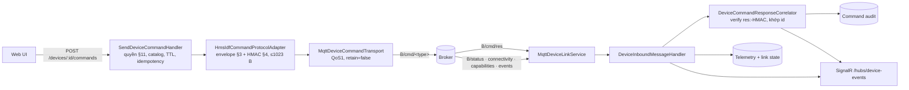

# MQTT device link — server ↔ thiết bị HMS-IDF

Trạng thái: **đã triển khai** (2026-11-06). Hợp đồng duy nhất: `HMS-IDF/engineering-docs/api/mqtt-api.md`, snapshot 2026-10-28, cùng `http-api.md` cho `/api/security/keys`. Không đọc source firmware.

Tài liệu này thay thế luồng "Node bridge → HTTP ingest" trong [architecture-real-device-mqtt-integration.md](architecture-real-device-mqtt-integration.md). Envelope `req_id/client_id/params` trong `plans/261001-0030-full-hardware-mqtt-apis-c2/phase-02-live-mqtt-transport.md` sai spec và **không** được dùng.

## Luồng



`B = <topic_prefix>/<device_id>`, lấy từ binding của từng thiết bị. Server không bao giờ tự đoán prefix.

| Thành phần | File |
|---|---|
| Port + state (binding, link state, pending, reply store) | `src/Hms.Server.Application/DeviceLink/DeviceLinkContracts.cs` |
| Correlator, inbound handler, bind/import-key handler | `src/Hms.Server.Application/DeviceLink/DeviceLinkHandlers.cs` |
| Envelope, ký, verify reply | `src/Hms.Server.Infrastructure/Commands/HmsIdfCommandCodec.cs` |
| Protocol adapter | `src/Hms.Server.Infrastructure/Commands/HmsIdfCommandProtocolAdapter.cs` |
| MQTTnet session, subscribe, publish, sweep timeout | `src/Hms.Server.Infrastructure/Mqtt/MqttDeviceLinkService.cs` |
| Transport | `src/Hms.Server.Infrastructure/Mqtt/MqttDeviceCommandTransport.cs` |
| Bảng `device_mqtt_bindings` | migration `AddDeviceMqttBindings` |

MQTT chỉ nằm trong Infrastructure, theo ADR modular monolith 260927. Service MQTT không chứa logic theo action.

## Quy tắc đã thực thi (spec → code)

- **Envelope** (§3): `type,id,ts(giây),ttl_ms[,key_ver][,confirm][,dry_run],data{action[,data]}`, `sig` nằm cuối.
  - Raw UTF-8, không key trùng (kể cả khác hoa/thường), không NUL, nesting ≤16.
  - Tổng ≤1023 byte **sau** khi gắn sig; quá cỡ thì `COMMAND_TOO_LARGE`, không publish.
- **Ký** (§4): `HMAC-SHA256(key32, bytes)`; reply verify bằng `HMAC(key, "res:"+body)`.
  - Test vector được tính độc lập bằng Node crypto (`tests/.../DeviceLinkTests.cs`).
- **Confirm** (§7): token phải đúng template với **MQTT device id**, ví dụ `REBOOT-gateway_870c`. Dùng GUID server thì bị `CONFIRM_MISMATCH`.
- **Key**: chỉ dùng key đã cấp/import cho đúng `KeyGeneration`. Không có key thì `COMMAND_KEY_NOT_PROVISIONED`, không publish. Key không bao giờ được trả ra API.
- **Capabilities** (§2): khi đã nhận `B/capabilities`, action không `available` bị chặn với `DEVICE_ACTION_UNAVAILABLE`.
- **Reply** (§5, R3): kết quả được ánh xạ như sau.

  | Thiết bị trả về | Status | Code | Detail |
  |---|---|---|---|
  | `success:true` | `Executed` | `DEVICE_EXECUTED` | — |
  | `accepted+pending` | `Acknowledged` | `DEVICE_ACCEPTED` | `operation_id` |
  | `success:false` | `Failed` | `DEVICE_REJECTED` | `error[: data.error]` |

  - Reply của client khác trên cùng topic thì bỏ qua.
  - Chữ ký sai thì command vẫn giữ trạng thái pending.
- **Timeout** (R4): sau 30 giây không có reply thì `Failed/DEVICE_RESPONSE_TIMEOUT`, nghĩa là *không rõ outcome*: phải đọc lại trạng thái trước khi gửi lại với id mới.
- **Audit**: `Published` đến muộn không bao giờ ghi đè outcome của thiết bị.
- **Action mở** (`PinnedCommandCatalog.EnabledActions` và `PhysicalOutputActions`): 28 action.
  - 11 action đọc gốc: 9 action read `SLICE_PASS` của snapshot spec, cộng `system.ping` và `system.get_operations`.
  - 15 action đọc giám sát (xem [Lệnh đọc giám sát](#lệnh-đọc-giám-sát)).
  - `control.set_output` và `control.pulse` mở có điều kiện (xem [DO relay control](#do-relay-control)).
  - Mọi action ghi khác, gồm `control.set_all` (không atomic), vẫn ở `DENIED_UNTIL_ACTION_CONTRACT`. Modbus, tags, `sms.*`, `config.get`, `ota.remote_config_get` cũng vẫn đóng.
- **Inbound**: không bao giờ đổi lifecycle thiết bị. Broker lab cho phép anonymous, nên identity trên broker không phải bằng chứng.

## API

| Method | Route | Quyền |
|---|---|---|
| GET | `/api/v1/command-transport/status` | đăng nhập |
| GET | `/api/v1/devices/{id}/link` | scope thiết bị |
| PUT | `/api/v1/devices/{id}/link` `{topicPrefix, mqttDeviceId, keyVersion?}` | `devices.manage` + CSRF |
| PUT | `/api/v1/devices/{id}/link/command-key` `{valueHex}` | master-admin + CSRF; tăng `KeyGeneration` |
| GET | `/api/v1/devices/{id}/link/capabilities` | scope thiết bị |
| PUT | `/api/v1/devices/{id}/link/output-channels` `{channels}` | master-admin + CSRF |
| GET | `/api/v1/devices/{id}/outputs` | `gpio.do_view` trên thiết bị |
| GET | `/api/v1/devices/{id}/allowed-commands` | scope như POST (`DeviceAccessChecks.CanSendCommands`); trả `{actions: string[]}`; không đủ scope hoặc thiết bị revoke → 404 `DEVICE_NOT_FOUND` |
| GET | `/api/v1/devices/{id}/commands/{correlationId}` | scope như POST; data reply chỉ cho người gửi hoặc master-admin, và chỉ khi người gửi còn quyền của action trên thiết bị |

SignalR có thêm các event `connectivity`, `capabilities`, `device_event`, `command_result` và `outputs`. Event `command_result` chỉ chứa outcome, không chứa data, và **không được phát cho lệnh class R (đọc)**, kể cả khi reply tới hoặc khi timeout. Người đọc poll `GET .../commands/{correlationId}`. Event `outputs` chỉ chứa `readAt`, `stale`, `staleReason`.

## Cấu hình (`Mqtt`)

```json
{ "Mqtt": { "Enabled": true, "Host": "192.168.1.101", "Port": 443, "UseTls": true,
  "CaCertificatePath": "<pem>", "ClientId": "hms-server-dev", "ResponseTimeoutSeconds": 30,
  "MaxPendingReadsPerDevice": 4,
  "Devices": [ { "DeviceId": "870c870c-…", "TopicPrefix": "hms_toan_lab", "MqttDeviceId": "gateway_870c", "KeyVersion": 11 } ] } }
```

- `Enabled=false` (mặc định): dùng transport deferred. Lệnh hợp lệ trả `MQTT_DEFERRED`; adapter vẫn kiểm đầy đủ.
- `ResponseTimeoutSeconds` phải lớn hơn 20 s (TTL lớn nhất của mọi lệnh), nếu không `MQTT_TIMING_INVALID`.
- `MaxPendingReadsPerDevice` (mặc định 4, hợp lệ 1..16, ngoài khoảng → `MQTT_READ_LIMIT_INVALID`): số lệnh đọc đang chờ tối đa trên mỗi thiết bị. Chi tiết xem [Lệnh đọc giám sát](#lệnh-đọc-giám-sát).
- `Devices[]` chỉ seed trong Development. `CommandKeyHex` chỉ đặt qua user-secrets hoặc env, không commit.
- Máy dev đã có user-secrets `hms-server-api-dev` cho broker lab. Chạy server bằng cấu hình `hms-api` trong `.claude/launch.json`.

## Lab (quan sát 2026-11-06)

- Gateway `gateway_870c` kết nối Mosquitto TLS `192.168.1.101:443` do tooling HIL của team firmware dựng. CA nằm trong `%TEMP%\hms-idf-mosquitto-*`.
- Thiết bị ở chế độ `signed`. Ngày 2026-11-06 command key đã được **xoay** sang key do server sinh: trước đó là `key_version` 11, fingerprint `7b266b1a`.
  - Key được nạp qua `POST /api/security/keys`. Server không ghim `key_ver`.
  - Tooling HIL của team firmware phải dùng key mới này.
- Nạp key qua web console của thiết bị: trang "Bảo mật lệnh" dùng `confirm()` của trình duyệt, nên trong trình duyệt tích hợp của app nút Nạp không có tác dụng. Dùng Chrome/Edge, hoặc gọi thẳng HTTP API.
- Đã kiểm chứng live:
  - Chiều vào (heartbeat, connectivity, capabilities 105 action) đi tới telemetry và UI.
  - Chiều ra qua đúng broker lab với simulator độc lập theo spec (`hms_server_selftest/sim_001`): ký hợp lệ → `Executed` có data; im lặng → `DEVICE_RESPONSE_TIMEOUT`.
  - **Gateway thật, lệnh ký:** cả 11 action đã mở đều trả `Executed` với reply có `res:`-HMAC hợp lệ, mỗi lệnh khoảng 1 giây.

    | Action | Data trả về |
    |---|---|
    | `system.ping` | `alive` |
    | `system.get_info` | fw 1.0.108, IDF v5.5.5, `device_id` `gateway_870c` |
    | `system.get_heap` | — |
    | `mqtt.get_status`, `mqtt.get_config` | password được che |
    | `status.services` | — |
    | `status.dump` | 2.6 KB |
    | `status.tags` | 6.7 KB |
    | `network.get_all_status` | — |
    | `control.get_status` | 6 kênh DO |
    | `system.get_operations` | — |

## DO relay control

Trạng thái: **đã triển khai và kiểm chứng live** (2026-11-06). Plan: `plans/261106-0735-do-relay-control/`. Trên gateway thật chỉ DO1 nằm trong allowlist; DO2–DO6 chỉ kiểm chứng trên simulator.

### Action mở

| Action | Payload (đúng các key này, không thừa) | Ghi chú |
|---|---|---|
| `control.set_output` | `{channel: int ≥ 1, value: bool}` | `0`/`1` bị từ chối (`COMMAND_PAYLOAD_INVALID`) |
| `control.pulse` | `{channel: int ≥ 1, duration_ms: int 1..MaxPulseMs}` | Kênh phải ở `pulse` mode trên thiết bị |
| `control.set_all` | — | Vẫn đóng: không atomic |

- Kiểm trước khi ký: `OutputCommandPolicy.Check`. Action class B khác → `PHYSICAL_ACTION_UNSUPPORTED`.
- `Mqtt:MaxPulseMs` (`MqttLinkOptions.MaxPulseMs`): mặc định 60000, hợp lệ 1..3600000. Đây là chính sách của server; spec §6.4 để giới hạn thật cho cấu hình HTTP của thiết bị.
- TTL vật lý: `SendDeviceCommandHandler.MaxPhysicalCommandTtlMs = 10000` kẹp TTL lệnh class B xuống 10 s. `ttl_ms` trên envelope cũng ≤ 10000. Các lệnh khác bị kẹp ở `MaxCommandTtlMs = 20000` (xem [Lệnh đọc giám sát](#lệnh-đọc-giám-sát)).
- `Mqtt:ResponseTimeoutSeconds` (mặc định 30) phải lớn hơn 20 s, nếu không `MqttLinkOptions.Validate` ném `MQTT_TIMING_INVALID`. Lý do: thiết bị kiểm TTL khi lệnh rời hàng đợi của nó. Nếu server đã báo timeout mà lệnh còn hạn, lệnh vẫn có thể chạy sau đó, và operator không biết trạng thái thật.

### Allowlist kênh

- Mặc định đóng: `null` hoặc rỗng nghĩa là không kênh nào được điều khiển (`DO_CHANNEL_NOT_ALLOWED`, không ký).
- Giá trị hợp lệ: tối đa 32 phần tử, mỗi số 1..255, không trùng (`DeviceMqttBinding.ValidateOutputChannels`, lỗi `OUTPUT_CHANNELS_INVALID`). Lưu ở cột `AllowedOutputChannels` (`varchar(200)`) của `device_mqtt_bindings`.
- Chỉ master-admin đổi: `PUT /api/v1/devices/{id}/link/output-channels` `{"channels": [1]}`, có CSRF. Không phải master-admin → 403; dữ liệu sai → 400; chưa có binding → 409 `DEVICE_MQTT_BINDING_MISSING`. Mỗi lần đổi được ghi log cảnh báo kèm danh sách trước/sau.
- Re-bind:
  - `PUT /link` cùng topic base: giữ nguyên allowlist.
  - Đổi sang topic base khác: allowlist về đóng và xoá trạng thái DO đã cache (`IDeviceOutputStateStore.Clear`).
- Dev seed: `Mqtt:Devices:N:AllowedOutputChannels` (`MqttDeviceSeedOptions`), chỉ đọc khi Development. Không khai báo thì đóng.

### Trạng thái DO đã xác minh

- Chỉ được ghi từ reply `control.get_status` đã xác minh chữ ký (`DeviceReplyProjection`). Heartbeat, device event và `POST /telemetry` không ghi được.
- Store là in-memory (`IDeviceOutputStateStore`). Sau restart chưa có state, API trả 404 `OUTPUTS_NOT_READ`, UI phải đọc lại.
- `GET /api/v1/devices/{id}/outputs` (`DeviceLinkController.Outputs`) cần `gpio.do_view` trên thiết bị, thiếu quyền → 403 `DEVICE_PERMISSION_REQUIRED`. Trả `channels[{channel, state, mode, pulseActive}]`, `readAt`, `stale`, `staleReason`.
- Event `outputs` không có dữ liệu relay. Người xem phải gọi lại endpoint trên.
- Telemetry: `digital_outputs`/`digitalOutputs` bị gỡ khỏi heartbeat `status` và khỏi telemetry lưu (`TelemetryRelayStates`). **Contract change:** `GET /api/v1/devices/{id}/telemetry` không còn trả `digital_outputs`.

Đánh dấu stale (`staleReason`):

| Reason | Đặt khi |
|---|---|
| `output_command_executed` | Lệnh DO trả `Executed`, chưa đọc lại |
| `output_command_outcome_unknown` | Lệnh DO không `Executed` và không bị từ chối trước handler; hoặc hết thời gian chờ (`DEVICE_RESPONSE_TIMEOUT`) |
| `device_rebooted` | Heartbeat có uptime nhỏ hơn lần trước |
| `device_offline` | Connectivity `offline` |

- Spec R3: chỉ các lỗi từ chối trước handler giữ nguyên state: `expired`, `future_timestamp`, `LANE_FULL`, `unknown_action`, `confirm_required`, `permission_unmapped`, `schema:*`. `UNAUTHORIZED` (dedup) vẫn là unknown, vì lần gửi đầu có thể đã chạy.
- Projection chạy trước khi ghi audit. Sweep timeout đánh stale trước, và mỗi lệnh có try/catch riêng.

### Audit

- Cột `command_audits.IssuedBy` (người gửi), `Detail` (varchar 1024, lý do từ thiết bị), `PayloadSummary` (JSON payload, varchar 512, chỉ với class physical/destructive/flash).
- Khi khởi động, `FailUnfinished("OUTCOME_UNKNOWN_AFTER_RESTART")` (`Program.cs`) đổi mọi row `Published` và `IN_FLIGHT` thành `Failed` với code `OUTCOME_UNKNOWN_AFTER_RESTART`.
- Kết quả transport muộn (`Published`, `MQTT_PUBLISH_UNCONFIRMED`) không ghi đè outcome mà thiết bị đã báo (`CommandTransportOutcome.IsTransportOnly`).

### UI (`DeviceOutputsPanel.vue`)

- Đây là đường ghi DO duy nhất. `DeviceCommandModal` ẩn `control.set_output`, `control.pulse`, `control.set_all` (`PANEL_ONLY_ACTIONS`).
- Panel hiện cho mọi thiết bị có MQTT binding, kể cả khi chưa có telemetry.
- Quy tắc khoá kênh (`useDeviceCommand.ts`, `certainlyNotSent`):

| Kết quả | Hành vi |
|---|---|
| `ContractUnavailable`, `TransportNotConfigured`, `MQTT_NOT_CONNECTED`, `MQTT_RESPONSE_SUBSCRIPTION_MISSING`, `MQTT_COMMAND_TOPIC_INVALID`, hoặc HTTP 4xx | Mở khoá ngay, hiện lỗi |
| `Executed`, `DEVICE_REJECTED`, timeout, HTTP 5xx, mất kết nối, `IDEMPOTENCY_OUTCOME_UNKNOWN`, các trường hợp khác | Giữ khoá, đọc lại (tối đa 2 lần) |
| Pulse | Sau khi hết xung + 1 s, đọc lại thêm một lần |

- Thiết bị offline hoặc broker server mất kết nối: mọi kênh hiện **Không rõ**, vẫn có nút Bật/Tắt kèm cảnh báo. "Đọc lúc" hiện giờ đọc và tuổi của lần đọc.
- Pulse: số nguyên 1..60000 ms, mặc định 1000 ms. Ngoài khoảng thì không gửi.

### Simulator

`tools/mqtt-broker/spec-device-simulator.js` là bản mô phỏng độc lập theo spec: kiểm chữ ký thật, trả reply `res:`-HMAC, 6 kênh (DO6 ở pulse mode, còn lại toggle). Cấu hình chỉ qua biến môi trường, không có key trong repo.

```powershell
$env:SIM_MQTT_URL   = "mqtts://192.168.1.101:443"
$env:SIM_CA_PATH    = "<PEM của CA broker, ngoài repo>"
$env:SIM_TOPIC_BASE = "hms_server_selftest/sim_001"   # phải được bind trên server trước
$env:SIM_KEY_FILE   = "<file 64 ký tự hex, ngoài repo>"
$env:SIM_SILENT     = "control.set_output"           # tuỳ chọn: không trả reply, để test R4
node tools/mqtt-broker/spec-device-simulator.js
```

- `SIM_KEY_FILE`: đường dẫn tới file key, nội dung không bao giờ được paste vào repo, log hay tài liệu.
- `SIM_SILENT`: danh sách `type.action` bị bỏ qua. Dùng để kiểm timeout `DEVICE_RESPONSE_TIMEOUT` sau 30 s.
- `SIM_HEARTBEAT_SECONDS` (mặc định 5): simulator gửi `<base>/status` định kỳ. Với `0`, không có heartbeat nào và server coi thiết bị là offline (heartbeat cũ hơn 15 s không còn tính là online).
- Các biến khác: `SIM_SECONDS`, `SIM_CHANNELS` (mặc định 6), `SIM_PULSE_CHANNELS` (mặc định 6).

### Kết quả kiểm chứng

Gateway thật (`gateway_870c`, allowlist chỉ có DO1):

| Bước | Kết quả |
|---|---|
| 1. Đọc trạng thái | 6 kênh, đều `toggle`, đều OFF |
| 2. DO1 Bật | `Executed` → `output_command_executed` → đọc lại ON (≈2 s) → mở khoá |
| 3. DO1 Tắt | Đọc lại OFF (≈2 s) |
| 4. `set_output` DO2 qua API | `DO_CHANNEL_NOT_ALLOWED`, từ chối trước khi ký. Sniffer trên `.../cmd/#` cả phiên: 9 lệnh (5 `get_status`, 2 `set_output` DO1, 2 `pulse` DO1), không lệnh nào tới DO2–DO6; bộ đếm thiết bị sau đó: DO1 `totalCommands 2`, DO2–DO6 `0` |
| 5. `pulse` DO1 (toggle) | `DEVICE_REJECTED`, `ESP_ERR_INVALID_ARG`; stale `output_command_outcome_unknown`; đọc lại OK |
| 6. Allowlist `[]` rồi `set_output` DO1 | `DO_CHANNEL_NOT_ALLOWED`; allowlist sau đó được đặt lại `[1]` |
| Kết thúc | DO1 OFF, allowlist về `[]` |

Simulator (`hms_server_selftest/sim_001`):

| Kịch bản | Kết quả |
|---|---|
| `set_output` khi chưa có allowlist | `DO_CHANNEL_NOT_ALLOWED` |
| DO3 ON, rồi OFF | Executed → stale → đọc lại đúng state |
| `pulse` DO6 1500 ms | Executed; đọc giữa xung thấy ON · đang xung; đọc sau xung + 1 s thấy OFF |
| `pulse` trên kênh toggle | `DEVICE_REJECTED` |
| Payload xấu (`value:"1"`, `duration_ms:70000`, channel 7) | `COMMAND_PAYLOAD_INVALID` / `DO_CHANNEL_NOT_ALLOWED`; không tới simulator |
| `SIM_SILENT=control.set_output` | Khoá giữ trong 30 s, `DEVICE_RESPONSE_TIMEOUT`, tự đọc lại, mở khoá |
| Restart giữa lệnh | Chưa chạy live (dev dùng DB in-memory). Kiểm bằng `PhysicalOutputSafetyTests.Commands_a_previous_run_left_unfinished_become_outcome_unknown` và `PersistenceModelTests.Ef_command_audit_fails_what_a_previous_run_left_unfinished_and_keeps_device_outcomes` |

**Spec gap (gateway thật):** `pulse` trên kênh toggle bị thiết bị trả `ESP_ERR_INVALID_ARG` với text `Channel is in toggle mode, use set_output`. Spec §6.4 nói kênh phải ở pulse mode nhưng không định nghĩa mã lỗi. Simulator trả cùng mã và text.

### Rủi ro còn lại

- **Broker lab cho anonymous:** lệnh đã ký có thể bị bắt và replay. Sau khi thiết bị reboot, dedup mất; khi đồng hồ thiết bị chưa sync, không có kiểm tra tuổi lệnh. Cách khắc phục thật là ACL và xác thực trên broker (xem mục Gap, dòng về danh tính/ACL).
- **Store DO in-memory:** sau restart phải đọc lại. Hành vi restart chỉ kiểm bằng test.
- **Client gửi `RequestedAt` lệch tới +60 s** (`SendDeviceCommandHandler`, chưa sửa): lệnh đã ký có thể còn hiệu lực tới khoảng +80 s (+60 s và TTL 20 s), vượt timeout 30 s. UI không gửi trường này; script API thì có thể.
- **Dev seed áp lại allowlist mỗi lần khởi động** (`Program.cs`, chưa sửa): khởi động lại sẽ mở lại kênh đã bị đóng qua API. Chỉ dev, nhưng dev đang điều khiển relay lab thật.
- **Read-back bị `DEVICE_READ_BUSY`:** UI đã chờ 1.5 s rồi thử lại một lần. Nhưng server vẫn chỉ ghi audit row cho lần từ chối này, không có log riêng; log có cấu trúc chỉ có cho lệnh bị từ chối trước khi có audit.
- **`PayloadSummary` lưu nguyên payload:** hiện các action class D/F đang đóng nên chưa lộ gì. Trước khi mở OTA hoặc action có token, phải thêm redaction theo action.

## Lệnh đọc giám sát

Trạng thái: **đã triển khai và kiểm chứng live** (2026-11-06). Plan: `plans/261106-1040-monitoring-read-actions/`. Cả 15 lệnh đều `Executed` trên gateway thật.

Mở trước chiến dịch spec theo quyết định owner: đây là lệnh chỉ đọc, và reply của từng lệnh được đối chiếu với §6 trên gateway thật. Server vẫn ghim catalog `83e93d77e`. Modbus và tags vẫn đóng cho tới khi HMS-IDF commit firmware và sửa số đếm §11 (đặc tả ghi 98 cặp, bảng có 104; generator từ chối bản `18a63e8ed`).

### Action mở và quyền firmware

| Thẻ UI | Action | Quyền firmware |
|---|---|---|
| Thiết bị & thời gian | `system.get_time`, `system.get_hostname` | `sys.time_view`, `sys.hostname_view` |
| | `system.get_device_id`, `ota.get_status` | `sys.info_view` |
| Mạng | `network.get_priority` | `net.priority_view` |
| | `network.get_ethernet` / `network.get_modem` | `eth.view` / `modem.view` |
| | `network.wifi_sta_status` / `network.wifi_ap_status` | `wifi.sta_view` / `wifi.ap_view` |
| Nguồn & ADC | `battery.get_status`, `battery.get_alerts` | `sys.battery_view` |
| | `adc.get_config`, `adc.get_channels`, `adc.get_values` | `adc.view` |
| Chỉ C2 modal | `adc.get_status` | `adc.view` |

- Cả 15 là class R và đã có trong catalog ghim. Không có mã quyền mới.
- **Mở quyền ngầm:** role đang giữ `sys.time_view`, `sys.hostname_view`, `sys.info_view`, `net.priority_view`, `eth.view`, `modem.view`, `wifi.sta_view`, `wifi.ap_view`, `sys.battery_view` hoặc `adc.view` đọc được lệnh tương ứng ngay. Rà role trước khi cấp các mã này.
- Vẫn đóng: `sms.*`, `config.get`, `ota.remote_config_get`, `broker.*`, `network.wifi_ap_clients`, `network.wifi_scan_results`, mọi lệnh ghi, Modbus và tags.

### Giới hạn hàng đợi thiết bị

Hàng đợi lệnh của thiết bị nhỏ và dùng chung giữa lệnh đọc và lệnh relay. Server giới hạn lệnh đọc để không làm đầy hàng đợi:

| Quy tắc | Giá trị | Ghi chú |
|---|---|---|
| Lệnh đọc đang chờ trên mỗi thiết bị | 4 (`Mqtt:MaxPendingReadsPerDevice`) | Vượt → `ContractUnavailable` / `DEVICE_READ_BUSY`, không publish |
| Phần của mỗi người gửi | 2 (một nửa) | Một người chạy vòng lặp không chiếm hết slot của người khác |
| Read-back relay `control.get_status` | +1 slot ngoài giới hạn | Luôn xác minh được trạng thái sau lệnh relay |
| Lệnh vật lý (class B) | Không bị giới hạn | |
| Thời điểm giải phóng slot | `ExpiresAt + 2 s` | Thiết bị đã bỏ lệnh khi hết TTL |

- Lệnh bị từ chối đã được ký rồi bỏ, không publish. Cap nằm trong transport, sau adapter. Không có rủi ro bảo mật vì không có gì được gửi.
- Lệnh bị từ chối vẫn có audit row `DEVICE_READ_BUSY`.

### TTL

- Lệnh không vật lý: `ttl_ms` ≤ 20000 (`SendDeviceCommandHandler.MaxCommandTtlMs`). Lệnh relay: ≤ 10000 (`MaxPhysicalCommandTtlMs`).
- Lý do 20 s: thiết bị kiểm tuổi lệnh khi lệnh rời hàng đợi (spec §3). Với 10 s, thiết bị có đồng hồ nhanh hơn khoảng 9 s sẽ từ chối mọi lệnh đọc, kể cả `system.get_time` và `system.ping` dùng để chẩn đoán. Với 20 s, dung sai xấp xỉ 19 s, trừ thời gian truyền.
- `GET /api/v1/me/command-catalog` vẫn trả `ttlMs` gốc của catalog (ví dụ 120000 cho `config.get`). Đó không phải TTL gửi đi.

### Realtime và đọc kết quả

- Lệnh đọc không phát `command_result`, kể cả khi reply tới hoặc timeout. Thẻ tự poll `GET .../commands/{correlationId}` tới khi có outcome.
- "Last Heartbeat" đổi theo event `status`. `connectivity` chỉ làm mới trạng thái link.
- Correlator lưu data reply trước khi ghi audit `Executed`, nên poll thấy `Executed` thì cũng thấy data.

### allowed-commands

- `GET /api/v1/devices/{id}/allowed-commands` → `{"actions":["system.get_time","network.get_ethernet"]}`.
- Trả các action đang mở mà người gọi được gửi trên thiết bị. Quyền được resolve một lần mỗi request, theo đúng scope của POST.
- Chỉ là gợi ý cho UI (`no-store`), không phải ranh giới bảo mật. `POST .../commands` vẫn kiểm lại đầy đủ.
- Hiện chỉ thẻ đọc dùng. Modal C2 chưa dùng (ngoài phạm vi plan).

### Ba thẻ đọc

Trang thiết bị (`DeviceDetailView.vue`) hiện ba thẻ, đều đọc theo yêu cầu: `DeviceInfoTimeCard.vue`, `DeviceNetworkCard.vue`, `DevicePowerAdcCard.vue` (trong `frontend/src/features/devices/components/reads/`). Logic đọc nằm ở `frontend/src/core/commands/useDeviceReads.ts`.

- Đọc khi người dùng bấm. Các lệnh chạy tuần tự, huỷ được, không chạy chồng.
- Nút đọc chỉ bật khi catalog đã xác minh và danh sách `allowed-commands` đã tải. Lệnh không được phép không được gửi.
- Mỗi lệnh có giờ đọc riêng. Đọc lỗi thì xoá giá trị cũ.
- Lỗi hiện mã và chi tiết: `CATALOG_STALE`, thiếu quyền, `DEVICE_READ_BUSY` / `LANE_FULL`, thiết bị offline.
- Khi bận, thử lại đúng một lần sau 2 s (`RETRY_DELAY_MS`).
- Dữ liệu chỉ thuộc thiết bị đang xem. Reply không nhận ra cấu trúc thì hiện JSON thô.

### Chạy công cụ kiểm tra

```powershell
$env:HMS_ADMIN_EMAIL    = "<email tài khoản HMS>"
$env:HMS_ADMIN_PASSWORD = "<mật khẩu>"
node tools/device-read-check.js <deviceId> system.get_time network.get_ethernet
node tools/device-read-check.js <deviceId> --burst 6 system.get_info   # kiểm cap
```

- Công cụ đi qua API, server ký. Không cần command key của thiết bị.
- Credential chỉ lấy từ biến môi trường (`tools/tool-env.js`). `HMS_API_BASE` mặc định `http://127.0.0.1:5099`.
- Reply đầy đủ ghi vào `tools/device-reads/` (gitignored). Reply chứa MAC, SSID, IP: không commit, không dán vào tài liệu hay issue. Fixture đã ẩn danh: `frontend/src/features/devices/components/reads/fixtures/lab-gateway-replies.json`.

### Kết quả kiểm chứng (`gateway_870c`, firmware 1.0.108)

| Kết quả | Action |
|---|---|
| Khớp §6 (11) | `system.get_hostname`, `system.get_device_id`, `network.get_priority`, `network.get_ethernet`, `network.get_modem`, `network.wifi_sta_status`, `battery.get_status`, `battery.get_alerts`, `adc.get_config`, `adc.get_channels`, `adc.get_values` |
| Spec gap (4) | `ota.get_status`, `network.wifi_ap_status`, `adc.get_status`, `system.get_time` |

Spec gap:

1. `ota.get_status`: `data` lồng thêm một cấp (`{success, data: {firmware, partition, ota, rollback}}`). Spec không nêu tên field. Thẻ đã bóc lớp này.
2. `network.wifi_ap_status` khi AP tắt: không có `channel`, `client_count`. Có thêm `password_set`, `autoOffMinutes`, `timerRunning`, `timerRemainingMs`.
3. `adc.get_status`: kênh có `ai`, còn spec chỉ liệt kê value/unit/quality/raw. Thẻ không dùng action này để ghép kênh.
4. `system.get_time`: có thêm `ntp_servers`, `ntp_mode`.

Kết quả khác:

- Burst 6 `system.get_info` từ một user: 2 `Executed`, 4 `DEVICE_READ_BUSY` trong ~10 ms. Thiết bị không bỏ lệnh nào.
- Ba thẻ cùng lúc: 15 lệnh xong trong ~8 s, không lỗi. Một lần bận được thử lại sau 2 s.
- Sniffer trên `cmd/#`: số message khớp số lệnh đã publish, mọi lệnh đọc có `ttl_ms: 20000`, không có lệnh ghi nào.
- Chưa kiểm dữ liệu ADC thật: lab không có cảm biến (`WIRE_BREAK`).

### Rủi ro còn lại

- **Cap theo tiến trình server:** bộ đếm nằm trong bộ nhớ (`InMemoryPendingDeviceCommandRegistry`). Nhiều instance thì mỗi instance có giới hạn riêng, tổng có thể vượt. Hiện giả định một instance.
- **Broker lab anonymous:** reply đọc là plaintext đã ký, ai trên broker cũng đọc được, gồm MAC, SSID, IP. Replay lệnh đọc vô hại nhưng lộ thông tin mạng. Cần ACL và xác thực broker (xem Gap).
- **Audit không có retention:** mỗi lần đọc, kể cả lần bị từ chối vì bận, thêm một dòng `command_audits`. Chưa có chính sách xoá. Index `IX_command_audits_Status` phục vụ sweep khi khởi động.
- **Dung sai đồng hồ:** relay (10 s) bị từ chối khi đồng hồ lệch quá dung sai. Đọc có dung sai xấp xỉ 19 s.
- **Global lock:** `TryRegisterRead` quét mọi pending command dưới một khoá. Ổn ở quy mô lab, cần bộ đếm theo thiết bị khi fleet lớn.

## Gap của spec (giữ cho user, không gửi firmware nếu chưa được yêu cầu)

- Thuật toán `fingerprint` của `GET /api/security/keys` không được định nghĩa, nên server không xác minh được key import có khớp thiết bị không.
- Không có cách lấy `key_version` qua MQTT, chỉ qua HTTP.
- Danh tính/ACL broker cho server chưa được định nghĩa (broker lab là anonymous).
- Telemetry SIGN/ENCRYPT (§9) chưa làm vì thiết bị chưa có key `tlm_*`.
