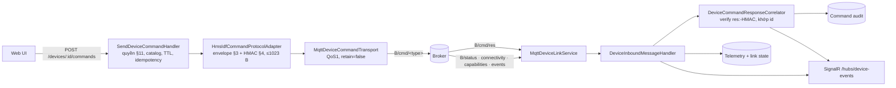

# MQTT device link — server ↔ thiết bị HMS-IDF

Trạng thái: **đã triển khai** (2026-11-06). Hợp đồng duy nhất: `HMS-IDF/engineering-docs/api/mqtt-api.md`, snapshot 2026-10-28, cùng `http-api.md` cho `/api/security/keys`. Không đọc source firmware.

Tài liệu này thay thế luồng "Node bridge → HTTP ingest" trong [architecture-real-device-mqtt-integration.md](architecture-real-device-mqtt-integration.md). Envelope `req_id/client_id/params` trong `plans/261001-0030-full-hardware-mqtt-apis-c2/phase-02-live-mqtt-transport.md` sai spec và **không** được dùng.

## Luồng



`B = <topic_prefix>/<device_id>`, lấy từ binding của từng thiết bị. Server không bao giờ tự đoán prefix.

| Thành phần | File |
|---|---|
| Port + state (binding, link state, pending, reply store) | `src/Hms.Server.Application/DeviceLink/DeviceLinkContracts.cs` |
| Correlator, inbound handler, bind/import-key handler | `src/Hms.Server.Application/DeviceLink/DeviceLinkHandlers.cs` |
| Envelope, ký, verify reply | `src/Hms.Server.Infrastructure/Commands/HmsIdfCommandCodec.cs` |
| Protocol adapter | `src/Hms.Server.Infrastructure/Commands/HmsIdfCommandProtocolAdapter.cs` |
| MQTTnet session, subscribe, publish, sweep timeout | `src/Hms.Server.Infrastructure/Mqtt/MqttDeviceLinkService.cs` |
| Transport | `src/Hms.Server.Infrastructure/Mqtt/MqttDeviceCommandTransport.cs` |
| Bảng `device_mqtt_bindings` | migration `AddDeviceMqttBindings` |

MQTT chỉ nằm trong Infrastructure, theo ADR modular monolith 260927. Service MQTT không chứa logic theo action.

## Quy tắc đã thực thi (spec → code)

- **Envelope** (§3): `type,id,ts(giây),ttl_ms[,key_ver][,confirm][,dry_run],data{action[,data]}`, `sig` nằm cuối.
  - Raw UTF-8, không key trùng (kể cả khác hoa/thường), không NUL, nesting ≤16.
  - Tổng ≤1023 byte **sau** khi gắn sig; quá cỡ thì `COMMAND_TOO_LARGE`, không publish.
- **Ký** (§4): `HMAC-SHA256(key32, bytes)`; reply verify bằng `HMAC(key, "res:"+body)`.
  - Test vector được tính độc lập bằng Node crypto (`tests/.../DeviceLinkTests.cs`).
- **Confirm** (§7): token phải đúng template với **MQTT device id**, ví dụ `REBOOT-gateway_870c`. Dùng GUID server thì bị `CONFIRM_MISMATCH`.
- **Key**: chỉ dùng key đã cấp/import cho đúng `KeyGeneration`. Không có key thì `COMMAND_KEY_NOT_PROVISIONED`, không publish. Key không bao giờ được trả ra API.
- **Capabilities** (§2): khi đã nhận `B/capabilities`, action không `available` bị chặn với `DEVICE_ACTION_UNAVAILABLE`.
- **Reply** (§5, R3): kết quả được ánh xạ như sau.

  | Thiết bị trả về | Status | Code | Detail |
  |---|---|---|---|
  | `success:true` | `Executed` | `DEVICE_EXECUTED` | — |
  | `accepted+pending` | `Acknowledged` | `DEVICE_ACCEPTED` | `operation_id` |
  | `success:false` | `Failed` | `DEVICE_REJECTED` | `error[: data.error]` |

  - Reply của client khác trên cùng topic thì bỏ qua.
  - Chữ ký sai thì command vẫn giữ trạng thái pending.
- **Timeout** (R4): sau 30 giây không có reply thì `Failed/DEVICE_RESPONSE_TIMEOUT`, nghĩa là *không rõ outcome*: phải đọc lại trạng thái trước khi gửi lại với id mới.
- **Audit**: `Published` đến muộn không bao giờ ghi đè outcome của thiết bị.
- **Action mở** (`PinnedCommandCatalog.EnabledActions`):
  - 9 action read `SLICE_PASS` của snapshot spec, cộng `system.ping` và `system.get_operations`.
  - Mọi action ghi vẫn ở `DENIED_UNTIL_ACTION_CONTRACT`.
- **Inbound**: không bao giờ đổi lifecycle thiết bị. Broker lab cho phép anonymous, nên identity trên broker không phải bằng chứng.

## API

| Method | Route | Quyền |
|---|---|---|
| GET | `/api/v1/command-transport/status` | đăng nhập |
| GET | `/api/v1/devices/{id}/link` | scope thiết bị |
| PUT | `/api/v1/devices/{id}/link` `{topicPrefix, mqttDeviceId, keyVersion?}` | `devices.manage` + CSRF |
| PUT | `/api/v1/devices/{id}/link/command-key` `{valueHex}` | master-admin + CSRF; tăng `KeyGeneration` |
| GET | `/api/v1/devices/{id}/link/capabilities` | scope thiết bị |
| GET | `/api/v1/devices/{id}/commands/{correlationId}` | scope; data reply chỉ cho người gửi hoặc master-admin |

SignalR có thêm các event `connectivity`, `capabilities`, `device_event` và `command_result`. Event `command_result` chỉ chứa outcome, không chứa data.

## Cấu hình (`Mqtt`)

```json
{ "Mqtt": { "Enabled": true, "Host": "192.168.1.101", "Port": 443, "UseTls": true,
  "CaCertificatePath": "<pem>", "ClientId": "hms-server-dev", "ResponseTimeoutSeconds": 30,
  "Devices": [ { "DeviceId": "870c870c-…", "TopicPrefix": "hms_toan_lab", "MqttDeviceId": "gateway_870c", "KeyVersion": 11 } ] } }
```

- `Enabled=false` (mặc định): dùng transport deferred. Lệnh hợp lệ trả `MQTT_DEFERRED`; adapter vẫn kiểm đầy đủ.
- `Devices[]` chỉ seed trong Development. `CommandKeyHex` chỉ đặt qua user-secrets hoặc env, không commit.
- Máy dev đã có user-secrets `hms-server-api-dev` cho broker lab. Chạy server bằng cấu hình `hms-api` trong `.claude/launch.json`.

## Lab (quan sát 2026-11-06)

- Gateway `gateway_870c` kết nối Mosquitto TLS `192.168.1.101:443` do tooling HIL của team firmware dựng. CA nằm trong `%TEMP%\hms-idf-mosquitto-*`.
- Thiết bị đang ở chế độ `signed`, có command key, `key_version` 11. **Không xoay key** khi chưa thống nhất: tooling HIL của team firmware dùng chung key này.
- Đã kiểm chứng live:
  - Chiều vào (heartbeat, connectivity, capabilities 105 action) đi tới telemetry và UI.
  - Chiều ra qua đúng broker lab với simulator độc lập theo spec (`hms_server_selftest/sim_001`): ký hợp lệ → `Executed` có data; im lặng → `DEVICE_RESPONSE_TIMEOUT`.
  - Lệnh ký tới gateway thật cần key: `PUT …/link/command-key`.

## Gap của spec (giữ cho user, không gửi firmware nếu chưa được yêu cầu)

- Thuật toán `fingerprint` của `GET /api/security/keys` không được định nghĩa, nên server không xác minh được key import có khớp thiết bị không.
- Không có cách lấy `key_version` qua MQTT, chỉ qua HTTP.
- Danh tính/ACL broker cho server chưa được định nghĩa (broker lab là anonymous).
- Telemetry SIGN/ENCRYPT (§9) chưa làm vì thiết bị chưa có key `tlm_*`.
