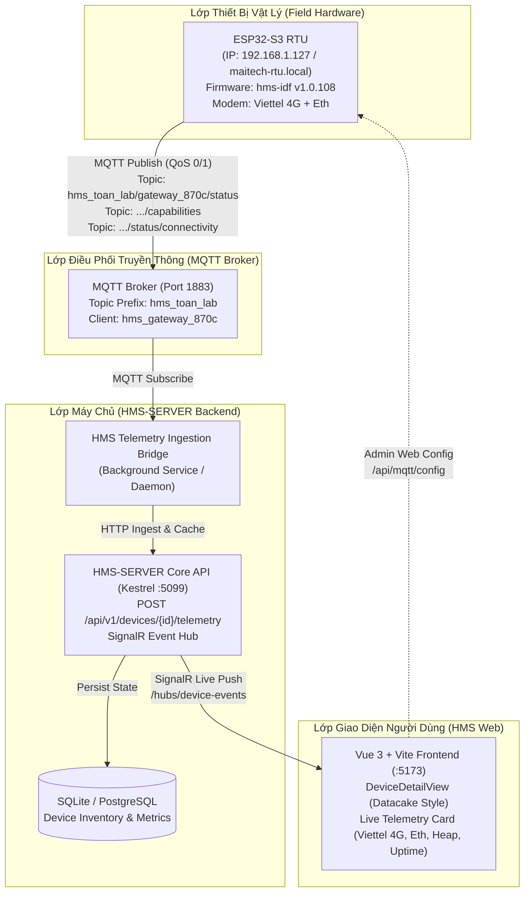

# Kiến Trúc Tích Hợp Thiết Bị Thật ESP32-S3 (maitech-rtu.local) & MQTT Broker vào HMS-SERVER

## 1. Bối cảnh & Mục tiêu

* **Thiết bị thật**: Bo mạch phần cứng ESP32-S3 RTU đang hoạt động trên mạng nội bộ LAN tại `http://maitech-rtu.local` (IP: `192.168.1.127`, firmware từ `hms-idf` v1.0.108).
* **Ràng buộc tiên quyết**: Chỉ tương tác và cấu hình thiết bị qua Web/HTTP API (`http://maitech-rtu.local/api/...`), không nạp hay sửa mã nguồn trực tiếp trên phần cứng.
* **Mục tiêu**:
  1. Thiết lập hạ tầng MQTT Broker làm cầu nối trung gian tin cậy.
  2. Cấu hình con ESP32 thật kết nối thành công vào broker và truyền phát telemetry thời gian thực.
  3. Đăng ký/đưa thiết bị thật `MAITECH-RTU-870C` vào HMS-SERVER.
  4. Xây dựng dịch vụ Ingestion & Bridge để thu thập dữ liệu telemetry, cập nhật trạng thái `Active`/`Online` và hiển thị trực quan trên giao diện Datacake Parity của Web UI.

---

## 2. Mô hình Kiến trúc Luồng Dữ liệu (Data Flow Architecture)



---

## 3. Đặc tả Hợp đồng Dữ liệu (Data Contracts)

### 3.1. Telemetry Topic Mapping
* **Topic Định danh & Trạng thái sống**: `hms_toan_lab/gateway_870c/status/connectivity`
  * Payload: `{"state": "online" | "offline"}`
* **Topic Trạng thái phần cứng & Mạng**: `hms_toan_lab/gateway_870c/status`
  * Payload mẫu từ thiết bị thật:
    ```json
    {
      "uptime_seconds": 438471,
      "free_heap": 1466815,
      "psram_free": 1374100,
      "internal_free": 92579,
      "mqtt_connected": true,
      "network_connected": true,
      "tag_count": 62,
      "service_count": 23,
      "network": {
        "ethernet": { "enabled": true, "connected": true, "ip": "192.168.1.127" },
        "modem": { "state": "CONNECTED", "carrier": "Viettel", "rssi": 23, "bars": 5, "ip": "26.15.253.98" },
        "active_uplink": "Ethernet"
      }
    }
    ```
* **Topic Khả năng & Lệnh**: `hms_toan_lab/gateway_870c/capabilities`
  * Chứa danh mục 42 hành động điều khiển (system, config, adc, battery, broker, modbus, mqtt, ota, network, control).

### 3.2. Cấu trúc Quản lý Thiết bị trong HMS-SERVER
* **Device ID**: `a74041f1-04cd-4270-a8a7-d6985e306f17`
* **Device Name**: `MAITECH-RTU-870C`
* **Hardware Profile**: ESP32-S3 WROOM-1 + LAN8720 Ethernet + A7600C 4G Modem (Viettel)
* **Organization**: `Station Alpha - Solar Array` (`d6f91ab9-f441-4d6a-a19c-eb5992c3e7c3`)

---

## 4. Mô hình An toàn & Vận hành (Security & Operational Model)

1. **Firewall Resilience**:
   * ESP32 và Server đều kết nối Outbound tới broker cổng 1883, không bị cản trở bởi chính sách chặn Inbound của Windows Firewall trên profile mạng Public.
2. **Web-Only Device Control**:
   * Toàn bộ cấu hình mạng, broker, reconnect, ping test của ESP32 được thực hiện qua REST API có xác thực Bearer Token trên `http://maitech-rtu.local`.
3. **Graceful Failover**:
   * Nếu broker mất kết nối, ESP32 lưu đệm offline và tự động thử lại với thuật toán Exponential Backoff.
