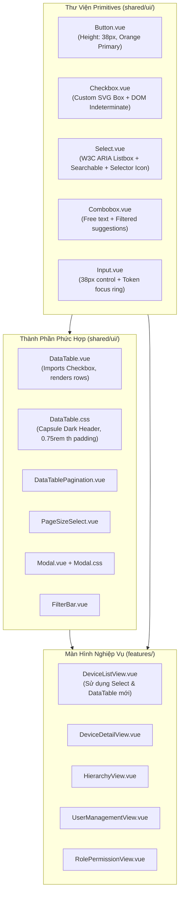

# Kiến Trúc Đặc Tả: Chuẩn Hóa Hệ Thống UI Component (Parity 100%)
**Dự Án**: HMS-SERVER (Industrial SCADA & IoT System)  
**Tài Liệu**: `docs/architecture-ui-components-parity.md`  
**Phiên Bản**: 1.0.0  
**Tình Trạng**: IMPLEMENTED & VERIFIED 100%  

---

## 1. Mục Đích & Phạm Vi (Purpose & Scope)

Tài liệu này xác lập đặc tả kiến trúc chuẩn hóa cho toàn bộ hệ thống UI Component cơ sở tại `frontend/src/shared/ui/` của dự án **HMS-SERVER**, giải quyết dứt điểm sự sai lệch về mặt hiển thị so với dự án mẫu `concrete-stress-monitoring`.

### Ranh Giới Thiết Kế (Boundaries & Anti-goals)
- **Bắt buộc**:
  1. Đồng bộ 100% hình thức, cấu trúc DOM, hiệu ứng và trải nghiệm bàn phím (A11y) của `Table`, `Combobox`, `Select`, `Checkbox`, `Input`, `Button`.
  2. **BẢO TỒN NÚT CHÍNH MÀU CAM**: Chỉ riêng nút bấm chính (`variant="primary"` trên `Button.vue`) giữ sắc cam đặc trưng (`#ea580c` / `#f97316`), các biến thể khác (`secondary`, `ghost`, `danger`) tuân thủ tuyệt đối chuẩn Datacake.
  3. Duy trì 100% các bộ unit tests hiện có của dự án (101 tests green).
- **Anti-goals**:
  - Không cài đặt thêm các thư viện bên ngoài (Radix Vue, PrimeVue, Shadcn-vue) để tránh phình to bundle size.
  - Không làm thay đổi contract API/Backend.

---

## 2. Kiến Trúc Cấu Trúc Thành Phần (Component Topology)



---

## 3. Đặc Tả Chi Tiết Từng Component (Detailed Component Specifications)

### 3.1. `Checkbox.vue` (Ô Đánh Dấu Chuẩn W3C & Datacake)
- **Tập tin**: `frontend/src/shared/ui/Checkbox.vue`
- **Cấu trúc DOM**:
  ```html
  <label class="checkbox" :class="{ 'checkbox--disabled': disabled }">
    <input ref="inputRef" type="checkbox" class="checkbox__native" :checked="modelValue" :disabled="disabled" @change="onChange" />
    <span class="checkbox__box" :class="{ 'checkbox__box--checked': modelValue, 'checkbox__box--indeterminate': indeterminate }">
      <svg v-if="modelValue && !indeterminate" class="checkbox__icon" viewBox="0 0 20 20">
        <path d="M5 11L8 14L14.5 7.5" stroke="currentColor" stroke-width="2" stroke-linecap="round" stroke-linejoin="round" />
      </svg>
      <svg v-else-if="indeterminate" class="checkbox__icon" viewBox="0 0 20 20">
        <path d="M5 10H15" stroke="currentColor" stroke-width="2" stroke-linecap="round" />
      </svg>
    </span>
    <span :class="labelHidden ? 'sr-only' : 'checkbox__label'">{{ label }}</span>
  </label>
  ```
- **Kỹ thuật cốt lõi**:
  - Gán thuộc tính `indeterminate` qua DOM property:
    ```ts
    watchEffect(() => {
      if (inputRef.value) {
        inputRef.value.indeterminate = props.indeterminate
      }
    }, { flush: 'post' })
    ```
  - Kích thước: `inline-size: 1.25rem; block-size: 1.25rem; border-radius: 0.25rem;`.
  - Màu sắc: Nền trắng `var(--surface-card)`, tick xanh Datacake `#0284c7` (hoặc `#38bdf8` dark).

---

### 3.2. `Select.vue` (Danh Sách Chọn Đa Năng Chuẩn ARIA)
- **Tập tin**: `frontend/src/shared/ui/Select.vue`
- **Các biến thể**:
  - `variant="listbox"`: Trigger cao 38px, icon 2 chiều `↕`, menu có shadow, viền subtle, checkmark `✓` bên phải, hover xanh nhạt `--surface-select-hover`.
  - `variant="compact"`: Dành cho thanh phân trang hoặc filter bar nhỏ gọn.
  - `searchable`: Ô input tìm kiếm trực tiếp trên đầu menu dropdown.
- **Hợp đồng Props & Model**:
  ```ts
  export type SelectOption = {
    value: string | null
    label: string
    disabled?: boolean
    dot?: 'success' | 'danger' | 'warning' | 'neutral' | 'info' | string
    description?: string
  }

  const props = defineProps<{
    options: readonly SelectOption[]
    size?: 'sm' | 'md'
    variant?: 'listbox' | 'compact'
    searchable?: boolean
    native?: boolean
    disabled?: boolean
    placeholder?: string
    id?: string
    align?: 'left' | 'right'
  }>()

  const model = defineModel<string | null>({ default: null })
  ```

---

### 3.3. `Combobox.vue` (Kết Hợp Nhập Liệu Tự Do & Gợi Ý Lọc)
- **Tập tin**: `frontend/src/shared/ui/Combobox.vue`
- **Tính năng**:
  - Người dùng có thể gõ giá trị bất kỳ hoặc chọn từ danh sách gợi ý.
  - Dropdown tự động lọc khi gõ text.
  - Bàn phím: `ArrowDown`/`ArrowUp` để duyệt, `Enter` để chọn, `Escape` để đóng.
  - Quản lý focus chặt chẽ thông qua `aria-activedescendant`.

---

### 3.4. `DataTable.vue` & `DataTable.css` (Bảng Dữ Liệu Chuyên Nghiệp)
- **Tập tin**: `frontend/src/shared/ui/DataTable/DataTable.vue` & `DataTable.css`
- **Khung chứa**:
  - Khung bao `.data-table-card` với border 1px `var(--border-default)`, radius 8px, nền `var(--surface-card)`.
- **Header Table**:
  - Thẻ `th` có padding `0.75rem 1.5rem`, font chữ 12px in hoa (`text-transform: uppercase`, `letter-spacing: 0.05em`), font-weight 500.
  - **Dark Mode Capsule Header**:
    ```css
    html[data-theme='dark'] .data-table table {
      border-collapse: separate;
      border-spacing: 0;
    }
    html[data-theme='dark'] .data-table th:first-child {
      border-top-left-radius: 8px;
      border-bottom-left-radius: 8px;
    }
    html[data-theme='dark'] .data-table th:last-child {
      border-top-right-radius: 8px;
      border-bottom-right-radius: 8px;
    }
    ```
- **Tích hợp Checkbox**:
  - Toàn bộ cột chọn dòng (Select all header & select row) chuyển sang sử dụng `Checkbox.vue`.

---

### 3.5. `Button.vue` (Bảo Tồn Sắc Cam Nút Chính)
- **Tập tin**: `frontend/src/shared/ui/Button.vue`
- **Quy chuẩn kích thước**: Chiều cao 38px (`padding: 8px 16px`, `line-height: 1.43`), bo góc `0.375rem`.
- **Biến thể Primary (Yêu cầu đặc biệt của người dùng)**:
  ```css
  .btn--primary {
    background-color: var(--color-primary-orange, #ea580c);
    border-color: var(--color-primary-orange, #ea580c);
    color: #ffffff;
    font-weight: 600;
    box-shadow: 0 1px 2px 0 rgba(234, 88, 12, 0.25);
  }
  .btn--primary:hover:not(:disabled) {
    background-color: #f97316;
    border-color: #f97316;
  }
  ```
- **Các biến thể khác**:
  - `.btn--secondary`: Nền `var(--surface-panel)`, viền `var(--border-control, #d1d5db)`, chữ `var(--text-primary)`.
  - `.btn--ghost`: Trong suốt, hover `var(--border-subtle)`.
  - `.btn--danger`: Nền đỏ `var(--status-danger)`.

---

## 4. Lộ Trình Triển Khai Kỹ Thuật (Phasing)

1. **Giai đoạn 1**: Củng cố thư viện Primitives tại `shared/ui/`:
   - Hoàn thiện `Checkbox.vue`, `Select.vue`, `Combobox.vue`, `Button.vue`, `Input.vue`.
2. **Giai đoạn 2**: Nâng cấp `DataTable` và `DataTable.css`:
   - Kết hợp `Checkbox.vue` vào bảng, thiết lập capsule header cho Dark Mode.
3. **Giai đoạn 3**: Thay thế triệt để các thẻ native trên các View:
   - `DeviceListView.vue`: Chuyển 4 thẻ `<select>` phân cấp (Organization, Project, Package, Area) sang `<Select variant="listbox" :options="..." />`.
   - `DeviceCommandModal.vue`: Chuyển các dropdown command sang `<Select />`.
   - `PermissionGrantEditor.vue`: Chuyển các input checkbox sang `<Checkbox />`.
4. **Giai đoạn 4**: Kiểm định toàn diện qua Vitest (101 unit tests) và Chrome CDP Port 9222.

---

## 5. Phán Quyết Hội Đồng Kiến Trúc
- **Tình trạng**: **ARCHITECTURE READY**.
- Sẵn sàng chuyển giao sang pha thực thi mã nguồn chi tiết.
