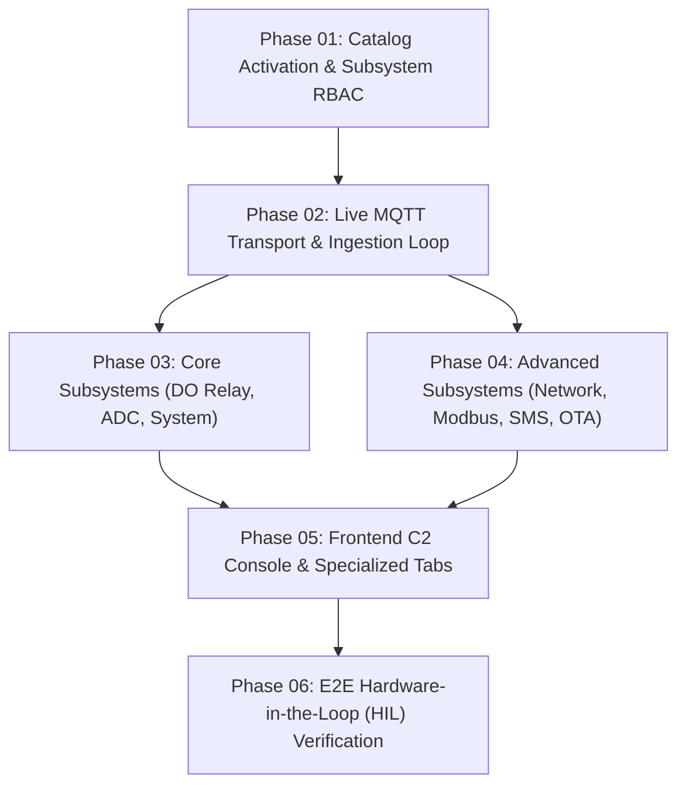

# Kế Hoạch Triển Khai: Tích Hợp Toàn Diện 94 MQTT Actions & Bảng Điều Khiển C2 Phần Cứng Thực Tế

> **Mã kế hoạch:** `PLN-261001-MQTT-C2-INTEGRATION`  
> **Kiến trúc tham chiếu:** [`docs/architecture-device-mqtt-api-catalog.md`](file:///d:/WORKSPACE/PROJECT/HMS-SERVER/docs/architecture-device-mqtt-api-catalog.md)  
> **Mã nguồn phần cứng mục tiêu:** `D:\WORKSPACE\PROJECT\HMS-IDF` (Nguyên tắc bất biến: **READ-ONLY 100%**)  
> **Quy chuẩn giao diện:** Phong cách Datacake UI; **bảo lưu tuyệt đối màu cam thương hiệu (`#f97316` / `#ea580c`) trên các nút nhấn**.

---

## 1. Tóm Tắt Mục Tiêu Chiến Lược

Hiện thực hóa toàn bộ kết quả khảo sát 94 actions và kiến trúc wire protocol đã được xác minh để biến Web UI của `HMS-SERVER` thành một **Trung tâm chỉ huy & điều khiển thiết bị công nghiệp (Industrial IoT C2 Console)** đầy đủ tính năng:
1. **Kích hoạt danh mục lệnh**: Kích hoạt 94 actions qua phân quyền Subsystem RBAC, bảo vệ lệnh nguy hiểm bằng token xác thực 2 bước.
2. **Kênh truyền thông hai chiều thời gian thực**: Sử dụng MQTT QoS 1 với topic `hms_toan_lab/{deviceId}/cmd` và `hms_toan_lab/{deviceId}/cmd/res`, đồng bộ tức thời lên Web UI qua SignalR.
3. **Bảng điều khiển chuyên dụng**:
   - Tab Relay Outputs: 4 công tắc rơ-le DO1-DO4 + nút kích xung.
   - Tab ADC Sensors: Giám sát 8 kênh analog trực quan.
   - Command Console Modal: Soạn thảo tham số JSON linh hoạt với auto-complete mẫu.
4. **Kiểm thử trên phần cứng thực (ESP32-S3 RTU `gateway_870c`)**: Kiểm tra round-trip thực tế trên broker `broker.emqx.io:1883` mà không sửa đổi bất kỳ dòng code nào của firmware.

---

## 2. Lộ Trình 6 Giai Đoạn (6-Phase TDD Roadmap)

| Phase | Trọng tâm bàn giao | File chính | Test Suite |
| :---: | :--- | :--- | :--- |
| **01** | Kích hoạt 94 actions, RBAC 12 subsystems, phân loại Dangerous | [`phase-01-catalog-activation.md`](file:///d:/WORKSPACE/PROJECT/HMS-SERVER/plans/261001-0030-full-hardware-mqtt-apis-c2/phase-01-catalog-activation.md) | `SubsystemCatalogActivationTests.cs` |
| **02** | Live MQTT Transport, Response Consumer, SignalR Event Hub | [`phase-02-live-mqtt-transport.md`](file:///d:/WORKSPACE/PROJECT/HMS-SERVER/plans/261001-0030-full-hardware-mqtt-apis-c2/phase-02-live-mqtt-transport.md) | `MqttCommandTransportTests.cs` |
| **03** | Endpoints điều khiển rơ-le DO, đọc cảm biến ADC, system health | [`phase-03-control-telemetry-subsystems.md`](file:///d:/WORKSPACE/PROJECT/HMS-SERVER/plans/261001-0030-full-hardware-mqtt-apis-c2/phase-03-control-telemetry-subsystems.md) | `DeviceControlApiTests.cs` |
| **04** | Cấu hình mạng Ethernet/Wi-Fi/4G, Modbus 5s cooldown, SMS paging, OTA | [`phase-04-advanced-subsystems.md`](file:///d:/WORKSPACE/PROJECT/HMS-SERVER/plans/261001-0030-full-hardware-mqtt-apis-c2/phase-04-advanced-subsystems.md) | `AdvancedSubsystemsTests.cs` |
| **05** | UI Tab Outputs, Tab ADC, Modal tham số thông minh, Nút cam | [`phase-05-frontend-c2-console.md`](file:///d:/WORKSPACE/PROJECT/HMS-SERVER/plans/261001-0030-full-hardware-mqtt-apis-c2/phase-05-frontend-c2-console.md) | Vitest Component Tests |
| **06** | HIL test thực tế trên ESP32-S3 RTU qua EMQX broker | [`phase-06-e2e-hil-verification.md`](file:///d:/WORKSPACE/PROJECT/HMS-SERVER/plans/261001-0030-full-hardware-mqtt-apis-c2/phase-06-e2e-hil-verification.md) | `HilHardwareE2ETests.cs` |

---

## 3. Ma Trận Rủi Ro 12 Chiều & Tiêu Chuẩn Chấp Nhận
Toàn bộ 12 chiều kiểm thử rủi ro (Null/Undefined, Boundary Limits, Heap Overflow, Concurrency, Cold Start, Auth Bypass, Extreme Scale, Network Flakiness, Error Cascade, Data Integrity, Security Injections, Business State) đã được bóc tách chi tiết tại:
👉 [`plans/261001-0030-full-hardware-mqtt-apis-c2/scenario-matrix.md`](file:///d:/WORKSPACE/PROJECT/HMS-SERVER/plans/261001-0030-full-hardware-mqtt-apis-c2/scenario-matrix.md).

---

## 4. Kỷ Luật Triển Khai (Execution Rules)
1. **TDD Test-First**: Mỗi phase bắt buộc viết Unit/Integration Tests đỏ trước khi hiện thực logic nghiệp vụ.
2. **Không làm gãy Baseline cũ**: 137 test backend và 128 test frontend hiện tại phải duy trì tỷ lệ đỗ 100%.
3. **READ-ONLY trên `HMS-IDF`**: Tuyệt đối không chạm vào code firmware trong `D:\WORKSPACE\PROJECT\HMS-IDF`.
4. **Bảo lưu màu cam**: Mọi nút nhấn thực thi/điều khiển chính trên Web UI phải mang mã màu cam (`#f97316` / `#ea580c`).
5. **Cấm tự ý commit/push**: Phải xin ý kiến người dùng trước khi tạo bất kỳ commit nào.
